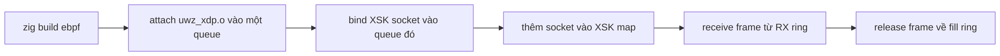

AF_XDP di chuyển packet giữa một network queue và vùng UMEM của userspace qua
bốn ring, bỏ qua kernel socket stack. µWebZockets cung cấp socket và transport
helper, cùng một XSK redirect program. Nó không attach program đó và không đưa
traffic của server qua đó.

## Yêu cầu

| Yêu cầu | Chi tiết                                                         |
| ------- | ---------------------------------------------------------------- |
| Kernel  | Linux có hỗ trợ AF_XDP                                           |
| Driver  | Driver và queue hỗ trợ XDP, và với zero copy là XSK zero copy    |
| Quyền   | Network-administration capability cho socket, map và bước attach |
| Build   | Build host Linux cho `zig build ebpf`                            |

`uz.xdp` là compile error ngoài Linux; `uz.xdp_transport` báo `.standard` với
reason `unsupported_platform` khi chạy. Build step lỗi thay vì tạo object mà
kernel không load được.

## Build redirect

```sh
zig build ebpf
```

Step này cài `zig-out/share/uwebzockets/uwz_xdp.o`. Program tra RX queue index
trong XSK map có 256 entry và redirect packet vào socket đã map; queue không có
trong map rơi xuống `XDP_PASS`, nên traffic vẫn đi theo đường thường.



Attach program, pin map và thêm socket vào XSK map là bước của operator. Server
không thực hiện các bước đó và không bao giờ attach redirect.

## Module

`uz.xdp_transport` là policy layer. `probe()` không bao giờ lỗi: nó trả mode và
reason, nên startup luôn có thể fallback về standard stack.

| API                                                 | Mục đích                                                       |
| --------------------------------------------------- | -------------------------------------------------------------- |
| `probe()`                                           | Báo `.kernel_bypass` hoặc `.standard` kèm fallback reason      |
| `resolve_mode(requested)`                           | Trả `.standard` ngoài Linux, ngược lại trả mode được yêu cầu   |
| `validate_umem(umem, chunk_size)`                   | Kiểm tra page alignment, chunk size và frame count             |
| `XdpTransport.init(umem, config)`                   | Sở hữu một socket, UMEM của caller và free-frame stack cố định |
| `bind`, `receive`, `release`, `transmit`, `reclaim` | Drive các ring; frame chỉ trở lại free stack sau completion    |
| `status()`                                          | Báo `Availability` hiện tại                                    |

`uz.xdp` là socket layer bên dưới: UMEM registration, các ring fill, completion,
receive và transmit, cùng việc recycle frame. Dùng nó khi bạn cần điều khiển
ring mà transport không expose.

`XdpConfig` mặc định dùng chunk 2,048 byte, 1,024 frame và data path copy. Một
transport theo dõi tối đa 4,096 frame, và zero copy phải được yêu cầu tường minh
chứ không mặc định.

## Vì sao server vẫn dùng standard

`ServerConfig.transport = .kernel_bypass` là một yêu cầu, không phải lời hứa.
Data path của server phục vụ mọi connection qua standard stack:

| Đường                          | Kết quả                                         |
| ------------------------------ | ----------------------------------------------- |
| `ServerConfig.transport`       | Báo `.standard` với reason `.data_path_unwired` |
| `xdp_kernel_bypass_fallbacks`  | Tăng một lần lúc startup cho yêu cầu đó         |
| XSK redirect                   | Server không bao giờ attach                     |
| `uz.xdp_transport` và `uz.xdp` | Dành cho code tự drive trực tiếp                |

Không accept, read hay write completion nào dispatch qua AF_XDP, nên báo một
bypass đang sống sẽ là sai. Fallback reason nêu đúng khoảng trống đó thay vì che
nó.

## Tự drive transport

```zig
const uz = @import("uWebZockets");

const umem = try std.heap.page_allocator.alignedAlloc(
    u8,
    .fromByteUnits(std.heap.page_size_min),
    1024 * 2048,
);
defer std.heap.page_allocator.free(umem);

var transport = try uz.xdp_transport.XdpTransport.init(umem, .{
    .chunk_size = 2048,
    .frame_count = 1024,
    .interface_index = interface_index,
    .queue_id = queue_id,
});
defer transport.deinit();
```

`init` validate hình học và register UMEM. `bind` gắn socket vào interface queue;
sau đó `receive` trả một frame mà bạn phải `release` để fill ring được nạp lại, và
`transmit` tiêu thụ một frame bạn sở hữu. Vòng đời frame là toàn bộ contract: một
frame không được release cũng không được transmit sẽ làm free stack thiếu.

## Quy trình test

1. Gọi `probe()` và ghi lại mode cùng reason. Trên host không có socket family
   hoặc không có quyền, `.standard` với `kernel_unavailable` hoặc
   `permission_denied` là kết quả mong đợi, không phải lỗi.
2. Khởi tạo transport với UMEM căn page và config mặc định, rồi bind vào queue
   bạn kiểm soát.
3. Attach `uwz_xdp.o` vào interface đó và thêm socket vào XSK map với cùng queue
   index.
4. Gửi traffic trên queue đó và xác nhận `receive` trả frame trong khi `release`
   giữ free stack đầy.
5. Chạy `curl` vào listener bình thường của server trên queue khác và xác nhận nó
   vẫn trả lời. Hai đường độc lập theo thiết kế.

Bước 5 là phép kiểm tra quan trọng cho deployment hỗn hợp: một bypass lỗi không
được kéo listener chuẩn xuống theo.

## Giới hạn

- AF_XDP chỉ có trên Linux và cần driver, queue cùng quyền tương thích.
- XSK map có 256 entry, key là RX queue index.
- Một transport theo dõi tối đa 4,096 frame, mỗi frame là một chunk.
- Server không expose cấu hình nào để bật bypass cho connection của chính nó. Chỉ
  caller trực tiếp mới có hành vi kernel-bypass.
- Các counter như `xdp_frames_received` thuộc bề mặt registry, nhưng standard
  transport không bao giờ tăng chúng.

## Liên quan

- [eBPF latency histogram](/docs/operations/ebpf) trình bày object thứ hai và
  hidden metrics endpoint.
- [kTLS và AF_XDP](/docs/architecture/ktls-and-xdp) nêu mỗi helper sở hữu gì và vì
  sao data path bỏ qua nó.
- [Transport](/docs/architecture/transports) cho thấy các đường TCP, TLS và QUIC
  thực sự phục vụ traffic.
