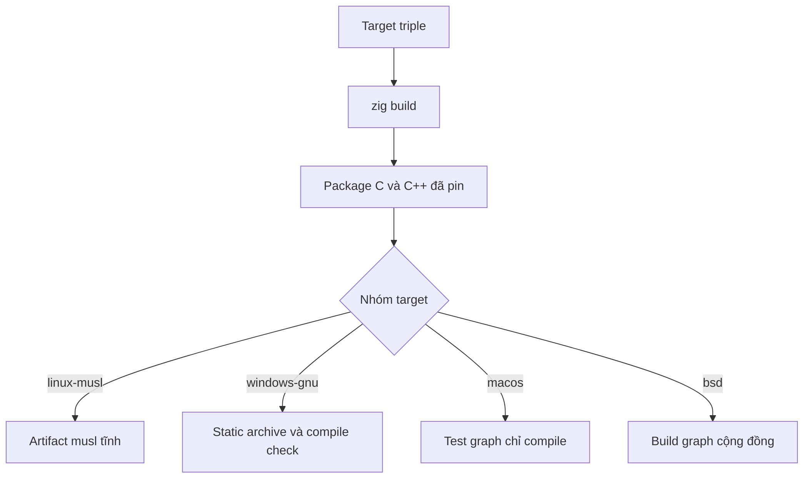

Target triple là input bổ sung duy nhất mà một cross build cần. Zig build
BoringSSL, lsquic, ls-qpack, ls-hpack, libdeflate và zlib cho target đã chọn, nên
không cần external sysroot, MinGW zlib hay system prefix.



## Toolchain đi kèm

| Input                    | Nguồn                                                            |
| ------------------------ | ---------------------------------------------------------------- |
| Compiler C và C++        | clang và libc++ đi kèm Zig                                       |
| BoringSSL, lsquic, HPACK | Package đã pin, build cho target đã chọn                         |
| zlib                     | Package Zig đi kèm; không cần zlib prefix bên ngoài              |
| libdeflate               | Package Zig đi kèm                                               |
| System header            | Định nghĩa libc theo target của Zig; không dùng sysroot của host |

Không thêm cross toolchain vào `PATH`. Compiler hoặc linker thứ hai có thể che
một lỗi build graph thật và tạo artifact không khớp dependency set đã pin.

## musl

Build artifact musl tĩnh bằng một command:

```sh
zig build -Dtarget=aarch64-linux-musl -Doptimize=ReleaseSafe
```

Dùng `x86_64-linux-musl` cho kiến trúc được hỗ trợ còn lại. Để compile test graph
mà không chạy, dùng `test-compile` với cùng target:

```sh
zig build test-compile -Dtarget=aarch64-linux-musl -Doptimize=ReleaseSafe --summary all
```

Flake cũng expose một musl development shell trên Linux:

```sh
nix develop .#musl
```

## Windows

Target Windows là `x86_64-windows-gnu`. Compile test và C ABI graph, rồi build
các static library:

```sh
zig build test-compile -Dtarget=x86_64-windows-gnu -Doptimize=ReleaseSafe --summary all
zig build lib -Dtarget=x86_64-windows-gnu -Doptimize=ReleaseFast --summary all
```

Cả hai command là compile gate. Native workflow chạy suite trên `windows-2025`
bằng `zig build test --summary all`; official support đi theo một runtime job
xanh cho release commit. Không có binary Windows nào được publish.

Application link trực tiếp các archive phải link thêm libc, C++ runtime,
`libz.a` đã cài và các platform networking library: `ws2_32`, `mswsock`,
`crypt32` và `advapi32`. Các archive dưới `zig-out/lib` là µWebZockets, BoringSSL,
lsquic, libdeflate và zlib.

QUIC trên Windows dùng IOCP UDP receive và Winsock `WSASendTo`. Phần accept và
queued-close của 1.9.0 được ghi trong ADR 0004 của framework repository.

## macOS

macOS là host được hỗ trợ trên `x86_64` và `aarch64`. Test graph cross-compile
theo yêu cầu, nhưng không có hosted macOS runner nào chạy kqueue. Hãy coi macOS
cross build là compile check trừ khi bạn cũng chạy kết quả trên macOS. Runtime
coverage cho kqueue được theo dõi riêng khỏi Linux runtime matrix.

## Target BSD

FreeBSD, NetBSD, OpenBSD và DragonFlyBSD dùng chung build graph. Đây là target
cộng đồng: project không chạy hosted CI riêng cho chúng.

| Nhóm target  | Trạng thái             |
| ------------ | ---------------------- |
| FreeBSD      | Build target cộng đồng |
| NetBSD       | Build target cộng đồng |
| OpenBSD      | Build target cộng đồng |
| DragonFlyBSD | Build target cộng đồng |

Chọn triple qua `-Dtarget=`. Một build thành công là evidence rằng graph compile
được; nó không phải kết quả runtime hosted.

## Cross build chứng minh gì

| Check                         | Cross build        | Chạy native |
| ----------------------------- | ------------------ | ----------- |
| Source Zig compile            | Có                 | Có          |
| Dependency C/C++ đã pin build | Có                 | Có          |
| Test graph compile            | Với `test-compile` | Có          |
| Test suite chạy               | Không              | Có          |
| Sanitizer chạy                | Không              | Chỉ Linux   |

Sanitizer build chỉ chạy native Linux. Cross build không thể thay cho gate ASan,
UBSan hay MSan; xem [Sanitizer](/docs/operations/sanitizers).

## Kiểm tra

```sh
zig build test-compile -Dtarget=aarch64-linux-musl -Doptimize=ReleaseSafe --summary all
```

Thay triple bằng target bạn cần. Một `test-compile` thành công chứng minh test và
C ABI graph build được cho target đó mà không tuyên bố host chạy được nó.

## Liên quan

- [Build từ source](/docs/operations/build) đi qua native graph và cache.
- [Nix development shell](/docs/operations/nix) cung cấp musl shell và compiler đã pin.
- [Platform support](/docs/architecture/backends) mô tả runtime backend phía sau mỗi target.
