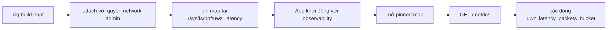

Build step `ebpf` tạo hai XDP object. Một object redirect packet vào XSK map;
object còn lại tăng histogram packet-length của frame ingress, tách theo từng
CPU. Server không tự attach object nào: bạn build, attach, pin, rồi hidden
metrics endpoint đọc map đã pin.

## Build object

```sh
zig build ebpf
```

Step này cần build host Linux và biên dịch cả hai C source bằng
`zig cc -target bpfel-freestanding`. Nó cài hai file:

| Output                                    | Source                                | Program                                         |
| ----------------------------------------- | ------------------------------------- | ----------------------------------------------- |
| `zig-out/share/uwebzockets/uwz_xdp.o`     | `src/xdp/xdp_redirect.c`              | Redirect XSK theo RX queue index                |
| `zig-out/share/uwebzockets/uwz_latency.o` | `src/observability/uwz_latency_bpf.c` | Histogram packet-length, 16 bucket lũy thừa hai |

Trên host không phải Linux, step này lỗi thay vì tạo object mà kernel không load
được.

## Đường đọc



Application mở pinned map một lần, lúc application được tạo, và chỉ khi
observability được bật. Map thiếu hoặc không đọc được không phải startup failure:
file descriptor để trống và các counter vẫn được phục vụ. Trên target không phải
Linux, module báo unavailable và không thử mở.

## Bucket

`uwz_latency.o` là XDP program tính bucket từ frame length bằng
`31 - clz(length)`, tăng một entry trong `PERCPU_ARRAY`, rồi trả `XDP_PASS`. Map
có 16 bucket; length rơi trên bucket 15 được tính vào bucket 15.

Kernel giữ một bộ counter cho mỗi CPU. Phép đọc cộng dồn mọi possible CPU, nên
exposition chứa tổng chứ không phải giá trị từng CPU. Phép đọc fail closed khi
`/sys/devices/system/cpu/possible` báo nhiều hơn 256 possible CPU, vì buffer
lookup là cố định.

## Output metrics

Histogram chỉ xuất hiện khi map đọc được. Exposition dùng biên lũy kế:

```console
# TYPE uwz_latency_packets_bucket histogram
uwz_latency_packets_bucket{le="63"} 0
uwz_latency_packets_bucket{le="127"} 12
...
uwz_latency_packets_bucket{le="+Inf"} 40
```

Mỗi biên hữu hạn là `(1 << index) - 1`, và count vượt biên hữu hạn cuối cùng dồn
vào `+Inf`. Hãy đọc bucket như các lớp độ dài, không phải số byte chính xác. Các
counter từ registry được render trong cùng response. Việc phục vụ dùng buffer cố
định 4096 byte và không cấp phát heap; buffer đầy trả `500` thay vì cắt document.

## Quyền

| Hành động                              | Yêu cầu                                       |
| -------------------------------------- | --------------------------------------------- |
| Biên dịch object                       | Build host Linux với Zig toolchain            |
| Attach redirect hoặc histogram program | Quyền network-administration trên Linux       |
| Pin map dưới `/sys/fs/bpf`             | bpffs đã mount và cùng quyền đó               |
| Populate XSK map                       | Cùng quyền đó, cộng một AF_XDP socket đã bind |

Không bước nào thuộc một lần khởi động application không đặc quyền. Hãy coi các
object là hạ tầng do operator cung cấp và giữ bước attach ra ngoài process phục vụ
traffic.

## Trạng thái AF_XDP

Metrics endpoint đọc một pinned map. Nó không cho server một data path.
`ServerConfig.transport = .kernel_bypass` báo `.standard` với reason
`.data_path_unwired` và tăng `xdp_kernel_bypass_fallbacks`; không accept hay read
completion nào dispatch qua AF_XDP. Application muốn bypass thì tự drive
`uz.xdp_transport` và `uz.xdp`, như [AF_XDP](/docs/operations/af-xdp) mô tả.

## Kiểm tra

Bật observability, khởi động process, rồi đọc endpoint:

```zig
var server = try uz.Server.builder(init.io)
    .with_observability(true)
    .with_metrics_path("/metrics")
    .build(std.heap.page_allocator);
defer server.deinit();
```

```sh
curl -s http://127.0.0.1:3000/metrics | grep uwz_latency_packets_bucket
```

Khi map đã pin và có traffic, count tăng; khi không có map, `grep` không tìm thấy
gì và phần còn lại của exposition không đổi. Khác biệt đó là dấu hiệu nguồn
histogram thiếu, không phải server lỗi.

## Liên quan

- [kTLS và AF_XDP](/docs/architecture/ktls-and-xdp) nêu helper nào được nối vào
  data path và vì sao.
- [AF_XDP](/docs/operations/af-xdp) trình bày socket, UMEM và ring setup mà
  redirect cần.
- [Metrics](/docs/operations/metrics) liệt kê counter trong registry và contract
  của hidden endpoint.
