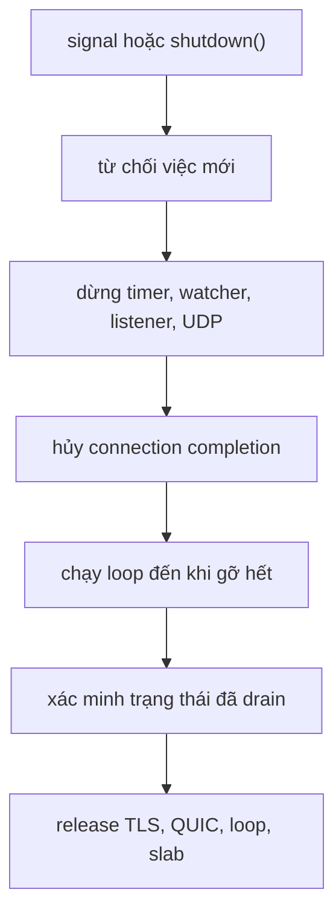

Một graceful shutdown sẽ ngừng nhận việc mới, để những connection đã được accept
hoàn tất hoặc hết hạn, và chỉ release slab sau khi mọi completion đã được gỡ.
`catch_shutdown_signals` nối SIGINT và SIGTERM vào đúng đường đó. Trang này trình
bày thứ tự gọi cho một application và cho một cluster, các error mà mỗi call trả
về, và khoảng chờ mà supervisor phải dành cho process.

## Cài watcher trước run

```zig src/main.zig
const std = @import("std");
const uz = @import("uWebZockets");

fn health(_: *uz.Request, res: *uz.Response) void {
    res.text("ok") catch |err| {
        std.log.err("response failed: {}", .{err});
    };
}

pub fn main(init: std.process.Init) !void {
    var server = try uz.Server.builder(init.io)
        .with_max_clients(256)
        .with_idle_timeout_ms(30_000)
        .build(std.heap.page_allocator);
    defer server.deinit();

    _ = try server.get("/healthz", health);
    _ = try server.get("/readyz", health);

    try server.catch_shutdown_signals();
    try server.listen("0.0.0.0", 3000);
    try server.run();
}
```

Thứ tự rất quan trọng. `catch_shutdown_signals` phải chạy trước `run`, và
`deinit` nằm trong `defer` tại đúng scope đã tạo application. Signal đến trước
khi event loop khởi động không bị mất: request được ghi lại và vòng lặp đầu tiên
sẽ drain nó.

## Watcher sở hữu gì

| Platform | Cơ chế                                                                 | Cách đưa vào loop                                        |
| -------- | ---------------------------------------------------------------------- | -------------------------------------------------------- |
| POSIX    | Handler SIGINT và SIGTERM ghi một byte vào self-pipe non-blocking      | File poll ở đầu đọc đánh thức loop thread                |
| Windows  | `SetConsoleCtrlHandler` cho Ctrl+C, đóng console, logoff hoặc shutdown | Một process flag cùng libxev async đánh thức loop thread |

Cả hai đường đều không cấp phát, và handler không bao giờ ghi log. Nhiều signal
đến trước khi loop drain sẽ gộp thành một shutdown request. Watcher là
process-wide, nên nó chỉ được cài một lần; `deinit` khôi phục disposition trước
đó và đóng pipe sau khi loop đã drain xong.

## Thứ tự drain



Một process đã drain có nghĩa là không còn pool slot active, không còn listener
đã arm, timer wheel đã dừng, signal watcher đã dừng và QUIC transport rỗng.
`run` thực hiện phép kiểm tra đó khi trở về từ shutdown do signal; `deinit` lặp
lại phép kiểm tra và panic thay vì release storage mà một completion vẫn trỏ
vào. Các bước nội bộ và thứ tự release nằm ở
[Thứ tự shutdown](/docs/architecture/shutdown).

## Shutdown cluster

`Cluster.catch_shutdown_signals()` cài một watcher process-wide, callback của nó
request shutdown cho mọi worker. Lifecycle không đổi: configure route, cài
watcher, listen, run, rồi release.

```zig
var group = try uz.Server.builder(init.io)
    .with_max_clients(256)
    .build_cluster(std.heap.page_allocator, 4, .{});
defer group.deinit();

const Cluster = @TypeOf(group);
try group.configure(struct {
    fn routes(worker: *Cluster.Worker, index: usize) !void {
        _ = index;
        _ = try worker.get("/healthz", health);
    }
}.routes);

try group.catch_shutdown_signals();
try group.listen("0.0.0.0", 3000);
group.run() catch |err| {
    if (group.first_failure()) |failure| {
        std.log.err("worker {d} ({s}): {s}", .{
            failure.index,
            @tagName(failure.phase),
            @errorName(failure.err),
        });
    }
    return err;
};
```

Supervisor không thể chấp nhận panic thì gọi `deinit_checked` thay vì dựa vào
contract của `deinit`. Call này claim release đúng một lần, chờ các supervisor
call đang chạy, và trả `error.ClusterRunning` khi `run` vẫn active. `state()` báo
`configured`, `running`, `stopped`, `releasing` hoặc `released`.

```zig
group.request_shutdown();
group.deinit_checked() catch |err| {
    std.log.err("cluster release failed: {s}", .{@errorName(err)});
    return err;
};
```

`request_shutdown` là entry an toàn từ thread khác và trả `void`. Gọi nó sau
`deinit` là no-op đã được ghi nhận, vì worker slice đã được release.

## Supervisor chờ bao lâu

Ngân sách drain gồm thời gian một response đang chạy cần, cộng idle timeout dùng
để đóng các keep-alive connection đã drain. Hãy đặt stop timeout của supervisor
lớn hơn ngân sách đó, và gửi SIGTERM đúng một lần.

| Supervisor | Cấu hình                        | Yêu cầu                                                               |
| ---------- | ------------------------------- | --------------------------------------------------------------------- |
| systemd    | `TimeoutStopSec`                | Lớn hơn ngân sách drain; dùng `Type=exec` kèm HTTP readiness probe    |
| Kubernetes | `terminationGracePeriodSeconds` | Lớn hơn ngân sách drain; đi cùng readiness route                      |
| Docker     | `docker stop --time`            | Lớn hơn ngân sách drain; chạy server như PID 1 với exec-form argument |

Quy trình deployment đầy đủ, gồm readiness và tương tác với rollout, nằm ở
[Shutdown và draining](/docs/deployment/shutdown).

## Error

| Error                                 | Call                                      | Nguyên nhân                                                            |
| ------------------------------------- | ----------------------------------------- | ---------------------------------------------------------------------- |
| `error.SignalWatcherAlreadyInstalled` | `catch_shutdown_signals`                  | Đã có watcher sở hữu disposition process-wide                          |
| `error.ApplicationUnavailable`        | `catch_shutdown_signals`, `listen`, `run` | Shutdown đã bắt đầu hoặc application đã deinit                         |
| `error.ApplicationAlreadyRunning`     | `run`                                     | Event loop bị vào lại                                                  |
| `error.ShutdownIncomplete`            | `shutdown`                                | Còn pool slot, listener, watcher, timer hoặc QUIC transport chưa drain |
| `error.ApplicationDeinitialized`      | `shutdown`                                | Storage đã được release                                                |
| `error.ClusterRunning`                | `deinit_checked`                          | `run` vẫn active                                                       |
| `error.ClusterWorkerFailed`           | `Cluster.run`                             | Một worker lỗi; đọc `first_failure()` để lấy index, phase và error gốc |

`deinit` panic thay vì trả các error này. Đó không phải call phù hợp trong một
supervisor cần quan sát process tree; dùng `deinit_checked` cho cluster và giữ
`defer deinit()` cho application đơn.

## Liên quan

- [Shutdown và draining](/docs/deployment/shutdown) trình bày readiness,
  rollout và cấu hình supervisor khi chạy production.
- [Graceful shutdown recipe](/docs/guides/graceful-shutdown) dựng lại chương
  trình trên thành recipe copy được.
- [Thứ tự shutdown](/docs/architecture/shutdown) giải thích từng bước drain và
  những gì `verify_shutdown` từ chối.
- [Cluster lifecycle](/examples/first-cluster) cho thấy toàn bộ thứ tự khởi
  động group quanh watcher này.
