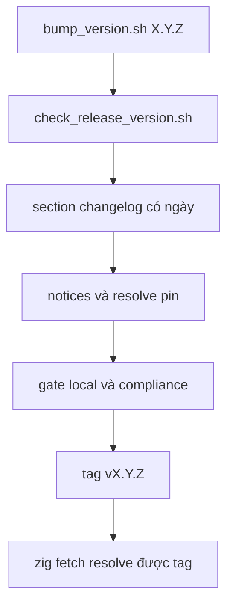

:::note[Đóng góp cho µWebZockets]
Trang này mô tả framework repository tại
[farbenbuilds/uWebZockets](https://github.com/farbenbuilds/uWebZockets), không phải
application project. Dùng khi bạn thay đổi hoặc kiểm tra framework và chuẩn bị pull request
theo [CONTRIBUTE.md](https://github.com/farbenbuilds/uWebZockets/blob/main/CONTRIBUTE.md).
Consumer dùng release qua `zig fetch --save`; xem [Installation](/docs/getting-started/installation).
Trang này nói về việc cắt release cho framework.
:::

Một release của µWebZockets là một source tag. Không có archive theo platform,
không có installer và không có file checksum: consumer fetch tag bằng `zig fetch`
rồi Zig build các dependency C và C++ từ pin của chúng. Trang này trình bày các
surface version, script bump và check, cùng trình tự tag.

## Nguồn version duy nhất

Release version được single-source trong `src/version.zig`, và `build.zig` lấy
version từ file đó. Các bản copy còn lại tồn tại vì consumer của chúng không chạy
Zig code.

| Surface             | File                                                                                          | Bản copy                                  |
| ------------------- | --------------------------------------------------------------------------------------------- | ----------------------------------------- |
| Zig source of truth | `src/version.zig`                                                                             | `pub const semantic`                      |
| Package manifest    | `build.zig.zon`                                                                               | `.version`                                |
| Nix flake           | `flake.nix`                                                                                   | `releaseVersion`                          |
| C header            | `include/uWebZockets.h`                                                                       | `UWZ_VERSION_MAJOR`, `_MINOR`, `_PATCH`   |
| Changelog           | `CHANGELOG.md`                                                                                | section `## [X.Y.Z] - YYYY-MM-DD` có ngày |
| C assertion         | `tests/c_api/header_cpp.cc`, `tests/c_api/smoke.c`                                            | giá trị `static_assert` và version string |
| Documentation       | `README.md`, `CODEBASE.md`, `examples/readme_examples_test.md`, `src/tests/dev_log_tests.zig` | ready-summary và header của example       |

Một release chỉ sửa một bản copy mà bỏ các bản còn lại sẽ fail release check
trước khi tới tag.

## Bump và verify

```sh
sh scripts/bump_version.sh 2.2.0
```

Script nhận version dạng `X.Y.Z` thuần. Nó rewrite mọi surface trong bảng trên
qua một temporary file, chèn một section changelog có ngày với các heading
`Added`, `Changed` và `Security`, rồi gọi `check_release_version.sh` với version
mới. Version đã có section changelog sẽ được giữ nguyên.

```sh
sh scripts/check_release_version.sh
```

Check đọc version từ `build.zig.zon`, so với `src/version.zig`, `flake.nix` và
các macro C, đồng thời xác nhận `build.zig` vẫn derive từ Zig source. Sau đó nó
kiểm tra C++ assertion, version string của C smoke, section changelog, header
trong documentation và test của development log. Truyền một version cụ thể để
check candidate chưa commit.

## Trình tự release



1. Bump version và chạy release check.
2. Viết section changelog có ngày, gồm breaking change và mọi limitation mà
   release giữ lại. Không để placeholder `Unreleased` trong snapshot release
   cuối cùng.
3. Verify `THIRD_PARTY_NOTICES.md` và từng license được đóng gói. Với mỗi pin
   của maintained fork, resolve commit từ máy thứ hai và đối chiếu archive đã
   giữ. Xem [Dependency](/docs/operations/dependencies).
4. Release commit mang evidence formatting, convention, test và build đã pass.
5. Cùng commit đó mang evidence sanitizer, fuzz, Autobahn, h1spec và HTTP/3
   cross-implementation đã ghi cho release line đó.
6. Tag commit cuối cùng là `v<version>` và push tag.
7. Xác nhận release notes render changelog, `scripts/check_package_paths.sh`
   pass trên release commit và tag resolve được qua `zig fetch` trước khi
   announce.

## Release chỉ có source

Không có binary artifact để review. Tag chứa source tree, dependency manifest đã
pin, header, changelog và license notice. `THIRD_PARTY_NOTICES.md` và `licenses/`
đi cùng source vì static archive mà consumer C link được build tại chỗ từ những
pin đó.

Một release không publish Docker image, package-manager formula hay
`libuWebZockets.a` build sẵn. Hãy build C archive từ tag:

```sh
zig build lib -Doptimize=ReleaseFast
```

## Pin một release trong consumer

```sh
zig fetch --save 'git+https://github.com/farbenbuilds/uWebZockets#v2.1.6'
```

Lệnh này thêm package dưới tên `uWebZockets` vào `build.zig.zon` của bạn. Pin
release tag khi cần một version dễ nhận biết, hoặc pin full commit 40 hex khi
build phải reproducible tới đúng tree. Không bao giờ pin `main`.

Package manifest của bản fetch tự resolve zslay, libxev, BoringSSL, lsquic,
ls-qpack, ls-hpack, libdeflate và zlib từ pin bất biến của chúng, nên application
không cần thêm entry cho các dependency này và không cần submodule phát triển
`h1spec`.

## Xác nhận tag trước khi announce

```sh
mkdir -p /tmp/uwz-fetch-check && cd /tmp/uwz-fetch-check
zig init
zig fetch --save 'git+https://github.com/farbenbuilds/uWebZockets#v2.1.6'
```

Tag không resolve được thì không phải release. Tag bị rewrite cũng không phải
release: hãy đi tiếp bằng một patch version mới thay vì retag một commit mà
người khác đã fetch.

## Liên quan

- [Dependency](/docs/operations/dependencies) trình bày các pin mà release
  resolve và các provenance check bảo vệ chúng.
- [C ABI](/docs/operations/c-abi) chỉ cách build archive từ một tag.
