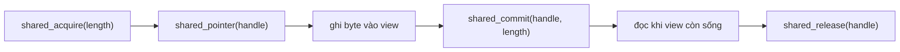

Hai artifact biên dịch protocol core độc lập platform sang WebAssembly. Artifact
freestanding nhắm tới V8 isolate host sở hữu socket và shared memory; artifact
WASI nhắm tới WASI host. Không artifact nào accept network connection: chúng
parse và tạo byte protocol rồi host di chuyển các byte đó.

Trang này bắt đầu với đường application sau
[`zig fetch --save`](/docs/getting-started/installation). Shortcut trong
framework checkout là command cho contributor và không cần thiết trong
application project.

## Dùng từ application

Resolve target `wasm32` trong `build.zig` của bạn và lấy artifact `uWebZockets`
từ dependency. Không cần clone framework repository.

```zig build.zig
const std = @import("std");

pub fn build(b: *std.Build) void {
    const wasm_target = b.resolveTargetQuery(.{
        .cpu_arch = .wasm32,
        .os_tag = .freestanding,
        .abi = .none,
        .cpu_features_add = std.Target.wasm.featureSet(&.{ .atomics, .bulk_memory }),
    });
    const uz = b.dependency("uWebZockets", .{
        .target = wasm_target,
        .optimize = .ReleaseSafe,
    });
    const artifact = uz.artifact("uWebZockets");
    const install = b.addInstallArtifact(artifact, .{
        .dest_dir = .{ .override = .{ .custom = "wasm" } },
        .dest_sub_path = "uWebZockets-freestanding.wasm",
    });
    const step = b.step("wasm-edge", "Build the uWebZockets edge module");
    step.dependOn(&install.step);
}
```

```sh
zig build wasm-edge
ls zig-out/wasm
```

Với biến thể WASI, đổi `.os_tag` thành `.wasi` và `.dest_sub_path` thành
`uWebZockets-wasi.wasm`. Phần wiring còn lại giữ nguyên. Dependency build chọn
edge module vì target là `wasm32`; native server không được compile vào artifact
này.

## Build trong framework checkout

Repository cũng expose các step có tên cho contributor của chính nó. Các command
này cần clone
[farbenbuilds/uWebZockets](https://github.com/farbenbuilds/uWebZockets) và không
thuộc consumer build.

```sh
zig build wasm-freestanding -Doptimize=ReleaseSafe
zig build wasm-wasi -Doptimize=ReleaseSafe
```

`zig build wasm` build cả hai. Artifact nằm dưới `zig-out/wasm`:

| Artifact                        | Target                                        | Memory                                         |
| ------------------------------- | --------------------------------------------- | ---------------------------------------------- |
| `uWebZockets-freestanding.wasm` | `wasm32-freestanding`, atomics và bulk memory | Shared, 32 MiB ban đầu, tối đa 64 MiB          |
| `uWebZockets-wasi.wasm`         | `wasm32-wasi`                                 | Single-threaded, 32 MiB ban đầu, tối đa 64 MiB |

Cả hai module được build không có entry point và export linear memory.
Freestanding build thêm shared memory vì host bridge dùng atomics.

## Export của host bridge

```zig
export fn alloc(length: u32) usize;
export fn free(pointer: usize, length: u32) void;
export fn shared_acquire(length: u32) u64;
export fn shared_pointer(encoded_handle: u64) usize;
export fn shared_commit(encoded_handle: u64, length: u32) u64;
export fn shared_release(encoded_handle: u64) i32;
```

Bridge là vùng cố định 64 block, mỗi block 64 KiB, căn 64 byte, nên tối đa 4 MiB
buffer host nhìn thấy tồn tại cùng lúc. Mọi accessor đều bounded:

| Call             | Hành vi                                                                         |
| ---------------- | ------------------------------------------------------------------------------- |
| `alloc`          | Lease một block cho `length` byte; trả `0` khi không block nào vừa              |
| `free`           | Chỉ release block khi pointer và length khớp một lease còn sống                 |
| `shared_acquire` | Trả handle đóng gói, hoặc `0` khi vùng đã đầy                                   |
| `shared_pointer` | Trả địa chỉ block cho handle còn sống, hoặc `0`                                 |
| `shared_commit`  | Ghi độ dài đã dùng và trả handle đã commit, hoặc `0`                            |
| `shared_release` | Release một lần; trả `0` khi thành công và `-1` với handle cũ hoặc không hợp lệ |

Handle đóng gói block index, generation counter và độ dài đã commit. Generation
là phần từ chối một release cũ hoặc một use-after-free: handle từ lease trước của
cùng block không còn khớp generation hiện tại.

## Vòng đời handle



Giữ mỗi handle trong suốt thời gian view shared-memory của nó còn sống, và
release đúng một lần. Release lần thứ hai cùng handle sẽ lỗi thay vì free block
mà một lease khác có thể đã sở hữu. `alloc` và `free` là cặp đơn giản hơn: `free`
kiểm tra base pointer và length trước khi release, và bỏ qua cặp không mô tả một
block đã acquire.

## Không có listener trên edge target

Module export protocol core, không export server. Nó chứa HTTP parser và request
type, xử lý abort và stream, WebSocket framing cùng backpressure, SIMD helper,
shared memory và JSON-RPC. Nó không có socket, không có accept loop và không có
listener.

| Phần việc                                         | Chủ sở hữu                       |
| ------------------------------------------------- | -------------------------------- |
| Accept connection, TLS và timer                   | Isolate hoặc WASI host           |
| Parse HTTP, quyết định route và tạo response byte | Module                           |
| Vòng đời buffer qua boundary                      | Host, qua handle                 |
| Tăng shared memory quá 64 MiB                     | Không hỗ trợ; module fail closed |

## Khi nào dùng

Dùng WASM target khi network edge vốn là việc của host: CDN worker, proxy plugin,
hoặc isolate runtime muốn cùng một HTTP và WebSocket state machine chặt chẽ như
native server. Lợi ích là một parser và một bộ limit ở cả hai nơi, không phải
server thứ hai.

Không dùng khi bạn cần listener, TLS termination, cluster worker, client, hoặc
static file dựa trên filesystem. Những thứ đó chỉ có trong native application, và
edge artifact không export tương đương.

## Kiểm tra

Build application step và kiểm tra output:

```sh
zig build wasm-edge
ls zig-out/wasm
```

```console
uWebZockets-freestanding.wasm
```

Thêm biến thể WASI bằng `.os_tag = .wasi` như phần trên; output thứ hai là
`uWebZockets-wasi.wasm`.

Instantiate module trong host với memory limit nằm trong biên đã ghi, gọi
`shared_acquire`, ghi, commit, đọc, rồi release. Một handle release hai lần phải
lỗi, và handle từ lease đã release không được resolve qua `shared_pointer`.

## Liên quan

- [Edge và WASM](/docs/architecture/edge-and-wasm) giải thích protocol core độc
  lập transport nằm ở đâu so với các transport.
- [Application model](/docs/concepts/application-model) mô tả lifecycle native mà
  edge module cố ý bỏ qua.
- [Ownership và lifetime](/docs/concepts/ownership-and-lifetimes) trình bày quy
  tắc borrowed view mà handle protocol phản chiếu.
