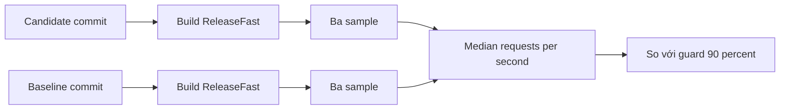

Benchmark là evidence, không phải tiêu đề. Project có hai contract có version:
`http-throughput-v1` bảo vệ throughput HTTP/1.1 trên pull request, và
`h2-tls-scaling-v1` characterization HTTP/2 trên TLS trên một host. Cả hai ghi
nhiều provenance hơn một con số requests-per-second.

## Mỗi contract đo gì

| Contract             | Target                                                                 | Generator               | Parameter chính                                                    | Guard                                                       |
| -------------------- | ---------------------------------------------------------------------- | ----------------------- | ------------------------------------------------------------------ | ----------------------------------------------------------- |
| `http-throughput-v1` | `hello_world` HTTP/1.1                                                 | `wrk`                   | 2 thread, 64 connection, 10 s, 3 sample                            | Median candidate ít nhất 90 percent median baseline         |
| `h2-tls-scaling-v1`  | HTTP/2 trên TLS, plaintext cluster control, single-application control | `h2load` 1.69.0 trở lên | 64 đến 2,048 connection, 1 và 8 stream, 10 s, warmup 2 s, 3 sample | Characterization và regression baseline, không phải CI gate |

`http-throughput-v1` là performance guarantee duy nhất được CI enforce.
`h2-tls-scaling-v1` nằm ngoài `benchmark.yml` vì shared runner không đáp ứng
quiet-host evidence contract của nó.

## Quiet-host contract

| Yêu cầu                                                              | Vì sao quan trọng                                     |
| -------------------------------------------------------------------- | ----------------------------------------------------- |
| Host riêng, không build, test hay benchmark đồng thời                | Tranh chấp CPU, cache và bộ nhớ làm đổi median        |
| Governor và CPU affinity cố định                                     | Frequency scaling và migration làm đổi latency        |
| Cùng kernel, backend, toolchain và build `ReleaseFast`               | Codegen và syscall behavior khác nhau giữa các cohort |
| Candidate và baseline chạy tuần tự                                   | Thermal drift và cache state giữ được tính so sánh    |
| Ghi CPU model, core count, quota, kernel, memlock và open-file limit | Kết quả thiếu host record không tái lập được          |
| Tách số của shared runner khỏi dedicated host                        | Hai cohort không so sánh được                         |

Archive `h2-tls-scaling-v1` ngày 2026-10-19 là local evidence từ một shared host
với governor `powersave`. README của nó nêu rõ đây không phải quiet-host
competitive claim. Hãy coi nó là characterization riêng của host, không phải con
số dùng chung.

## Candidate so với baseline



Cả hai revision được build bằng `-Doptimize=ReleaseFast` từ flake được pin của
chúng. Candidate không được thấp hơn 90 percent median baseline:

| Quy tắc             | Giá trị                                              |
| ------------------- | ---------------------------------------------------- |
| Sample mỗi revision | 3                                                    |
| Statistic báo cáo   | Median requests per second                           |
| Guard               | `candidate_median_rps >= baseline_median_rps * 0.90` |
| Phạm vi so sánh     | Cùng runner và toolchain cohort                      |

Guard này tính đến variance của shared runner. Đây là relative regression
guarantee rõ ràng, không phải absolute capacity claim.

## Ba sample wrk

Contract HTTP/1.1 dùng hai thread, 64 connection, duration 10 giây và URL loopback
của server `hello_world`. Lặp lại ba lần và giữ mọi raw sample:

```sh
wrk -t2 -c64 -d10s http://127.0.0.1:3000/
```

Sample bị loại khi `wrk` thiếu hoặc trả requests-per-second bằng 0, báo socket
error hoặc response non-2xx hay non-3xx, hoặc để lại counter sai định dạng.
Runner cũng quét server log và giới hạn thời gian chờ shutdown cho cả `SIGTERM`
và `SIGKILL`.

## Contract H2 trên TLS

| Parameter             | Giá trị                                                  |
| --------------------- | -------------------------------------------------------- |
| Connection            | 64, 256, 512, 1,024, 2,048                               |
| Stream mỗi session    | 1 và 8                                                   |
| Duration mỗi sample   | 10 s                                                     |
| Warmup trước sampling | 2 s                                                      |
| Sample mỗi cohort     | 3, báo median                                            |
| Generator             | `h2load` từ nghttp2 1.69.0 trở lên                       |
| Protocol              | HTTP/2 trên TLS 1.3 với ALPN `h2`, keep-alive            |
| Request               | `GET /`, không body, query hay header bổ sung            |
| Response              | `200` với body chính xác `hello from a TLS worker group` |
| Build server          | `-Doptimize=ReleaseFast`                                 |
| Result schema         | 2                                                        |

Một sample chỉ thành công khi `failed`, `errored` và `timeout` đều bằng 0, mọi
status code là `2xx`, mọi request counter được parse, mọi TLS sample báo
`TLS Protocol: TLSv1.3`, một `GET /` riêng trả đúng body, và server log không có
panic hay protocol error.

## Ghi provenance

| Field              | Nguồn ví dụ                                    |
| ------------------ | ---------------------------------------------- |
| Commit hoặc tag    | Source revision đang test                      |
| Ngày và giờ        | Run metadata                                   |
| Hardware           | Hostname, CPU model, core count, quota         |
| Kernel và governor | Host record                                    |
| Toolchain          | Zig version, dependency pin, `flake.lock` hash |
| Generator          | Version và flag                                |
| Command line       | Lệnh chạy server và generator                  |
| Raw sample         | Output và counter đã parse của từng sample     |

Thiếu những trường này thì giá trị chỉ là giai thoại. Không công bố con số không
truy được về artifact.

## Vị trí artifact

| Vị trí                                             | Nội dung                                                       |
| -------------------------------------------------- | -------------------------------------------------------------- |
| `benchmarks/http_throughput_guarantee.md`          | Contract `http-throughput-v1`                                  |
| `benchmarks/http_throughput_v1.env`                | Parameter machine-readable                                     |
| `benchmarks/h2_tls_scaling_guarantee.md`           | Contract `h2-tls-scaling-v1`                                   |
| `benchmarks/h2_tls_scaling_v1.env`                 | Connection, stream, duration, generator và schema              |
| `benchmarks/results/h2_tls_scaling_v1/2026_10_19/` | Host record, bảng, quyết định hypothesis và archive            |
| Nhánh `benchmark-data`                             | Record, raw sample, index, latest pointer và summary được sinh |

Raw report của pull request tồn tại dưới dạng workflow artifact 30 ngày. Lần chạy
mainline theo lịch và thủ công append JSON record chuẩn cùng raw evidence vào
nhánh `benchmark-data`. Pull-request job không tin cậy không bao giờ có quyền ghi
vào nhánh đó.

## Liên quan

- [Load test](/docs/performance/load-testing)
- [Chính sách regression](/docs/performance/regression-policy)
- [Profiling](/docs/performance/profiling)
