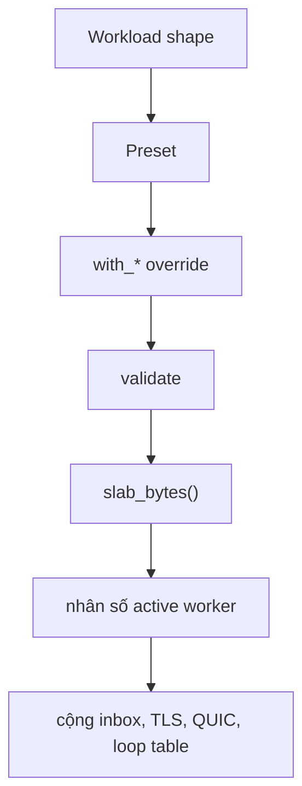

Việc định cỡ capacity bắt đầu từ workload, không phải từ mục tiêu
requests-per-second. Chọn shape, bắt đầu từ preset, chỉ override những field bạn
biện minh được, và gọi `slab_bytes()` trước khi cấp phát. Phép tính bên dưới suy
ra từ `ServerConfig`; đây không phải quy tắc kinh nghiệm.

## Quy trình định cỡ



## Worksheet

| Câu hỏi                              | Field hoặc API                                       | Ghi lại                                                       |
| ------------------------------------ | ---------------------------------------------------- | ------------------------------------------------------------- |
| Bao nhiêu peer kết nối cùng lúc?     | `max_connections`, `with_max_clients`                | Connection đồng thời cao nhất, không phải requests per second |
| Upload lớn nhất là bao nhiêu?        | `max_body_size`, `with_max_body_size`                | Byte, không phải nhãn làm tròn                                |
| Reader chậm nhất chậm đến đâu?       | `write_queue_size`, `with_write_queue_size`          | Burst mà write ring phải hấp thụ                              |
| Một WebSocket message lớn bao nhiêu? | `max_ws_message_size`, `with_max_ws_message_size`    | Một inbound message, không phải cả stream                     |
| Có bật compression mỗi connection?   | `compression`, `with_compression`                    | Scratch được giữ trong slab                                   |
| Có bật HTTP gzip?                    | `http_compression`, `with_http_compression`          | Một codec và scratch mỗi worker, ngoài slab                   |
| HTTP/2 limit nào áp dụng?            | Các field `max_h2_*`                                 | Header block, body, response header size và field count       |
| HTTP/3 limit nào áp dụng?            | Các field `max_h3_*`                                 | Body, response header size và field count                     |
| Bao nhiêu worker đang hoạt động?     | `ClusterOptions.worker_count`, `UWEBZOCKETS_WORKERS` | Active count, không phải compiled capacity                    |
| Có bật TLS?                          | `Cluster.enable_https`                               | Một `SSL_CTX` mỗi worker, ngoài slab                          |
| Slab chính xác là bao nhiêu?         | `slab_bytes()` trên config hoặc builder              | Byte mỗi worker                                               |
| Inbox cộng thêm bao nhiêu?           | `(64 + 1) * max_ws_message_size`                     | Mỗi active worker                                             |
| File server cộng thêm gì?            | `write_queue_size - 4 KiB`                           | Static file body lớn nhất                                     |

## Giới hạn nào áp dụng

| Limit                 | Định cỡ                                                                                | Không định cỡ                                                                  |
| --------------------- | -------------------------------------------------------------------------------------- | ------------------------------------------------------------------------------ |
| `max_body_size`       | HTTP/1.1 request buffer và `request_body_limit` của HTTP/2                             | Hard ceiling HTTP/2 (`max_h2_body_size`) hoặc body HTTP/3 (`max_h3_body_size`) |
| `write_queue_size`    | Pending output HTTP/1.1 và HTTP/2, response body HTTP/3, và static file body trừ 4 KiB | Tổng kích thước của một streamed body                                          |
| `max_ws_message_size` | Một inbound WebSocket message và inbox mỗi worker                                      | Pending outbound byte, do write queue giới hạn                                 |
| `max_h2_*`            | HTTP/2 header block, body và response metadata                                         | Parsing HTTP/1.1 hoặc HTTP/3                                                   |
| `max_h3_*`            | Request và response storage của HTTP/3                                                 | QUIC engine pool, nằm ngoài slab                                               |
| `max_connections`     | Connection pool và QUIC connection capacity                                            | Worker count hoặc throughput                                                   |

HTTP/2 request body cap là giá trị nhỏ hơn giữa `max_body_size` và
`max_h2_body_size`. Header-count overflow trên HTTP/2 là connection error, không
phải document `431`.

## Cluster và TLS overhead

| Item                | Phạm vi                                 | Nằm trong `slab_bytes()` |
| ------------------- | --------------------------------------- | ------------------------ |
| Application slab    | Một mỗi active worker                   | Có                       |
| Worker inbox        | Một mỗi active worker                   | Không                    |
| `SSL_CTX`           | Một mỗi active worker khi bật TLS       | Không                    |
| Bảng backend libxev | Một mỗi worker loop                     | Không                    |
| HTTP gzip codec     | Một mỗi worker khi bật HTTP compression | Không                    |
| QUIC engine pool    | Do `listen_udp` tạo                     | Không                    |

Chỉ active worker mới cấp phát slab, inbox và thread handle. Compiled worker
capacity lớn không giữ chỗ cho worker không bao giờ khởi động.

## Ví dụ có phép tính

Dùng capacity mặc định và chỉ những field cần cho ví dụ này:

```zig
const config: uz.ServerConfig = .{
    .max_connections = 1024,
    .write_queue_size = 64 * 1024,
    .max_body_size = 16 * 1024,
    .max_ws_message_size = 16 * 1024,
};
const per_worker = try config.slab_bytes();
std.debug.print("per worker: {d} bytes\n", .{per_worker});
```

Request buffer, write queue và message region cho các giá trị suy ra dưới đây.
Đây là phép tính chính xác, nhưng chưa phải toàn bộ slab.

| Bước                     | Giá trị                          | Cách tính                                       |
| ------------------------ | -------------------------------- | ----------------------------------------------- |
| Request stride           | 41,984 byte                      | 8,192 + 16,384 + 1,024 + 16,384, đã căn 16 byte |
| Ba region kiểm soát được | 123,904 byte                     | 41,984 + 65,536 + 16,384                        |
| 1,024 connection         | 126,877,696 byte (121.0 MiB)     | 123,904 × 1,024                                 |
| Inbox mỗi worker         | 1,064,960 byte (khoảng 1.0 MiB)  | 65 × 16,384                                     |
| Inbox bốn worker         | 4,259,840 byte (khoảng 4.06 MiB) | 1,064,960 × 4                                   |

Con số 121.0 MiB chưa gồm connection pool, freelist, HTTP/2 session, router
storage và metrics registry. HTTP/2 session là phần bị bỏ sót lớn nhất, nên đọc
`h2_session_bytes()` cho một connection rồi nhân với `max_connections`. Sau đó
nhân toàn bộ slab với số active worker và cộng inbox, TLS context cùng protocol
pool.

Preset `file_server` cho thấy cùng phép tính với tradeoff khác:

| Bước                     | Giá trị                    | Cách tính                      |
| ------------------------ | -------------------------- | ------------------------------ |
| Request stride           | 33,792 byte                | 8,192 + 16,384 + 1,024 + 8,192 |
| Ba region kiểm soát được | 562,176 byte               | 33,792 + 524,288 + 4,096       |
| 128 connection           | 71,958,528 byte (68.6 MiB) | 562,176 × 128                  |
| Static file body         | 520,192 byte (508 KiB)     | 524,288 − 4,096                |

## Kiểm tra trước khi cấp phát

```zig
var server = try uz.Server.builder(init.io)
    .preset(uz.Presets.microservice)
    .with_max_clients(1024)
    .with_max_body_size(256 * 1024)
    .build(std.heap.page_allocator);
defer server.deinit();
```

`Server.builder(...).slab_bytes()` trả về đúng layout có kiểm tra mà `carve`
dùng. Gọi nó trước `build` khi bạn cần so footprint với ngân sách bộ nhớ của
host.

## Liên quan

- [Capacity model](/docs/concepts/capacity-model)
- [HTTP limits](/docs/http/limits)
- [Mô hình chi phí](/docs/performance/cost-model)
