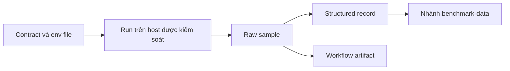

Regression policy là contract về cách performance evidence được tạo và công bố.
Nó không phải lời hứa rằng con số của một host áp dụng ở mọi nơi. Trang này mô tả
cách thêm benchmark, khi nào tạo ID mới, và những file không bao giờ được sửa
tay.

## Thêm một benchmark

| Bước                             | Artifact                              | Quy tắc                                                               |
| -------------------------------- | ------------------------------------- | --------------------------------------------------------------------- |
| 1. Đặt tên hành vi               | Benchmark ID                          | Ổn định và có version, ví dụ `http-throughput-v1`                     |
| 2. Cố định parameter             | Environment file                      | Giá trị machine-readable mà runner đọc trực tiếp                      |
| 3. Định nghĩa thành công         | Contract document                     | Counter, status code, body, TLS protocol, shutdown status             |
| 4. Định nghĩa so sánh            | Contract document                     | Candidate so với baseline, median và relative guard                   |
| 5. Ghi provenance                | Run metadata                          | Commit, ngày, host, kernel, tool, flag và command                     |
| 6. Chạy trên host được kiểm soát | Raw sample                            | Quiet host cho characterization; shared runner chỉ cho relative guard |
| 7. Công bố                       | History branch hoặc workflow artifact | Record và raw evidence append-only                                    |
| 8. Nối CI                        | Workflow                              | Chỉ gating khi host contract được đáp ứng                             |

Benchmark không nêu được success definition thì chưa sẵn sàng chạy. Benchmark
không nêu được host cohort thì chưa sẵn sàng công bố.

## Khi parameter thay đổi

| Thay đổi                                                       | Hành động bắt buộc                      |
| -------------------------------------------------------------- | --------------------------------------- |
| Duration, connection, thread, stream, warmup hoặc request path | Benchmark ID và schema mới              |
| TLS mode, ALPN hoặc credential type                            | Benchmark ID và history series mới      |
| Generator hoặc generator version                               | Cohort mới; không gộp row               |
| Kernel, backend hoặc CPU cohort                                | Results directory mới; không ghép ratio |
| Định nghĩa metric hoặc statistic                               | Schema version mới                      |

Contract `http-throughput-v1` và `h2-tls-scaling-v1` nêu rõ quy tắc này. Thay đổi
bất kỳ parameter nào cần benchmark ID, schema và history series mới. Không sửa
environment file đã ship để ép run mới vào ID cũ.

## Công bố evidence

| Vị trí                            | Nội dung                                |
| --------------------------------- | --------------------------------------- |
| `records/<year>/<record-id>.json` | Kết quả cấu trúc chuẩn                  |
| `raw/<year>/<record-id>/`         | Output gốc của generator và sample rate |
| `index.json` và `latest.json`     | Pointer cho consumer tự động            |
| `README.md` được sinh             | Summary cho người đọc                   |
| Contract và schema file           | Đúng version đã tạo record              |

Lần chạy mainline theo lịch và thủ công append record vào nhánh
`benchmark-data`. Nhánh này append-only ở mức record: publication fail nếu một
record ID đã tồn tại có nội dung khác. Chạy lại publication với nội dung giống
hệt là idempotent. Pull-request artifact giữ cùng structured record và raw
evidence, nhưng job pull request không tin cậy không bao giờ có quyền ghi vào
history branch.

## Không sửa output được sinh bằng tay

| Quy tắc                                                                                      | Lý do                                              |
| -------------------------------------------------------------------------------------------- | -------------------------------------------------- |
| Không sửa `dist/`, `.blume/` hay benchmark output được sinh                                  | Lần chạy sau ghi đè, và sửa tay phá provenance     |
| Giữ một compressed archive, một `README.md` và một `manifest.sha256` mỗi run                 | Results directory vẫn dễ review                    |
| Coi archive là append-only                                                                   | Giải nén, xem và để nguyên                         |
| Không commit file `.txt`, `.log`, `.tsv` hoặc `.bin` chưa archive dưới `benchmarks/results/` | `scripts/check_benchmark_results.sh` từ chối chúng |
| Regenerate thay vì patch record                                                              | Record bị patch không còn khớp raw evidence        |

Nếu một run sai, đánh dấu fail và công bố record mới. Không viết lại record cũ
cho đẹp.

## Relative guard không phải claim dùng chung

Guard `http-throughput-v1` là:

| Field       | Ý nghĩa                                                               |
| ----------- | --------------------------------------------------------------------- |
| So sánh     | Median requests per second của candidate với median của base revision |
| Ngưỡng      | Ít nhất 90 percent của baseline                                       |
| Phạm vi     | Cùng runner, toolchain và contract                                    |
| Không claim | Requests per second tuyệt đối xuyên hardware hoặc toolchain cohort    |

Hardware và scheduling của shared runner thay đổi theo thời gian. Kết quả tuyệt
đối chỉ so sánh được trong runner và toolchain cohort khớp nhau. Dedicated host
và shared runner là hai cohort khác nhau, và row từ cohort này không bao giờ được
nằm trong một ratio với row từ cohort kia.

Contract `h2-tls-scaling-v1` cố ý nằm ngoài `benchmark.yml` vì shared runner
không đáp ứng quiet-host evidence contract. Một dedicated quiet runner trong
tương lai có thể thêm job `workflow_dispatch` không gating để upload raw artifact
và ghi provenance, nhưng không bao giờ được so số của nó với shared runner.

## Checklist review

| Kiểm tra           | Điều kiện pass                                                               |
| ------------------ | ---------------------------------------------------------------------------- |
| ID và schema       | Parameter mới có ID và schema mới                                            |
| Provenance         | Commit, ngày, hardware, kernel, toolchain, command và artifact path được ghi |
| Success definition | Sample failed, errored, timed-out và non-2xx làm run fail                    |
| Append-only        | Record ID mới hoặc nội dung giống hệt từng byte                              |
| Output được sinh   | Không file sinh nào bị sửa tay                                               |
| Phạm vi claim      | Kết quả được mô tả là relative hoặc riêng cohort                             |

## Liên quan

- [Benchmarking](/docs/performance/benchmarking)
- [Load test](/docs/performance/load-testing)
- [Hiệu năng](/docs/performance)
