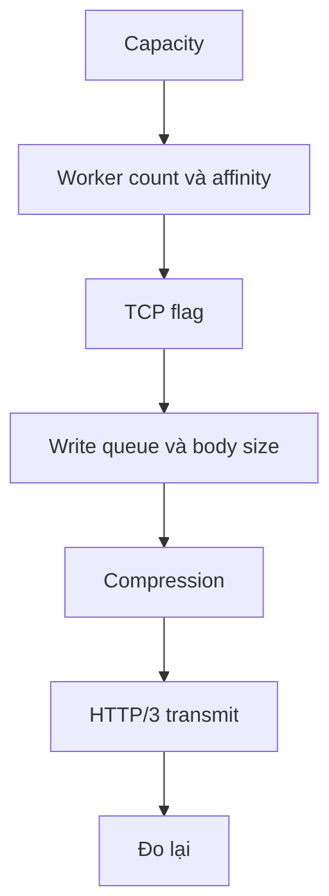

Phần lớn tuning là chọn capacity và worker count, rồi để hot path yên. Đổi một
biến, giữ nguyên host và workload, và ghi lại kết quả. Một setting thắng trên
host này không tự động thắng trên host khác.

## Thứ tự tuning

## TCP flag

| Flag               | Áp dụng cho           | Hành vi                                                 | Caveat                                                                         |
| ------------------ | --------------------- | ------------------------------------------------------- | ------------------------------------------------------------------------------ |
| `TCP_NODELAY`      | Accepted socket       | Tắt Nagle aggregation                                   | Best effort; macOS có thể trả `EINVAL` sau khi peer reset và kết quả bị bỏ qua |
| `TCP_QUICKACK`     | Accepted socket Linux | Yêu cầu quick ACK một lần lúc accept                    | One-shot theo thiết kế; không phải syscall mỗi lần đọc                         |
| `TCP_DEFER_ACCEPT` | Listener Linux        | Thức dậy ở byte ứng dụng đầu tiên thay vì chỉ handshake | Kernel khác giữ accept policy mặc định                                         |
| `SO_REUSEPORT`     | Listener cluster      | Kernel phân phối connection qua các listening socket    | Windows dùng `SO_REUSEADDR`; phân phối ở đó không được đảm bảo                 |
| `SO_REUSEADDR`     | Cluster Windows       | Fallback shared bind                                    | Không phải load-balancing guarantee                                            |

Không thêm socket option mà transport chưa áp dụng rồi kỳ vọng nó được đo. Lời
gọi `TCP_NODELAY` trên accepted socket là best effort: nó bỏ qua kết quả
`setsockopt` thô, nên `EINVAL` trên Darwin không chạm nhánh unreachable của
`std.posix` trong accept.

## Worker count và affinity

| Control                       | Tác dụng                                                             |
| ----------------------------- | -------------------------------------------------------------------- |
| Compiled worker capacity      | Upper bound; chỉ active worker cấp phát slab, inbox và thread handle |
| `ClusterOptions.worker_count` | Chọn active count tường minh                                         |
| `UWEBZOCKETS_WORKERS`         | Fallback environment qua `build_cluster_from_environment`            |
| Platform CPU count            | Mặc định khi cả option và biến môi trường không chọn count           |
| Affinity                      | Pin worker `i` vào physical core riêng trên Linux và Windows         |
| Worker dư                     | Wrap qua các core đã chọn thay vì giữ slab không dùng                |

Pinning là best effort. Cpuset bị giới hạn hoặc syscall fail ghi log một lần rồi
để worker unpinned. macOS không có hard-affinity API và chạy unpinned. Mặc định
theo logical CPU có thể oversubscribe host SMT khi bật affinity.

## Write queue và body size

| Knob                  | Chi phí                                                  | Tăng khi                                             |
| --------------------- | -------------------------------------------------------- | ---------------------------------------------------- |
| `write_queue_size`    | Mỗi connection; static file body là queue trừ 4 KiB      | Reader chậm hoặc streamed step lớn cần burst dài hơn |
| `max_body_size`       | Đi vào `request_stride` của mọi connection               | Upload cần headroom; nếu không thì giữ nhỏ           |
| `max_ws_message_size` | Mỗi connection; inbox worker dùng 65 lần giá trị này     | Một inbound message lớn hơn                          |
| `max_connections`     | Nhân mọi region theo connection                          | Nhiều peer kết nối cùng lúc                          |
| `max_header_size`     | Đi vào `request_stride` và header storage HTTP/2, HTTP/3 | Client gửi header block lớn hơn                      |
| `max_header_count`    | Thêm slot name/value mỗi connection trên 64              | Client gửi nhiều field hơn                           |

Write queue lớn không làm tăng tổng byte một stream producer được gửi. Producer
được gọi lại khi ring drain, nên queue chỉ giới hạn một bước của response.

## Tradeoff compression

| Setting                       | Bộ nhớ                                                              | Tradeoff                                               |
| ----------------------------- | ------------------------------------------------------------------- | ------------------------------------------------------ |
| `compression = true`          | RFC 7692 scratch theo cặp mỗi connection trong slab                 | WebSocket frame nhỏ hơn, byte mỗi connection nhiều hơn |
| `with_http_compression(true)` | Một gzip codec và output scratch có giới hạn mỗi worker, ngoài slab | HTTP body nhỏ hơn, thêm việc nén mỗi response          |
| Không compression             | Không scratch compression                                           | Wire size lớn nhất, bộ nhớ ít nhất                     |

`Presets.websocket_chat` giữ sẵn compression scratch. Các preset khác để
`compression` tắt trừ khi bạn bật. Kiểm tra `slab_bytes()` sau khi bật compression vì scratch nằm trong
chi phí mỗi connection.

## HTTP/3 transmit

| Hành vi                                    | Chính sách hiện tại                                                  |
| ------------------------------------------ | -------------------------------------------------------------------- |
| Packet cùng kích thước cho một destination | Gửi bằng một `sendmsg` mang `UDP_SEGMENT` (GSO) trên Linux           |
| Kích thước hoặc destination khác nhau      | Quay về per-packet path                                              |
| GRO phía receive                           | Tắt; loop không expose ancillary segment boundary                    |
| Coalesced receive buffer                   | Sẽ làm hỏng short-header parsing nếu đưa cho lsquic như một datagram |

Không bật GRO nếu chưa thay transport để expose segment boundary. Receive path
dùng `msghdr.control = null`, nên lsquic không thể tách segment từ coalesced
buffer.

## Khi nào không đổi gì

| Signal                                          | Diễn giải                           | Việc cần làm                                     |
| ----------------------------------------------- | ----------------------------------- | ------------------------------------------------ |
| Capacity error bằng 0 và p99 tăng đều theo load | Saturation, không phải queue defect | Thêm worker hoặc giảm load; để HTTP/2 window yên |
| Throughput scale theo worker và p99 giảm        | Dấu hiệu single-loop saturation     | Giữ worker count và đo lại                       |
| Đổi buffer cap không có measurement             | Thay đổi chưa được chứng minh       | Revert hoặc chạy test có kiểm soát               |
| Setting chỉ thắng trên một host                 | Hiệu ứng riêng của host             | Lặp lại trên cohort đích trước khi giữ           |
| Zero failure ở load mục tiêu                    | Capacity đủ                         | Giữ setting và ghi evidence                      |

Characterization 1.9.0 đóng HTTP/2 window tuning với kết luận đã đo và không
cần: throughput scale theo worker count và p99 giảm, không có timeout, failure
hay write-queue stall. Không buffer cap nào được mở rộng khi thiếu evidence.

## Liên quan

- [Định cỡ capacity](/docs/performance/capacity-sizing)
- [Profiling](/docs/performance/profiling)
- [Backpressure](/docs/concepts/backpressure)
