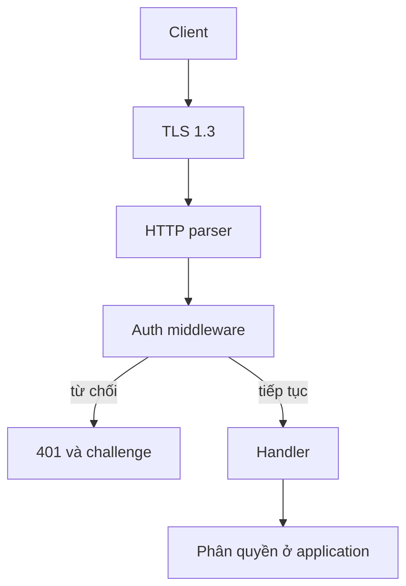

Middleware authentication chỉ trả lời một câu hỏi: request này có mang credential
Basic hoặc Bearer đã cấu hình hay không. Nó không xác định user, không cấp quyền
và không thay thế TLS. Trang này trình bày trust boundary và các bước triển khai
quanh nó; phần API theo từng request nằm ở
[Authentication HTTP](/docs/http/authentication).

## Trust boundary

| Control                        | Do framework thực hiện | Bạn chịu trách nhiệm                     |
| ------------------------------ | ---------------------- | ---------------------------------------- |
| Credential có mặt và đúng dạng | `middleware.Auth`      | Chọn tập credential được chấp nhận       |
| So sánh secret constant-time   | `middleware.Auth`      | Lưu secret có độ ngẫu nhiên cao          |
| Bảo mật đường truyền           | TLS layer              | Certificate, CA trust và rotation        |
| Phân quyền và tenancy          | Application            | Role, kiểm tra sở hữu, policy theo route |
| Cấp phát và hết hạn token      | Application            | Lưu trữ, thu hồi, audit                  |
| Chống brute force              | `middleware.RateLimit` | Chọn key và threshold                    |

Một kết quả khớp nghĩa là "request này mang một credential trong danh sách đã
cấu hình". Nó không cho biết ai đã gửi. Bạn có thể cấu hình cả danh sách Basic và
Bearer, và request có thể khớp bất kỳ entry nào trong hai danh sách. Middleware
không báo entry nào đã khớp. Handler nhận một `Request` không kèm identity.

## Những gì check bảo đảm

| Thuộc tính            | Hành vi                                                                     |
| --------------------- | --------------------------------------------------------------------------- |
| Chọn header           | `get_unique_header("authorization")`; field trùng trả `null`                |
| Scheme                | `Basic` hoặc `Bearer`, không phân biệt hoa thường, sau đó là space hoặc tab |
| Basic payload         | Base64 theo RFC 4648, decode vào buffer stack cố định 512 byte              |
| Tách Basic            | Dấu `:` đầu tiên tách username khỏi password; thiếu `:` bị từ chối          |
| Bearer payload        | Token rỗng bị từ chối                                                       |
| So sánh secret        | `std.crypto.timing_safe.eql` trên block cố định 64 byte                     |
| Các entry đã cấu hình | Mọi entry đều được so sánh, kể cả sau khi đã khớp                           |
| Từ chối               | `401 Unauthorized`, body rỗng, challenge cho các scheme đã cấu hình         |

Quy tắc field duy nhất quan trọng hơn vẻ ngoài của nó. Request có hai field
`Authorization` không có ý nghĩa xác định, nên việc từ chối ngăn proxy và origin
xác thực hai giá trị khác nhau.

## Nơi timing vẫn thay đổi

Phép so sánh chạy trên block cố định và không thoát sớm theo nội dung. Đoạn code
xung quanh vẫn rẽ nhánh theo hình dạng công khai:

- Nhận diện scheme so sánh prefix và dừng ở byte khác đầu tiên.
- Basic payload được decode base64, nên rẽ nhánh theo cú pháp và padding.
- Hai secret khác độ dài thất bại trước vòng block, nên độ dài quan sát được.
- Chi phí vòng lặp tăng theo số credential đã cấu hình.

Đó là contract có chủ đích: constant-time comparison bảo vệ nội dung của secret,
không bảo vệ độ dài hay số entry được chấp nhận. Đừng thêm phép so sánh tự viết
trả về ngay tại byte khác đầu tiên.

## Các failure mode

| Điều kiện                              | Kết quả                                              |
| -------------------------------------- | ---------------------------------------------------- |
| Thiếu, trùng, sai dạng hoặc không khớp | `401 Unauthorized`, body rỗng                        |
| Basic payload decode vượt 512 byte     | `401 Unauthorized`                                   |
| Không cấu hình credential nào          | `401` không có field `WWW-Authenticate`              |
| `realm` chứa dấu nháy, CR hoặc LF      | `500 Internal Server Error` ở request bị từ chối đầu |
| Challenge format vượt 1024 byte        | `500 Internal Server Error`                          |

Realm được kiểm tra lúc format challenge, không phải lúc dựng option. Realm sai vì
vậy xuất hiện ở request bị từ chối đầu tiên. Cấu hình chỉ có bearer không bao giờ
format realm, nên lỗi này ẩn cho tới khi thêm Basic.

Dòng "không cấu hình credential nào" là lỗi cấu hình chứ không phải cuộc tấn
công: `Auth` không có credential từ chối mọi request và không cho client thứ gì
để trình.

## Checklist triển khai

| Kiểm tra                                 | Lý do                                                         |
| ---------------------------------------- | ------------------------------------------------------------- |
| Kết thúc TLS trước middleware            | `Authorization` là cleartext trên đường truyền                |
| Đăng ký một `Auth` cho mỗi worker        | Option là immutable, nhưng mỗi app cần đăng ký riêng          |
| Giữ credential sống đến `app.deinit()`   | Credential là slice được mượn, không phải bản sao             |
| Coi rotation là rolling restart          | Không có hot reload hay credential store                      |
| Thứ tự CORS, rồi `Auth`, rồi `RateLimit` | Preflight không có credential và không nên tiêu token         |
| Phân quyền trong handler                 | Credential hợp lệ không phải là permission                    |
| Che field này trong log và body lỗi      | Token bị log là token bị lộ                                   |
| Dùng token có độ ngẫu nhiên cao          | Lưu plaintext nghĩa là lộ memory tương đương mất credential   |
| Kiểm tra challenge và realm              | `500` ở 401 đầu tiên là sự cố production, không phải cảnh báo |

Đừng trình bày middleware này như một chương trình authentication hoàn chỉnh. Nó
là một control tại một boundary. Session management, khóa tài khoản, hết hạn
token, audit và lưu trữ secret vẫn là việc của application và deployment.

## Tiếp theo

- [Authentication HTTP](/docs/http/authentication) mô tả thứ tự parse và các option
  chính xác.
- [Giới hạn tần suất](/docs/security/rate-limiting) giới hạn số lần credential bị
  đoán.
- [Threat model](/docs/security/threat-model) đặt boundary này cạnh các boundary
  khác.
