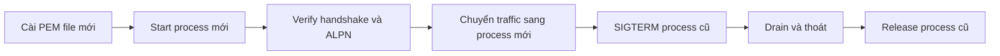

µWebZockets đọc certificate file lúc tạo TLS context. Nó không watch file, không
swap và không reload theo signal. Rotation là rolling restart: start process mới
với file mới, verify, chuyển traffic rồi drain process cũ tới khi thoát.

## Không có hot reload

Hot reload không được hỗ trợ. Một per-worker context swap an toàn sẽ cần
credential generation có generation-check, publish atomic tới owning loop, drain
mọi `SSL` đang dùng context cũ, release an toàn sau reference cuối và rollback
path khi PEM load sai. Chưa có yêu cầu production nào được đo biện minh cho bề mặt
đó. Quyết định và tiêu chí khôi phục được ghi trong
[ADR 0003](https://github.com/farbenbuilds/uWebZockets/blob/main/docs/adr/0003-tls-cluster-operational-boundaries.md).

Thay file trên disk không ảnh hưởng process đang chạy. Context cũ tiếp tục phục vụ
tới khi process thoát.

## Rolling restart



1. Ghi chain và key mới vào path mà process đọc. Giữ file cũ tới khi process cũ
   thoát.
2. Start process mới với cùng route configuration và capacity.
3. Verify process mới trước khi chuyển user traffic.
4. Chuyển traffic bằng load balancer, service discovery hoặc reverse proxy.
5. Gửi `SIGTERM` cho process cũ và chờ nó thoát.
6. Xác nhận supervisor báo exit sạch, rồi xóa file cũ.

Supervisor nên gửi `SIGTERM` và chờ exit. Runtime cài SIGINT và SIGTERM handler
qua `catch_shutdown_signals`; deployment đã tự quản lý signal không được cài
watcher thứ hai.

## Thứ tự trong cluster

TLS cluster theo cùng thứ tự khi start lần đầu và mỗi member restart:

| Bước | Call                                         |
| ---- | -------------------------------------------- |
| 1    | `build_cluster`                              |
| 2    | `configure`                                  |
| 3    | `enable_https` hoặc `enable_https_ephemeral` |
| 4    | `listen`                                     |
| 5    | `run`                                        |
| 6    | `request_shutdown` hoặc shutdown signal      |
| 7    | `deinit`                                     |

Gọi đúng một hàm enable một lần trước `listen`. Mỗi worker đọc PEM file một lần
lúc startup, nên process group mới nhận credential mới và group cũ giữ context cũ
tới khi thoát.

## Drain guidance

- Giữ một owner cho `Cluster`. Không copy hoặc move nó sau khi watcher hoặc `run`
  bắt đầu.
- Signal yêu cầu cùng drain path với `App.shutdown`: ngừng accept, cancel
  completion, drain connection và release slab.
- Không có deadline cho in-flight request ngoài connection idle timeout đã cấu
  hình. Idle timeout mặc định là 120 giây.
- Dùng `deinit_checked()` làm release path an toàn cho supervisor với cluster.
  `deinit` assert trạng thái đã drain và panic nếu gọi từ trong loop.
- Sau khi `run` trả về, `state()` báo `stopped` và `first_failure()` nêu worker
  index, phase và error đầu tiên.

## Cross-worker resumption sau rotation

Process mới tạo ticket key mới cho từng worker. Client reconnect sau khi chuyển có
thể không resume được session do process cũ cấp, và reconnect rơi vào worker khác
cũng không resume được. Dự kiến sẽ có full handshake trong rollout; đây là
resumption boundary đã được ghi, không phải certificate failure.

## Verify

```sh
curl -v https://127.0.0.1:3443/
```

Kiểm tra subject của certificate và dòng ALPN. Bản `curl` có HTTP/2 sẽ thương
lượng `h2`; bản không có sẽ thương lượng `http/1.1`. Với certificate self-signed
cục bộ, thêm `-k` như mô tả ở
[Certificate tạm thời](/docs/security/ephemeral-certificates). Lặp lại check với
process mới trước khi chuyển traffic.

## Liên quan

- [TLS cluster](/docs/security/tls-clusters) trình bày lifecycle mà worker group
  restart tuân theo.
- [Certificate production](/docs/security/production-certificates) mô tả PEM load
  và startup check.
- [TLS 1.3 và ALPN](/docs/security/tls) giải thích kết quả handshake bạn verify
  sau restart.
