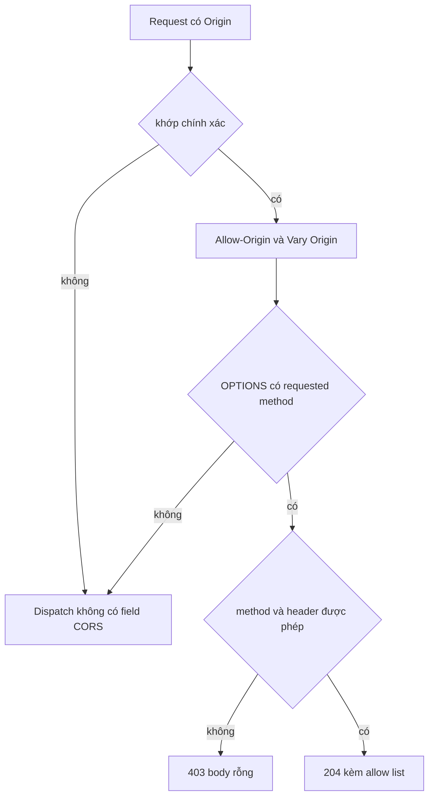

CORS và security header là hai middleware riêng với hai nhiệm vụ riêng. CORS
quyết định origin nào của browser được đọc response; middleware security header
ghi năm field response. Cả hai đều không xác thực caller. Chi tiết triển khai nằm
ở [CORS](/docs/http/cors) và
[security header](/docs/http/security-headers).

## Khớp origin

| Quy tắc                         | Hành vi                                                |
| ------------------------------- | ------------------------------------------------------ |
| So sánh                         | Byte equality bằng `std.mem.eql`, phân biệt hoa thường |
| Wildcard                        | Không có; entry `*` chỉ khớp đúng giá trị `*`          |
| Khớp prefix hoặc suffix         | Không có                                               |
| Thiếu `Origin`                  | Dispatch tiếp tục, không có field CORS                 |
| `Origin` bị trùng               | Coi như thiếu; `get_unique_header` trả `null`          |
| Origin không có trong danh sách | Dispatch tiếp tục; browser chặn cross-origin read      |

Không có reflection của origin tùy ý. Dấu slash cuối, khác hoa thường hoặc khác
port đều không khớp, và response không mang `Access-Control-Allow-Origin`.

Khớp chính xác không phải hình thức. So sánh origin là thứ duy nhất ngăn một site
đọc response của site khác qua browser. Một wildcard cho tiện sẽ chuyển quyết
định đó cho attacker.

## Preflight

| Điều kiện                                       | Kết quả                              |
| ----------------------------------------------- | ------------------------------------ |
| Origin khớp, request không phải preflight       | Thêm field CORS, dispatch tiếp tục   |
| Origin khớp, preflight hợp lệ                   | `204 No Content`, dừng dispatch      |
| Method không biết hoặc không được cấu hình      | `403 Forbidden`, body rỗng           |
| Requested header không có trong `allow_headers` | `403 Forbidden`, body rỗng           |
| Nhiều hơn 10 entry trong `methods`              | `500` qua `error.TooManyCorsMethods` |

Các check chạy trước routing, nên preflight cho một path không tồn tại vẫn nhận
`204`. Preflight bị từ chối vẫn mang `Access-Control-Allow-Origin` và `Vary`, vì
các field đó được thêm trước bước kiểm tra method.

## Credential và cache

`allow_credentials = true` thêm `Access-Control-Allow-Credentials: true` cho mọi
origin được phép, kể cả preflight. Nó không làm request trở nên đã xác thực và
không bảo browser gửi cookie hay field `Authorization`; browser vẫn áp dụng quy
tắc của nó.

`Vary: Origin` là bắt buộc khi origin được reflect. Không có nó, shared cache có
thể lưu response cho một origin rồi trả cho origin khác. Middleware tự thêm dòng
`Vary`; đừng thêm dòng thứ hai từ lớp khác, vì cache sẽ gộp các giá trị.

CORS là policy đọc của browser, không phải access control. Client không phải
browser bỏ qua hoàn toàn. Hãy ghép nó với authentication, không dùng thay thế.

## Security header mặc định

| Option                      | Field                       | Mặc định                              |
| --------------------------- | --------------------------- | ------------------------------------- |
| `strict_transport_security` | `Strict-Transport-Security` | `max-age=31536000; includeSubDomains` |
| `content_security_policy`   | `Content-Security-Policy`   | `default-src 'self'`                  |
| `x_content_type_options`    | `X-Content-Type-Options`    | `true`, ghi ra `nosniff`              |
| `x_frame_options`           | `X-Frame-Options`           | `DENY`                                |
| `referrer_policy`           | `Referrer-Policy`           | `no-referrer`                         |

Mọi field trừ `x_content_type_options` đều optional: `null` bỏ field, còn `false`
bỏ `nosniff`. Middleware thêm field theo thứ tự và trả `continue_dispatch`, kể cả
với response về sau thành `404`. Nếu một header không append được, response kết
thúc bằng `500`.

## Những gì mặc định không bảo đảm

| Giới hạn                   | Hệ quả                                                                        |
| -------------------------- | ----------------------------------------------------------------------------- |
| HSTS qua plaintext         | Không có tác dụng; browser cần HTTPS origin để lưu policy                     |
| `includeSubDomains`        | Mở rộng policy sang subdomain bạn có thể chưa migrate                         |
| `default-src 'self'`       | Chặn inline script, inline style, `eval` và asset bên thứ ba                  |
| Không hỗ trợ nonce, hash   | Middleware ghi đúng chuỗi bạn đưa; nó không đọc HTML                          |
| Không có report-only mode  | Policy chưa được kiểm tra cho tới khi browser enforce                         |
| Không có policy theo route | Mọi route trong app nhận cùng năm field                                       |
| Không cấu hình CORS        | CORS là middleware riêng với danh sách origin riêng                           |
| Không có header khác       | `Permissions-Policy`, COOP, COEP, CORP, `Cache-Control`, `ETag` vẫn thuộc bạn |

Một header CSP không phải bằng chứng trang đã an toàn. Hãy tải trang thật với
policy đang bật, mở browser console và chỉ thêm nguồn mà trang thực sự dùng. Một
field bị thêm hai lần sẽ được enforce như giao của hai policy, nên mỗi header chỉ
nên có một owner.

`frame-ancestors 'none'` và `X-Frame-Options: DENY` cùng hạn chế framing. Giữ cả
hai khi vẫn hỗ trợ browser cũ.

## Tiếp theo

- [CORS](/docs/http/cors) mô tả mọi option và tên lỗi.
- [Security header](/docs/http/security-headers) mô tả output response chính xác.
- [Xác thực](/docs/security/authentication) trình bày check mà CORS không thực hiện.
