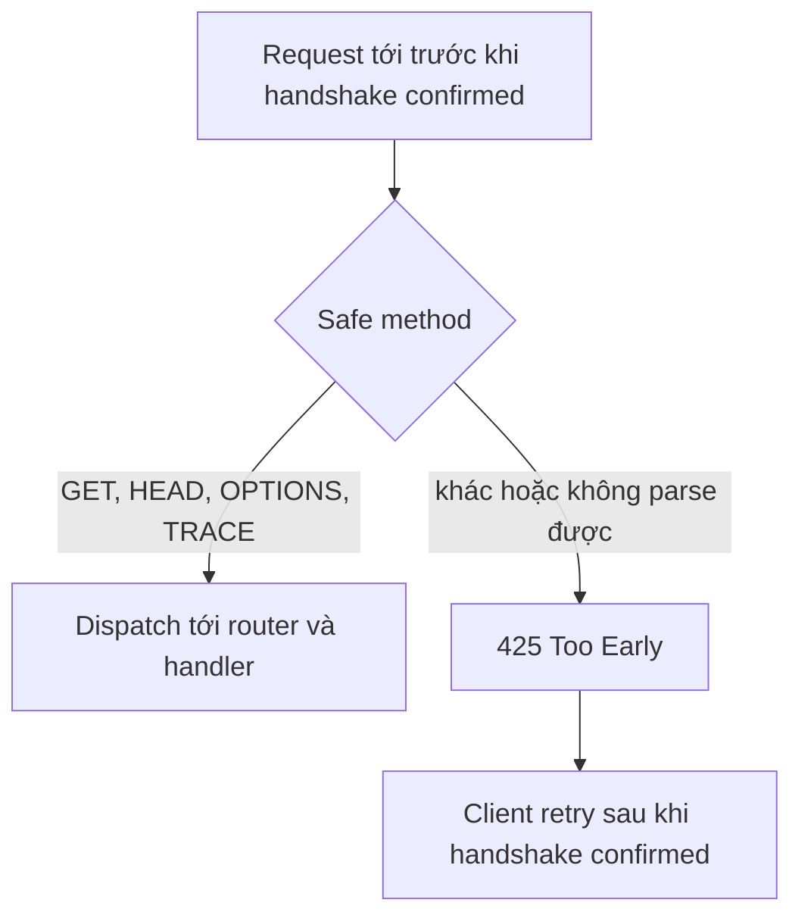

TLS 1.3 early data cho client gửi request byte trước khi handshake confirmed.
Những byte đó có thể bị network attacker replay, nên µWebZockets chỉ nhận safe
method cho tới lúc confirmation và trả `425 Too Early` cho phần còn lại.

## 0-RTT được bật ở đâu

| Context                              | Early data           |
| ------------------------------------ | -------------------- |
| `init_https`, `init_https_ephemeral` | Bật, chỉ safe method |
| `init_https_mtls` với `.none`        | Bật, chỉ safe method |
| `init_https_mtls` với `.optional`    | Tắt                  |
| `init_https_mtls` với `.required`    | Tắt                  |
| `init_http3`, `init_http3_ephemeral` | Tắt                  |
| `Cluster.enable_https`               | Bật, chỉ safe method |

Client-certificate mode tắt early data vì certificate được verify ở flight thứ
hai. QUIC giữ early data tắt cho tới khi lsquic replay policy được nối end to
end.

## Safe-method gate

Early-data gate nhận `GET`, `HEAD`, `OPTIONS` và `TRACE`. `QUERY` không
replay-safe và bị từ chối, cùng với `POST`, `PUT`, `DELETE`, `PATCH`, `CONNECT`
và method không parse được.

Trên HTTP/1.1, rejection còn gửi `Connection: close` và body
`Early data is limited to safe methods`. Trên HTTP/2, response là status `425`
không kèm connection header đó. RFC 8470 mô tả client retry: stream có thể được
thử lại sau khi handshake confirmed.

## Replay model

Attacker bắt được early data có thể replay. Gate giữ một `POST` bị replay khỏi
route, nhưng nó không làm cho replay-safe method vô hại nếu handler thay đổi
state. Một `GET` xóa record, tăng counter hoặc gửi email là defect dù method được
phân loại là safe.

Coi early data là tối ưu latency cho thao tác đọc:

| Dạng handler                             | Hướng dẫn early data                            |
| ---------------------------------------- | ----------------------------------------------- |
| Read-only lookup                         | An toàn để phục vụ từ handler `GET` hoặc `HEAD` |
| Mutation đặt sau `GET`                   | Không làm vậy; chuyển mutation sang method khác |
| `OPTIONS` hoặc `TRACE` idempotent        | An toàn để phục vụ                              |
| Authentication challenge trên early data | Client sẽ retry sau confirmation                |

## Hướng dẫn cho handler an toàn

- Giữ `GET`, `HEAD`, `OPTIONS` và `TRACE` không có side effect mà lần giao thứ
  hai sẽ nhân đôi.
- Không dựa vào early data cho quyết định authorization phụ thuộc client
  certificate; context mTLS đã tắt nó.
- Client có thể thấy `425 Too Early` và retry. Retry là hành vi protocol bình
  thường, không phải server failure.
- Nếu handler buộc phải mutate state, dùng method không an toàn để gate từ chối
  early attempt trước routing.

## QUIC

HTTP/3 context quảng bá `h3` với early data tắt. QUIC engine giữ policy đó cho tới
khi replay protection được định nghĩa end to end, nên client không thể gửi 0-RTT
HTTP/3 request tới live listener. Xem
[Early data policy](/docs/http3/early-data) cho góc nhìn HTTP/3.

## Liên quan

- [Mutual TLS](/docs/security/mtls) giải thích vì sao client-certificate mode tắt
  early data.
- [TLS 1.3 và ALPN](/docs/security/tls) trình bày context policy bật hoặc tắt
  0-RTT.
- [HTTP/3 early data policy](/docs/http3/early-data) mô tả đường QUIC.
