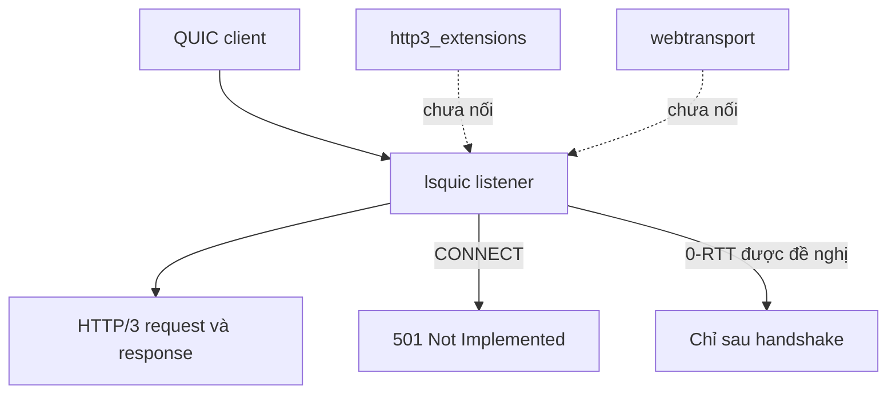

HTTP/3 chạy trên QUIC với một TLS context riêng. Listener đang chạy giữ bề mặt
hẹp hơn protocol cho phép: không 0-RTT, validate header chặt và không có extended
CONNECT hay WebTransport session. Trang này tách phần đang chạy khỏi phần chỉ tồn
tại dưới dạng helper có bound. Cấu hình transport nằm ở
[QUIC transport](/docs/http3/quic-transport).

## Bề mặt đang chạy và bị gate

| Khả năng                 | Hành vi đang chạy                          |
| ------------------------ | ------------------------------------------ |
| Request và response      | Được hỗ trợ                                |
| TLS 0-RTT                | Tắt; request chờ handshake                 |
| Extended CONNECT         | Từ chối bằng `501 Not Implemented`         |
| WebTransport session     | Không advertise và không tới được          |
| Server push              | Không triển khai                           |
| HTTP/3 cluster           | Không hỗ trợ; cluster listener chỉ TCP/TLS |
| Raw QUIC engine callback | Internal, không phải consumer interface    |

`uz.http3_extensions` và `uz.webtransport` cung cấp validator và wire helper có
bound cho backend tương lai. Chúng chưa nối vào listener đang chạy, nên sự tồn
tại của chúng không phải feature đã triển khai. Đừng xây quyết định security trên
module mà network path không bao giờ gọi.

## 0-RTT

QUIC context truyền early data disabled, và lsquic được yêu cầu giữ 0 delayed
0-RTT packet. Client đề nghị early data sẽ hoàn tất handshake bình thường trước
khi request tới handler.

Các policy helper trong `uz.http3_extensions` có thể phân loại request thành
`reject`, `defer_until_confirmed` hoặc `allow_replay_safe`, nhưng listener đang
chạy không expose early-data state theo từng request. Hãy coi 0-RTT là không tồn
tại, không phải "chỉ method an toàn". Hành vi TCP khác đi; xem
[Early data policy](/docs/http3/early-data).

Replay là lý do cho lựa chọn chặt này. Request 0-RTT có thể bị network attacker
phát lại, và server không phân biệt được bản phát lại với request hợp lệ thứ hai.

## Validate header

| Quy tắc                                     | Kết quả                   |
| ------------------------------------------- | ------------------------- |
| Pseudo-field bị trùng                       | Stream `H3_MESSAGE_ERROR` |
| Pseudo-field sau regular field              | Stream `H3_MESSAGE_ERROR` |
| Field name viết hoa hoặc không hợp lệ       | Stream `H3_MESSAGE_ERROR` |
| Connection-specific field                   | Stream `H3_MESSAGE_ERROR` |
| `:protocol` trên request không phải CONNECT | Sai dạng                  |
| `QUERY` không có `Content-Type` hợp lệ      | `400 Bad Request`         |
| Body không khớp `content-length`            | `400 Bad Request`         |

Lỗi theo stream rất quan trọng: request sai dạng đóng stream của nó mà không hủy
các stream lành mạnh khác trên cùng connection. Cross-implementation gate trộn
stream sai dạng với stream lành mạnh có chủ đích để chứng minh tính chất đó.

## Bound của engine và request

| Giới hạn                | Mặc định          | Nguồn                          |
| ----------------------- | ----------------- | ------------------------------ |
| Connection capacity     | `max_connections` | Engine pool                    |
| Header list size        | `max_header_size` | `es_max_header_list_size`      |
| Header set đang chờ     | 1                 | `es_max_header_sets`           |
| QPACK decoder table     | 0 byte            | `es_qpack_dec_max_size`        |
| QPACK stream bị block   | 0                 | `es_qpack_dec_max_blocked`     |
| Request body            | 16 KiB            | `max_h3_body_size`             |
| Response header storage | 4 KiB             | `max_h3_response_header_size`  |
| Response field          | 64                | `max_h3_response_header_count` |
| UDP receive payload     | 2.048 byte        | Packet slot                    |

QPACK decoder table bằng 0 nghĩa là server không giữ dictionary decode động giữa
các stream. Điều đó loại bỏ một cấu trúc decode chia sẻ khỏi boundary, đồng thời
mất khả năng nén bằng dynamic table. Header list vượt `max_header_size` bị từ chối
trước dispatch.

`max_header_size` trên 65.535 vẫn hợp lệ cho HTTP/1.1 và HTTP/2, nhưng `listen_udp`
từ chối vì độ dài field của lsxpack là 16-bit. Đó là lỗi lúc khởi động, không phải
lỗi runtime.

## Ranh giới cluster

HTTP/3 clustering không được hỗ trợ. `init_http3` và `listen_udp` là API
single-application, và cluster listener chỉ TCP/TLS. Deployment cần nhiều hơn một
QUIC worker phải kết thúc QUIC ở nơi khác hoặc chấp nhận một process duy nhất;
nó không nhận per-worker QUIC state từ framework này.

Raw QUIC engine, stream, packet và QPACK callback dưới `src/quic` là internal.
Chúng không phải consumer interface được hỗ trợ, và application chạm vào chúng tự
nhận một boundary mà security policy không bao phủ.

## Tiếp theo

- [QUIC transport](/docs/http3/quic-transport) trình bày listener setup và hành vi
  congestion.
- [Giới hạn HTTP/3](/docs/http3/limits) liệt kê mọi bound của engine và adapter.
- [Trạng thái WebTransport](/docs/http3/webtransport) giải thích capability gate.
