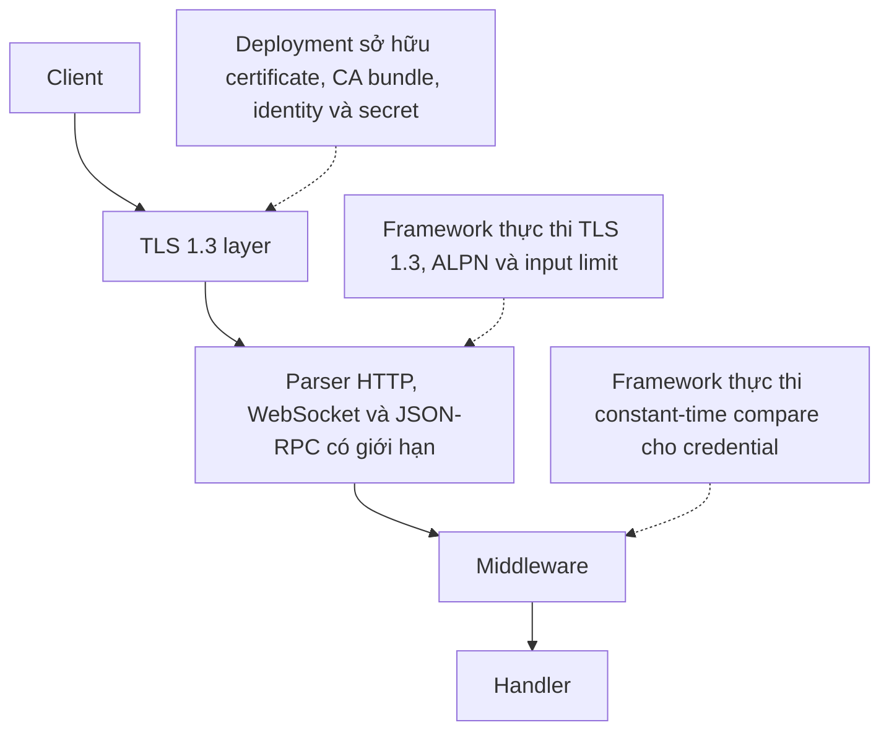

µWebZockets giới hạn mọi network input và fail closed khi protocol data không hợp
lệ. Certificate trust, identity, secret storage và capacity sizing vẫn thuộc về
deployment của bạn. Phần này mô tả bề mặt TLS, các giới hạn vận hành và những
control nằm cạnh nó.

## Ranh giới tin cậy

| Ranh giới      | Framework thực thi                                               | Deployment sở hữu                                    |
| -------------- | ---------------------------------------------------------------- | ---------------------------------------------------- |
| TLS            | Chỉ TLS 1.3, ALPN policy, verify client certificate khi bật mTLS | Certificate issuance, CA bundle, rotation, pinning   |
| HTTP parsing   | Buffer cố định, framing chặt, rejection có cấu trúc              | Capacity sizing và OS resource limit                 |
| Authentication | Constant-time compare và middleware fail closed                  | User store, token issuance, authorization theo route |
| Rate limiting  | Token bucket cố định và bảng theo từng worker                    | Chọn key, threshold, chính sách shared state         |
| C ABI          | Opaque handle, destroy tường minh, error code khác 0             | Vòng đời handle và copy borrowed slice               |

## Chọn certificate path

| Tình huống               | Entry point                      | Credential                            |
| ------------------------ | -------------------------------- | ------------------------------------- |
| HTTPS cục bộ             | `init_https_ephemeral`           | Generate trong memory lúc startup     |
| HTTP/3 cục bộ            | `init_http3_ephemeral`           | Generate trong memory lúc startup     |
| HTTPS production         | `init_https`                     | PEM chain và key bạn cung cấp         |
| HTTP/3 production        | `init_http3`                     | PEM load vào cả TCP và QUIC context   |
| Mutual TLS               | `init_https_mtls`                | PEM server và client CA bundle        |
| TLS cluster, production  | `Cluster.enable_https`           | PEM load một lần cho mỗi worker       |
| TLS cluster, development | `Cluster.enable_https_ephemeral` | Mỗi worker nhận một certificate riêng |
| C ABI, cục bộ            | `uwz_app_create_tls_ephemeral`   | Generate trong memory lúc startup     |

Certificate được generate là self-signed và không export được. Chỉ dùng cho test
cục bộ; client cần `curl -k` hoặc cách bỏ qua verification tương đương.

## Bản đồ bề mặt bảo mật

<CardGroup cols={2}>
  <Card title="TLS 1.3 và ALPN" href="/docs/security/tls" icon="shield-check">
    Đọc protocol policy cố định, quy tắc chọn ALPN và các context entry point.
  </Card>
  <Card title="Certificate tạm thời" href="/docs/security/ephemeral-certificates" icon="key-round">
    Generate certificate cục bộ trong memory, đổi tên và đọc nội dung của nó.
  </Card>
  <Card title="Certificate production" href="/docs/security/production-certificates" icon="lock">
    Load PEM chain và key, fail nhanh khi mismatch và theo startup checklist.
  </Card>
  <Card title="Mutual TLS" href="/docs/security/mtls" icon="handshake">
    Verify client chain với CA bundle và hiểu tương tác với early data.
  </Card>
  <Card title="TLS cluster" href="/docs/security/tls-clusters" icon="network">
    Bật TLS cho từng worker, giữ đúng lifecycle order và đọc resumption boundary.
  </Card>
  <Card title="Early data và 0-RTT" href="/docs/security/early-data" icon="clock">
    Xem method nào đi qua trước khi handshake confirmed và vì sao phần còn lại nhận 425.
  </Card>
  <Card title="Rotate certificate" href="/docs/security/certificate-rotation" icon="activity">
    Rotate bằng rolling restart, drain process cũ và verify handshake mới.
  </Card>
</CardGroup>

## Control ở tầng ứng dụng

<CardGroup cols={2}>
  <Card title="Authentication" href="/docs/security/authentication" icon="key-round">
    Đặt credential check ở middleware boundary và đọc các failure mode.
  </Card>
  <Card title="Rate limiting" href="/docs/security/rate-limiting" icon="gauge">
    Chọn key do server suy ra và size bảng token bucket theo worker.
  </Card>
  <Card title="CORS và security headers" href="/docs/security/cors-and-headers" icon="globe">
    Áp dụng exact origin match, preflight policy và response header có chủ đích.
  </Card>
  <Card title="Input hardening" href="/docs/security/input-hardening" icon="filter">
    Đọc parser bound và framing rule loại bỏ input sai trước handler.
  </Card>
  <Card title="WebSocket security" href="/docs/security/websocket-security" icon="messages-square">
    Xem upgrade như một request đã xác thực và giới hạn connection sau đó.
  </Card>
  <Card title="HTTP/3 security" href="/docs/security/http3-security" icon="radio">
    Đọc QUIC listener policy và các extension module nằm ngoài live path.
  </Card>
</CardGroup>

## Bảo đảm

<CardGroup cols={2}>
  <Card title="Threat model" href="/docs/security/threat-model" icon="shield-alert">
    Nêu asset, khả năng của attacker và non-goal mà phần này giả định.
  </Card>
  <Card title="Báo lỗ hổng" href="/docs/security/reporting" icon="circle-help">
    Dùng kênh riêng và kèm bằng chứng maintainer cần.
  </Card>
</CardGroup>

## Khái niệm

| Khái niệm              | Trang                                                       |
| ---------------------- | ----------------------------------------------------------- |
| Toàn bộ trust model    | [Security model](/docs/concepts/security-model)             |
| ALPN và chọn protocol  | [Protocol negotiation](/docs/concepts/protocol-negotiation) |
| Capacity và idle limit | [Capacity model](/docs/concepts/capacity-model)             |

## Framework không cung cấp gì

- Certificate issuance, ACME automation hoặc quan hệ với public CA.
- User directory, session store hoặc authorization model phía trên credential
  match.
- Secret storage, key management hoặc log redaction cho field của application.
- Certificate revocation enforcement. CRL được load nhưng revocation không được
  kiểm tra trong handshake.
- Hot certificate reload. Rotation là rolling restart.
- HTTP/3 clustering hoặc WebTransport live path.
- Web application firewall, DDoS protection hoặc OS hardening.

Capacity, idle timeout và OS limit là quyết định của deployment, được mô tả
trong [Capacity model](/docs/concepts/capacity-model).

## Báo lỗ hổng

Security fix áp dụng cho revision phát triển hiện tại và minor line đã release gần
nhất. Không mở public issue cho lỗ hổng chưa công bố. Gửi private report kèm
revision, platform, reproducer, hành vi mong đợi và quan sát được, impact và log
đã xóa secret. Policy đầy đủ và địa chỉ liên hệ nằm trong
[SECURITY.md](https://github.com/farbenbuilds/uWebZockets/blob/main/SECURITY.md).
Checklist báo cáo riêng nằm ở
[Báo lỗ hổng](/docs/security/reporting).

## Liên quan

- [TLS 1.3 và ALPN](/docs/security/tls) là baseline protocol cho mọi trang trong
  phần này.
- [Certificate production](/docs/security/production-certificates) là bước vận
  hành đầu tiên trước khi public launch.
- [Security model](/docs/concepts/security-model) đặt các control này vào threat
  model tổng thể của framework.
