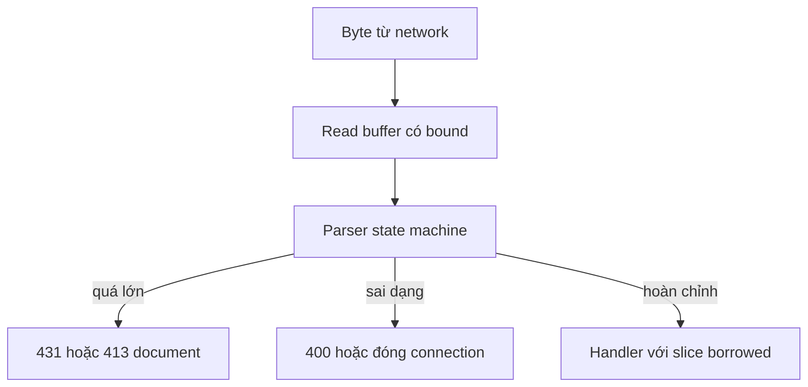

Mọi input từ network đều có trần cố định, và input sai dạng bị từ chối trước khi
dispatch. Trang này tập hợp các bound quan trọng cho security, hình dạng của một
rejection và các quy tắc framing ngăn request smuggling. Tham chiếu cấu hình đầy
đủ nằm ở [Giới hạn HTTP](/docs/http/limits).

## Đường đi có bound



## Bound lúc runtime

| Input            | Mặc định  | Khi vượt                                         |
| ---------------- | --------- | ------------------------------------------------ |
| Request line     | 8 KiB     | `431` kèm JSON document                          |
| Header block     | 16 KiB    | `431` kèm JSON document                          |
| Số header        | 64 inline | Tràn vào slab storage, rồi `431`                 |
| Request body     | 16 KiB    | `413` kèm JSON document                          |
| Query pair       | 32        | `error.TooManyQueryParameters` từ `query_params` |
| Cookie pair      | 32        | Pair dư bị bỏ qua                                |
| Header read time | 30 s      | Đóng connection                                  |
| Idle timeout     | 120 s     | Đóng connection                                  |

`max_header_count` không thể thấp hơn 64 vì array inline trong `Request` không
co lại được. Giá trị lớn hơn cấp một cặp name/value cho mỗi header thêm vào slab
của từng connection, nên trần vẫn hữu hạn.

Khác biệt giữa query và cookie overflow có chủ đích nhưng dễ bỏ sót. Query view
fail closed bằng error; cookie jar âm thầm bỏ pair vượt capacity. Đừng xây quyết
định phân quyền dựa trên index của cookie pair mà không kiểm tra count.

## Bound lúc khởi động

| Bound            | Mặc định  | Lỗi khi vượt                          |
| ---------------- | --------- | ------------------------------------- |
| Route node       | 256       | `error.RouteCapacityReached`          |
| Route capture    | 16 inline | `error.RouteParameterCapacityReached` |
| Middleware entry | 32        | `error.MiddlewareCapacityReached`     |
| Connection       | 1.024     | Connection TCP mới bị đóng            |
| Write queue      | 64 KiB    | `error.WouldBlock` từ sender          |

Đây là giới hạn đăng ký và capacity, không phải bound parse theo từng request.
Route table vượt các giới hạn này fail lúc khởi động thay vì nhận traffic nó
không thể route.

## Rejection có cấu trúc

Body hoặc header block quá lớn tạo một JSON document có bound. Trường hợp body
báo giới hạn đã cấu hình:

```json
{
  "error": {
    "code": "payload_too_large",
    "message": "Request body exceeded the 16KB limit. Consider increasing 'max_body_size' in ServerConfig.",
    "limit_bytes": 16384
  }
}
```

Header quá lớn dùng cùng hình dạng với `headers_too_large`. Request line hoặc số
header vượt giới hạn cũng trả `431`; document đó báo `max_header_size`, vì
transport chỉ render một policy từ chối header. Document bị chặn ở 384 byte và
được ghi từ storage cố định, nên đường rejection không allocation và không tới
handler.

Rejection nêu tên giới hạn thay vì đóng connection. Client phân biệt được "quá
lớn" với lỗi network, và operator thấy được giá trị cấu hình cần đổi.

## Framing và smuggling

Framing xung đột là primitive request smuggling cổ điển: hai hop bất đồng về chỗ
một request kết thúc và request sau bắt đầu. Parser từ chối từng điểm mơ hồ thay
vì chọn một bên:

| Điều kiện                                     | Kết quả          |
| --------------------------------------------- | ---------------- |
| Field `Host` bị trùng                         | Request sai dạng |
| Thiếu hoặc rỗng `Host`                        | Request sai dạng |
| `Content-Length` bị trùng                     | Request sai dạng |
| `Transfer-Encoding` bị trùng                  | Request sai dạng |
| `Transfer-Encoding` khác `chunked`            | Request sai dạng |
| Có cả `Content-Length` và `Transfer-Encoding` | Request sai dạng |
| `Content-Length` không phải chữ số hợp lệ     | Request sai dạng |
| Control character trong field value           | Request sai dạng |
| Target dạng authority, fragment hoặc userinfo | Request sai dạng |

`Transfer-Encoding` phải đúng là `chunked`; một list, coding khác hoặc cách viết
gây nhiễu bị từ chối thay vì chuẩn hoá. Xung đột `Content-Length` và
`Transfer-Encoding` thắng check body size, nên request không hợp lệ kể cả khi độ
dài khai báo dưới giới hạn.

Chỉ chấp nhận origin-form, absolute-form cho `http` và `https`, và asterisk-form
cho `OPTIONS` toàn server loại bỏ bề mặt smuggling thứ hai: mọi hop hiểu target
giống nhau.

Response áp dụng cùng kỷ luật. Response writer kiểm tra control-character
injection và `Content-Length` hoặc `Transfer-Encoding` mơ hồ trước khi ghi, nên
handler không thể phát response mà proxy sẽ frame khác đi.

## Timeout cũng là một bound

Chỉ giới hạn byte không ngăn client gửi chậm. Header read deadline 30 giây đóng
request HTTP/1 chưa hoàn chỉnh, và idle deadline 120 giây đóng connection im lặng.
Đặt một trong hai bằng 0 sẽ tắt deadline; chỉ làm vậy khi proxy phía trước enforce
deadline riêng và bạn đã đo tài nguyên nó giữ mở.

HTTP/2 dùng header block limit và idle deadline thay cho header read timer. HTTP/3
bound header đã decode, body, packet buffer, connection và active stream qua
engine limit.

## Tiếp theo

- [Giới hạn HTTP](/docs/http/limits) liệt kê mọi builder override và giá trị dùng
  chung.
- [Threat model](/docs/security/threat-model) đặt parser giữa network và handler.
- [Bảo mật HTTP/3](/docs/security/http3-security) trình bày các bound riêng của
  QUIC.
