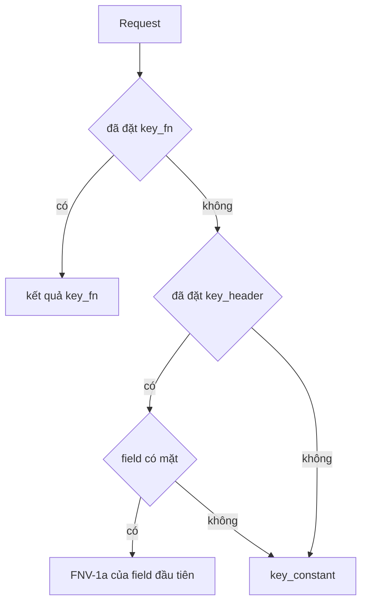

Một rate limiter chỉ tốt bằng key của nó. µWebZockets trừ token từ các token
bucket do caller sở hữu, và đường header mặc định tin đúng giá trị nằm trong
header đó.
Trang này trình bày trust boundary, hành vi eviction và quyết định sizing. Phần
API nằm ở [Rate limiting HTTP](/docs/http/rate-limiting).

## Dẫn xuất key

`RateLimitOptions` phân giải key theo thứ tự cố định:



| Nguồn          | Kiểu              | Thứ tự ưu tiên | Ghi chú                                       |
| -------------- | ----------------- | -------------- | --------------------------------------------- |
| `key_fn`       | `?RateLimitKeyFn` | Đầu tiên       | Dùng đúng giá trị trả về, kể cả `0`           |
| `key_header`   | `?[]const u8`     | Thứ hai        | Hash bằng FNV-1a; thiếu field thì fallback    |
| `key_constant` | `u64`             | Cuối cùng      | Một budget chung cho mọi request không có key |

`key_header` chỉ an toàn khi một lớp đáng tin ghi giá trị đó. `x-forwarded-for`
từ client không đáng tin, hoặc bất kỳ header nào client tự chọn, cho phép một
client xoay key. Mỗi lần xoay tạo một bucket mới, và bảng đầy sẽ evict bucket cũ
nhất, nên attacker không thể refill budget của chính nó nhưng có thể đẩy client
khác ra khỏi bảng.

Hai chi tiết cần nằm trong ghi chú triển khai:

- Đường header có sẵn đọc field khớp đầu tiên bằng `Request.get_header`. Proxy
  đáng tin phải loại bỏ bản copy do client gửi trước khi forward.
- Hash một credential, ví dụ `Authorization`, biến việc xoay token thành reset
  budget. Hãy key theo identity ổn định do server sinh ra.

Key do server sinh ra qua `key_fn` tránh cả hai vấn đề:

```zig
fn trusted_proxy_key(request: *const uz.Request) u64 {
    const forwarded = request.get_unique_header("x-forwarded-for") orelse return 0;
    return uz.middleware.fnv1a_64(forwarded);
}
```

`get_unique_header` trả `null` khi field bị trùng, nên chuỗi proxy mơ hồ dùng
chung bucket fallback thay vì chọn một giá trị.

## Hành vi token bucket

| Thuộc tính     | Hành vi                                                            |
| -------------- | ------------------------------------------------------------------ |
| Refill         | Liên tục từ `std.Io.Clock.now(.awake)`, không theo cửa sổ cố định  |
| Capacity       | `burst`, hoặc `rate_per_second` với tối thiểu một token khi bằng 0 |
| Thời gian idle | Không được tích; token bị clamp về capacity ở mỗi bước             |
| Key mới        | Bucket đầy ở slot trống, 0 token sau khi bị evict                  |
| Rate bằng 0    | Không refill, nên middleware bỏ `Retry-After`                      |
| Core test được | `rate_limit_step` là hàm thuần của rate, burst, token và thời gian |

Refill liên tục nghĩa là sau một burst, limiter không tặng thêm burst thứ hai tại
ranh giới cửa sổ. Đánh đổi là client bị từ chối chờ một token, không chờ một lần
reset.

## Bảng cố định và eviction

`rate_limit_indexed` dựng một open-addressed index và một LRU intrusive trên các
array do caller sở hữu:

| Array     | Ràng buộc                      | Lỗi                          |
| --------- | ------------------------------ | ---------------------------- |
| `buckets` | Một slot cho mỗi key phân biệt | Bảng rỗng trả `429`          |
| `slots`   | Ít nhất `2 * buckets.len`      | `error.InvalidIndexCapacity` |
| `links`   | Đúng bằng `buckets.len`        | `error.InvalidIndexCapacity` |

Một hit và một insert vào slot trống đều là O(1) expected. Một miss khi bảng đầy
evict head của LRU, tức bucket lâu nhất chưa được bảng dùng tới; các bucket có
cùng thời điểm dùng giữ bucket index thấp hơn trước. Key bị evict bắt đầu với 0
token, nên nó không thể reset budget bằng cách churn bảng. Slot trống bắt đầu đầy,
nên việc bảng tăng kích thước bình thường không trừng phạt client mới.

Tombstone kích hoạt rebuild khi vượt một phần tư `slots`, giữ probe chain ngắn.
Rebuild bảo toàn thứ tự LRU.

## Các trường hợp fail closed

| Điều kiện                       | Kết quả                                              |
| ------------------------------- | ---------------------------------------------------- |
| Array bucket rỗng               | `429` cho mọi request                                |
| Table lookup không trả slot     | `429`                                                |
| Hết token                       | `429` kèm `Retry-After` khi rate khác 0              |
| `rate_per_second` bằng 0        | Không refill và không có field `Retry-After`         |
| Key trùng trong bảng pre-seeded | `error.DuplicateRateLimitKey` từ indexed constructor |

Bảng rỗng là trạng thái fail closed có chủ đích, không phải chế độ "tắt". Nếu
không muốn giới hạn, đừng đăng ký middleware.

## Sizing

| Quyết định      | Hướng dẫn                                                                                  |
| --------------- | ------------------------------------------------------------------------------------------ |
| `buckets.len`   | Số key phân biệt active mỗi worker, cộng headroom cho churn                                |
| `slots.len`     | Ít nhất gấp đôi số bucket; tỉ lệ này giữ load factor ở 0.5                                 |
| `links.len`     | Bằng số bucket; không có giá trị mặc định                                                  |
| `burst`         | Dung sai ngắn hạn; 0 sẽ suy ra từ rate với tối thiểu một token                             |
| `rate`          | Tốc độ duy trì cho mỗi key; 0 tắt refill                                                   |
| Churn đối kháng | Size cho nhiều key hơn đỉnh lưu lượng thật, nếu không client xoay key sẽ đẩy người khác ra |

Bảng lưu key, không lưu identity. Một key đổi theo từng request sẽ tiêu một slot
ở mỗi miss. Hãy size bảng cho đỉnh số key phân biệt mà bạn sẵn sàng theo dõi, và
giữ `key_fn` ổn định.

## Theo worker

Một bảng thuộc về một event loop và là mutable state không có lock. Không chia sẻ
nó giữa các worker.

| Topology     | Tác động                                                                                 |
| ------------ | ---------------------------------------------------------------------------------------- |
| Một worker   | Budget đúng bằng rate đã cấu hình                                                        |
| N worker     | Client chạm N worker có thể tiêu budget per-worker một lần ở mỗi worker                  |
| Cluster mode | Dựng một limiter cho mỗi worker; accounting toàn cục cần external store và độ trễ của nó |
| Restart      | Token state mất; restart cấp một burst mới                                               |

`Retry-After` là một giây cho mọi rate nguyên khác 0, vì độ phân giải của header
là một giây. Rate 0 không bao giờ refill, nên middleware bỏ field này thay vì hứa
một khoảng chờ không tới.

## Tiếp theo

- [Rate limiting HTTP](/docs/http/rate-limiting) mô tả phép tính token bucket và
  các constructor.
- [Xác thực](/docs/security/authentication) quyết định request có được tiêu token
  hay không.
- [Shared-nothing workers](/docs/concepts/shared-nothing) giải thích vì sao không
  thể chia sẻ bảng.
