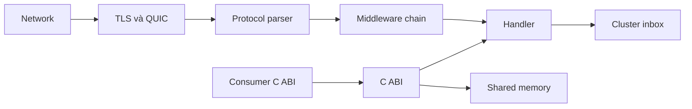

µWebZockets bound input từ network và sở hữu một số protocol boundary. Nó không
phải là một security program. Trang này nêu framework bảo vệ gì, application phải
bảo vệ gì và attacker nào nằm ngoài phạm vi, để một buổi review có thể phản đối
một claim cụ thể thay vì phản đối toàn bộ thiết kế.

## Asset

| Asset                         | Nằm ở                                 | Rủi ro chính                             |
| ----------------------------- | ------------------------------------- | ---------------------------------------- |
| Credential và token           | Application storage và option         | Lộ, replay, brute force                  |
| TLS private key và CA bundle  | File triển khai và context mỗi worker | Giả mạo, peer bị forge                   |
| Nội dung request và response  | Buffer connection dạng borrowed       | Đọc chéo tenant, rò rỉ qua log           |
| Connection và worker capacity | Slab và queue cố định                 | Cạn kiệt, đẩy peer trung thực ra ngoài   |
| Cluster message               | Inbox có bound của từng worker        | Forge, mất message, lạm dụng chéo worker |
| Application state             | Storage do handler sở hữu             | Thay đổi trái phép                       |
| Availability                  | Event loop và tài nguyên OS           | Peer chậm, việc quá lớn                  |

## Trust boundary

| Boundary      | Control của framework                                       | Rủi ro còn lại                                    |
| ------------- | ----------------------------------------------------------- | ------------------------------------------------- |
| Network       | Read có bound, connection capacity, idle và header deadline | Tấn công volume và cạn kiệt OS vẫn ở ngoài        |
| TLS và QUIC   | Chỉ TLS 1.3, ALPN policy, QUIC 0-RTT tắt, chế độ mTLS       | Certificate trust, rotation và CRL enforcement    |
| Parser        | Bound độ dài, từ chối framing, validate control character   | Defect trong parser vẫn có thể xảy ra             |
| Middleware    | So sánh credential, khớp CORS, token bucket                 | Chọn key, threshold và policy                     |
| Handler       | Slice borrowed với vòng đời xác định                        | Logic application, phân quyền và truy cập dữ liệu |
| Cluster inbox | Inbox có bound mỗi worker, publish report                   | Trust giữa worker và ý nghĩa message              |
| C ABI         | Opaque handle, destroy tường minh, lỗi khác 0               | Vòng đời handle và copy slice borrowed            |
| Shared memory | Block cố định, handle có generation, state atomic           | Validate nội dung block ở phía host               |

Mỗi boundary có failure mode khác nhau. Input quá lớn trả `431` hoặc `413`; input
sai định dạng trả `400` hoặc connection bị đóng; early data không an toàn trả `425
Too Early`. Lỗi capacity là connection bị từ chối hoặc startup error, còn defect
trong handler là hành vi application mà framework không thấy được.

## Khả năng của attacker

| Attacker                              | Khả năng                                     | Control phải giữ                               |
| ------------------------------------- | -------------------------------------------- | ---------------------------------------------- |
| Client chưa xác thực                  | Byte tùy ý, request chậm, input quá lớn      | Bound parser, deadline, rejection document     |
| Caller đã xác thực, quyền thấp        | Credential hợp lệ và field tùy chọn bị forge | Phân quyền trong handler, đọc field duy nhất   |
| Trang browser ở origin khác           | Cookie trong handshake, đọc cross-origin     | Allow list origin, CORS, `Vary: Origin`        |
| Observer trên đường truyền, không TLS | Đọc và sửa plaintext                         | TLS 1.3, HSTS, không dùng credential cleartext |
| Peer dùng chung một QUIC connection   | Stream sai dạng bên cạnh stream lành mạnh    | `H3_MESSAGE_ERROR` theo stream, header limit   |
| Process cục bộ có shared memory       | Đọc và ghi block đã map                      | Validate phía host, handle có generation       |
| Operator có quyền triển khai          | Đọc file, đổi cấu hình, đọc log              | Lưu secret, redaction, least privilege         |

Framework giả định attacker kiểm soát byte trên đường truyền và, trong trường hợp
browser, kiểm soát trang mở connection. Nó không giả định attacker kiểm soát
process.

## Non-goal

| Non-goal                                            | Vì sao nằm ngoài                                              |
| --------------------------------------------------- | ------------------------------------------------------------- |
| Web application firewall                            | Ngữ nghĩa payload thuộc application                           |
| Hấp thụ DDoS                                        | Capacity hữu hạn; scrubbing phía trước là lựa chọn triển khai |
| Identity provider                                   | Không có user store, session hay cấp phát token               |
| Secret manager                                      | Credential là giá trị borrowed do caller cung cấp             |
| Thay thế cryptographic review                       | TLS và crypto dependency cần review riêng                     |
| Hardening operating system                          | File permission, limit và sandbox là việc triển khai          |
| Bảo vệ khỏi handler độc hại                         | Handler chạy với quyền của worker                             |
| Bảo vệ khỏi attacker cùng address space             | Process đọc được memory đã có secret                          |
| Bề mặt WebTransport hoặc extension HTTP/3 đang chạy | Module chưa nối vào listener                                  |

Một feature có thể đúng mà vẫn sai control cho một threat. So sánh credential
constant-time không ngăn phishing; khớp CORS chính xác không ngăn native client;
token bucket không ngăn tấn công phân tán với nhiều key.

## Những gì framework không bảo vệ

- Credential yếu hoặc bị dùng lại. Token có độ ngẫu nhiên cao là quyết định của
  application.
- Credential lộ qua log, body lỗi hoặc crash dump.
- Sai sót phân quyền sau khi credential hợp lệ được chấp nhận.
- Dependency bị xâm phạm hoặc build input độc hại.
- Traffic nằm dưới mọi byte limit nhưng vẫn bào mòn thời gian worker.
- Certificate đã bị thu hồi khi CA bundle có CRL; revocation được load nhưng TLS
  layer không enforce.
- Client certificate trên HTTP/3; client authentication chưa nối qua QUIC
  transport.
- HTTP/3 clustering; listener là single-application.

Buffer có bound, sanitizer, fuzzing và bộ compliance protocol là bằng chứng một
lớp defect ít khả năng xảy ra hơn. Chúng không phải chứng minh tính đúng đắn và
không thay thế review workload của bạn.

## Bằng chứng

- [Mô hình bảo mật](/docs/concepts/security-model) ánh xạ cùng các boundary tới
  control đã có.
- [Gia cố input](/docs/security/input-hardening) liệt kê bound parser và quy tắc
  framing.
- [Báo cáo lỗ hổng](/docs/security/reporting) là đường đi cho defect vượt qua một
  boundary.
