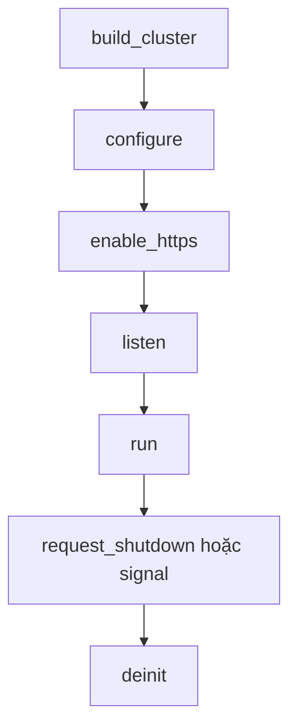

TCP cluster terminate TLS với một BoringSSL context cho mỗi worker. Gọi
`Cluster.enable_https` với PEM file, hoặc `Cluster.enable_https_ephemeral` cho
development cục bộ, sau `configure` và trước `listen`. Không credential,
session-cache, handshake hay ticket state nào được chia sẻ giữa các loop.

## Lifecycle order



Thứ tự được hỗ trợ là `build_cluster` -> `configure` -> `enable_https` (hoặc
`enable_https_ephemeral`) -> `listen` -> `run` -> `request_shutdown` hoặc
shutdown signal -> `deinit`. TLS setup là startup work: `listen` khóa route và
bắt đầu accept, nên call enable không được chuyển xuống sau đó.

## Bật TLS

```zig src/main.zig
const std = @import("std");
const uz = @import("uWebZockets");

fn hello(_: *uz.Request, response: *uz.Response) void {
    response.text("hello from a TLS worker") catch |err| {
        std.log.err("response failed: {}", .{err});
    };
}

pub fn main(init: std.process.Init) !void {
    var cluster = try uz.Server.builder(init.io)
        .with_max_clients(128)
        .build_cluster(std.heap.page_allocator, 4, .{});
    defer cluster.deinit();

    const Group = @TypeOf(cluster);
    try cluster.configure(struct {
        fn routes(worker: *Group.Worker, index: usize) !void {
            _ = index;
            _ = try worker.get("/", hello);
        }
    }.routes);

    try cluster.enable_https("certs/fullchain.pem", "certs/privkey.pem");
    try cluster.listen("0.0.0.0", 8443);
    try cluster.run();
}
```

Số `4` truyền vào `build_cluster` là compiled capacity. Dùng
`build_cluster_from_environment` để resolve `UWEBZOCKETS_WORKERS` hoặc mặc định
theo CPU count của platform; `ClusterOptions.worker_count` chọn số active nhỏ hơn.
Chỉ worker active mới tạo TLS context, slab và thread.

## Một context cho mỗi worker

Mỗi worker tạo và sở hữu một `SSL_CTX` lúc enable, trước khi listener tồn tại.
Mỗi connection được accept tạo `SSL` riêng từ context của worker đó. Certificate
và key file được đọc một lần cho mỗi worker lúc startup. Không lock hay allocation
nào được thêm vào request path, và `Cluster.deinit` release từng context cùng
worker của nó.

## Cross-worker resumption

Ticket key theo worker nghĩa là resumption cùng worker hoạt động, còn
cross-worker resumption thì không. Reconnect mà kernel đưa sang worker khác phải
trả full handshake. Đây là boundary được chấp nhận cho HTTP workload mục tiêu,
không phải defect, và được ghi trong
[ADR 0003](https://github.com/farbenbuilds/uWebZockets/blob/main/docs/adr/0003-tls-cluster-operational-boundaries.md).
Chia sẻ ticket key sẽ cần cross-loop key manager, rotation policy và chi phí
TLS-state được đo.

## Rolling restart

Rotate credential cần rolling restart vì mỗi worker đọc PEM file một lần lúc
enable. Điều này áp dụng cho cả PEM production và certificate generate. Không có
hot reload. Xem [Rotate certificate](/docs/security/certificate-rotation) để biết
quy trình.

## Error

| Error                         | Nguyên nhân                                         |
| ----------------------------- | --------------------------------------------------- |
| `ClusterDeinitialized`        | Gọi lifecycle-sensitive call sau `deinit`           |
| `ClusterRunning`              | Gọi configuration trong lúc `run` đang active       |
| `ClusterStopped`              | Gọi sau khi `run` đã trả về                         |
| `AlreadyListening`            | Gọi `enable_https` sau khi `listen` đã bắt đầu      |
| `TlsAlreadyEnabled`           | Gọi `enable_https` nhiều hơn một lần                |
| `CertificateLoadFailed`       | Không đọc hoặc parse được PEM chain                 |
| `PrivateKeyLoadFailed`        | Không đọc hoặc parse được PEM key                   |
| `KeyMismatch`                 | Check phòng vệ; BoringSSL từ chối key ngay lúc load |
| `TlsContextCreationFailed`    | BoringSSL không allocate được context               |
| `ProtocolConfigurationFailed` | Không áp được TLS 1.3 bound                         |
| `ApplicationUnavailable`      | Một worker đang shutdown hoặc đã deinit             |

Credential load hoặc context creation fail sẽ release đúng những context mà call
đó tạo và có thể retry sau khi sửa nguyên nhân. Nó không ghi đè hay release
context đã được cài bởi call thành công trước đó.

## Ranh giới

- `enable_https` không cấu hình client certificate. Dùng
  `init_https_mtls` của single application khi cần mTLS.
- `enable_https_ephemeral` generate một self-signed certificate riêng cho mỗi
  worker, không nhận tên tùy chỉnh và chỉ dành cho development. Vì mỗi worker
  trình certificate khác nhau, nó không phù hợp cho certificate pinning.
- HTTP/3 và QUIC clustering không được hỗ trợ. `init_http3` và `listen_udp` vẫn
  là API single-application, còn cluster listener chỉ TCP/TLS.
- Cluster TLS giữ policy của single application: chỉ TLS 1.3, ALPN `h2` rồi
  `http/1.1`, và 0-RTT cho safe method với early data không an toàn nhận
  `425 Too Early`.

## Verify

```sh
zig build run
curl -sk https://127.0.0.1:8443/
```

Với PEM file trong ví dụ, response body là `hello from a TLS worker`. Dùng
`curl -v` khi certificate được tin, hoặc `-k` khi test với cặp self-signed. Muốn
thử đường generate, thay call enable bằng `enable_https_ephemeral` rồi restart
group.

## Liên quan

- [Rotate certificate](/docs/security/certificate-rotation) trình bày rolling
  restart thay credential theo worker.
- [Shared-nothing workers](/docs/concepts/shared-nothing) giải thích vì sao mỗi
  worker sở hữu một TLS context.
- [Cluster đầu tiên](/docs/examples/first-cluster) khởi động plaintext worker
  group mà trang này mở rộng.
