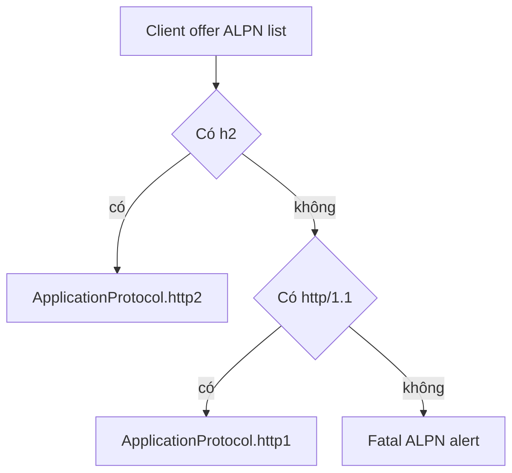

µWebZockets terminate TLS bằng BoringSSL. Mọi HTTPS context chỉ dùng TLS 1.3 và
chọn application protocol qua ALPN. HTTP/3 dùng một context riêng quảng bá `h3`,
nên handshake TCP không bao giờ chọn protocol này.

## Protocol policy

| Thuộc tính            | Giá trị                                                  |
| --------------------- | -------------------------------------------------------- |
| TLS version           | Chỉ 1.3; version cũ bị từ chối ngay tại context          |
| ALPN ưu tiên trên TCP | `h2`, rồi `http/1.1`                                     |
| ALPN cho QUIC         | Chỉ `h3`                                                 |
| Fallback TLS 1.2      | Không có                                                 |
| TCP 0-RTT             | Bật trừ khi client authentication được yêu cầu           |
| QUIC 0-RTT            | Tắt cho tới khi lsquic replay policy được nối end to end |

Min và max protocol version đều được đặt thành TLS 1.3 lúc tạo context. Client
chỉ offer TLS 1.2 sẽ fail handshake thay vì thương lượng version yếu hơn.

## Context entry point

| Entry point                                         | ALPN             | Early data            |
| --------------------------------------------------- | ---------------- | --------------------- |
| `TlsContext.init(cert_path, key_path)`              | `h2`, `http/1.1` | 0-RTT cho safe method |
| `TlsContext.init_mtls(cert_path, key_path, config)` | `h2`, `http/1.1` | Tắt trừ `.none`       |
| `TlsContext.init_http3(cert_path, key_path)`        | `h3`             | Tắt                   |
| `TlsContext.init_ephemeral(names)`                  | `h2`, `http/1.1` | 0-RTT cho safe method |
| `TlsContext.init_http3_ephemeral(names)`            | `h3`             | Tắt                   |

Các wrapper ở tầng application là `App.init_https`, `App.init_https_mtls`,
`App.init_http3`, `App.init_https_ephemeral` và `App.init_http3_ephemeral`. Chúng
tạo đúng các context trên và gắn vào server. `init_http3` tạo hai context: một
cho TCP và một cho QUIC, cùng load từ bộ PEM file.

## Chọn ALPN

`ApplicationProtocol` có ba giá trị: `.http2`, `.http1` và `.none`.

- `select_http_protocol(offered)` đọc danh sách ALPN ở wire format và trả
  `.http2` khi có `h2`, ngược lại `.http1` khi có `http/1.1`, còn lại `null`.
  Input length-prefix sai cũng trả `null`.
- `negotiated_protocol(ssl)` đọc giá trị BoringSSL đã chọn sau handshake và trả
  `.none` khi không có protocol nào.

Callback phía server fail handshake bằng fatal alert khi client không offer tên
nào trong hai tên trên. `select_http_protocol` báo cùng trường hợp không match
đó là `null` khi bạn gọi helper trực tiếp.

## Không có fallback TLS 1.2

Không có switch cấu hình cho version cũ. Handshake không thống nhất được TLS 1.3
sẽ fail, và failure là protocol error chứ không phải downgrade. Điều này khớp với
baseline deployment: client hiện đại, một protocol floor và không có bề mặt
thương lượng cipher cũ.

## Error

| Error                         | Nguyên nhân                                        |
| ----------------------------- | -------------------------------------------------- |
| `CertificateLoadFailed`       | Không đọc hoặc parse được PEM chain                |
| `PrivateKeyLoadFailed`        | Không đọc hoặc parse được PEM key                  |
| `KeyMismatch`                 | Check phòng vệ; key mismatch đã fail ngay lúc load |
| `TlsContextCreationFailed`    | BoringSSL không allocate được context              |
| `ProtocolConfigurationFailed` | Không áp được TLS 1.3 bound                        |
| `InvalidClientAuthConfig`     | Mode client-auth khác `.none` nhưng `ca_path` rỗng |
| `TrustStoreLoadFailed`        | Không đọc hoặc parse được client CA bundle         |

Credential generate thêm các error `Ephemeral*` được liệt kê ở
[Certificate tạm thời](/docs/security/ephemeral-certificates).

## Liên quan

- [Certificate tạm thời](/docs/security/ephemeral-certificates) trình bày đường
  in-memory và nội dung certificate được generate.
- [Certificate production](/docs/security/production-certificates) trình bày PEM
  loading và startup checklist.
- [Protocol negotiation](/docs/concepts/protocol-negotiation) đặt ALPN cạnh
  plaintext HTTP/2 preface.
