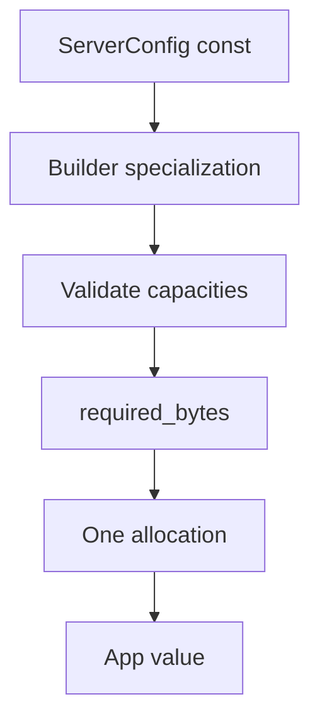

Capacity không phải setting áp lên server đang chạy. Chúng quyết định kích thước type application
được sinh ra: connection pool, request buffer, write queue, WebSocket message
region, router table và protocol session. Compiler evaluate plan, và startup thực
hiện một allocation cho toàn bộ slab.

## Constructor application

| Constructor                                               | Capacity được cố định                                  |
| --------------------------------------------------------- | ------------------------------------------------------ |
| `uz.App(N)`                                               | `N` connection, WebSocket message 16 KiB, queue 64 KiB |
| `uz.ConfiguredApp(N, message, queue)`                     | Connection, WebSocket message, write queue             |
| `uz.ConfiguredAppWithTimeout(N, message, queue, timeout)` | Ba giá trị trên cộng idle timeout                      |
| `uz.Server.builder(io)`                                   | `ServerConfig` compile-time resolve thành một slab     |
| `uz.Server.preset(io, config)`                            | Như trên, bắt đầu từ named preset                      |

Ba form đầu trả một type. `Server` builder trả value factory specialize type từ
configuration của nó.

## Giá trị hợp lệ và không hợp lệ

| Code                                                        | Kết quả       |
| ----------------------------------------------------------- | ------------- |
| `uz.App(128)`                                               | Compile       |
| `const connections = 128; uz.App(connections)`              | Compile       |
| `var connections: usize = 128; uz.App(connections)`         | Compile error |
| `.with_max_body_size(256 * 1024)`                           | Compile       |
| `var body: usize = 256 * 1024; .with_max_body_size(body)`   | Compile error |
| `const config = uz.ServerConfig{ .max_connections = 256 };` | Compile       |

Argument phải biết lúc compile. Value load từ file, environment variable hoặc
command line không thể chọn kích thước type. Nếu capacity phải chọn lúc startup, compile
maximum và enforce operational limit nhỏ hơn riêng.

## Giá trị mặc định của ServerConfig

| Field                   |  Default | Builder method               |
| ----------------------- | -------: | ---------------------------- |
| `max_connections`       |   `1024` | `with_max_clients`           |
| `max_ws_message_size`   | `16 KiB` | `with_max_ws_message_size`   |
| `write_queue_size`      | `64 KiB` | `with_write_queue_size`      |
| `max_body_size`         | `16 KiB` | `with_max_body_size`         |
| `max_request_line_size` |  `8 KiB` | `with_max_request_line_size` |
| `max_header_size`       | `16 KiB` | `with_max_header_size`       |
| `max_header_count`      |     `64` | `with_max_header_count`      |
| `max_route_nodes`       |    `256` | `with_max_route_nodes`       |
| `max_pattern_routes`    |     `64` | `with_max_pattern_routes`    |
| `max_middleware`        |     `32` | `with_max_middleware`        |
| `idle_timeout_ms`       | `120000` | `with_idle_timeout_ms`       |

Danh sách field đầy đủ nằm ở [HTTP limits](/docs/http/limits), trang trình bày các
transport limit dùng chung các field này.

## Tính toán một slab

```zig
const std = @import("std");
const uz = @import("uWebZockets");

pub fn main(init: std.process.Init) !void {
    const planned = uz.Server.builder(init.io)
        .preset(uz.Presets.microservice)
        .with_max_body_size(256 * 1024);

    const bytes = try planned.slab_bytes();
    std.log.info("slab bytes: {d}", .{bytes});

    var server = try planned.build(std.heap.page_allocator);
    defer server.deinit();

    try server.listen("0.0.0.0", 3000);
    try server.run();
}
```

`slab_bytes()` dùng cùng plan với `build`, nên kích thước báo cáo và kích thước allocate không
thể drift. `build` thực hiện đúng một allocation cho slab.



## Preset

| Preset                   | Connection | WebSocket message | Write queue | Request body |
| ------------------------ | ---------: | ----------------: | ----------: | -----------: |
| `Presets.microservice`   |        256 |             8 KiB |      16 KiB |       64 KiB |
| `Presets.websocket_chat` |        512 |            32 KiB |      32 KiB |        4 KiB |
| `Presets.file_server`    |        128 |             4 KiB |     512 KiB |        8 KiB |

Preset là `const ServerConfig`. Derive từ nó bằng `with_*`; mỗi call trả một
compile-time configuration mới.

## Theo worker

Cluster tạo một slab cho mỗi worker. Capacity trong `ServerConfig` là theo worker,
không phải cho toàn process:

| Deployment           | Số slab             | Connection capacity            |
| -------------------- | ------------------- | ------------------------------ |
| Single app           | 1                   | `max_connections`              |
| Bốn worker           | 4                   | `4 * max_connections`          |
| Runtime worker count | Capacity đã compile | Active worker mỗi cái một slab |

Xem [Cluster model](/docs/concepts/cluster-model) cho shared-nothing rule.

## Vì sao runtime configuration bị từ chối

Runtime value sẽ đổi kích thước array nhúng trong application type. Điều đó đòi
hỏi hoặc dynamic allocation trên request path, hoặc một generic instantiation thứ
hai cho mỗi giá trị khả dĩ. Cả hai đi ngược thiết kế fixed-slab. Framework chọn
compile-time type và một startup allocation.

## Tiếp theo

- [Error sets và failure](/docs/type-safety/error-sets) map validation error mà các
  capacity này trả về.
- [Capacity model](/docs/concepts/capacity-model) giải thích slab layout.
- [HTTP limits](/docs/http/limits) liệt kê per-request bound.
