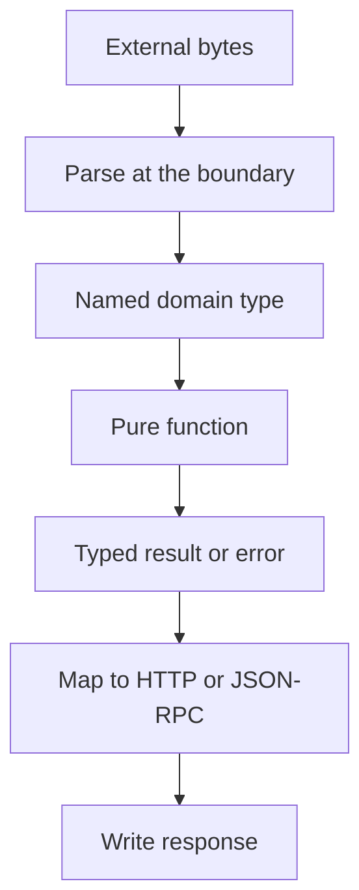

Framework cung cấp type; application vẫn quyết định boundary có trung thực không.
Các rule này giữ service nhỏ, tường minh và test được. Chúng áp dụng cho Zig
consumer, không phải build của framework.

## Quy tắc

| Rule                                                | Lý do                                                         |
| --------------------------------------------------- | ------------------------------------------------------------- |
| Chọn capacity lúc compile                           | Chúng quyết định kích thước type được sinh ra và startup slab |
| Đặt tên cho mọi parameter và result type            | Inline anonymous struct che contract                          |
| Truyền state qua explicit context                   | Hidden global không scope được cho một worker                 |
| Một owner cho một event loop                        | Service, client và response buffer không synchronized         |
| Allocator phải tường minh                           | Request path không có ambient allocator                       |
| Giải phóng `Parsed(T)` đúng một lần                 | Parsed value sở hữu allocation lồng nhau                      |
| Map error tại boundary                              | Domain function không nên chọn HTTP status                    |
| Giữ `Aborted` riêng                                 | Peer đã mất không phải internal failure                       |
| Chỉ dùng `anytype` khi contract thật sự polymorphic | Signature quá rộng che mất type contract                      |
| Test pure logic không cần socket                    | Nhanh và chính xác hơn end-to-end test                        |
| Coi JSON-RPC HTTP 200 là protocol result            | Member error quyết định thành công, không phải status         |

## Boundary



Parsing, domain logic và presentation là các bước riêng. Handler vừa parse, query,
format HTML và chọn status trong một function là bốn module giả làm một.

## Ưu tiên named type

```zig
const UserId = struct {
    value: u64,
};

const User = struct {
    id: UserId,
    name: []const u8,
};

fn label(user: User) []const u8 {
    _ = user.id;
    return user.name;
}
```

`UserId` có tên ngăn truyền nhầm session id hoặc account id. Inline
`struct { value: u64 }` tại mỗi call site thì không.

## Tránh forwarding wrapper

| Anti-pattern                                        | Vấn đề                                          |
| --------------------------------------------------- | ----------------------------------------------- |
| Wrapper `fn json(comptime T: type, value: anytype)` | Thêm layer nhưng không thêm bound hay invariant |
| Runtime registry của handler                        | Sao chép router và che signature                |
| Global `var service: Service` cho mọi worker        | Race trên response buffer                       |
| `catch {}` khi ghi response                         | Che response bị truncate                        |
| Lưu `req.text()` vào struct field                   | Borrowed slice chết cùng handler                |
| Trả HTTP 500 cho `Aborted`                          | Báo failure mà peer không nhận được             |
| Nâng `ServerConfig` từ runtime value                | Type không thể chọn kích thước sau compile      |

Một lớp indirection là đủ, và nó phải thêm bound, invariant hoặc type guarantee.

## Checklist capacity

- Mọi `App` hoặc `ServerConfig` có dùng compile-time constant không?
- `max_body_size` có ít nhất bằng JSON document lớn nhất được chấp nhận không?
- `max_connections` có bao phủ số worker và load-balancer fan-in không?
- JSON-RPC response buffer có lớn hơn result lớn nhất không?
- Write queue có chứa fixed response lớn nhất không?
- Cluster có tạo một service cho mỗi worker không?

## Checklist ownership

- Mọi `Parsed(T)` có được giải phóng bằng `deinit` không?
- Có value nào sống lâu hơn callback đã mượn nó không?
- Service value có ở địa chỉ ổn định sau `app.rpc` không?
- Client value có ở địa chỉ ổn định sau `init` không?
- Mọi callback có complete trên event loop sở hữu không?
- Async token có được copy trước khi callback trả về không?

## Checklist lỗi

- Mỗi handler có map domain error thành một status không?
- `OutOfMemory` có tách khỏi parse failure không?
- `Aborted` có được propagate không?
- JSON-RPC procedure có dùng `Call.fail` cho application code không?
- Test có assert error object chính xác, không chỉ HTTP status không?
- Load test có inspect body, không chỉ response 200 không?

## Checklist test

- Domain function có gọi được mà không cần server không?
- Dispatcher test có bao phủ call hợp lệ, notification và batch không?
- Schema test có bao phủ happy path và một rule bị từ chối không?
- Client test có bao phủ một failure kind và một fetch thành công không?
- Cluster test có chạm mọi worker không?

## Tiếp theo

- [Typed handlers](/docs/type-safety/handlers) áp dụng callback rule.
- [Error sets và failure](/docs/type-safety/error-sets) map failure.
- [Testing một JSON-RPC service](/docs/json-rpc/testing) biến checklist thành test.
