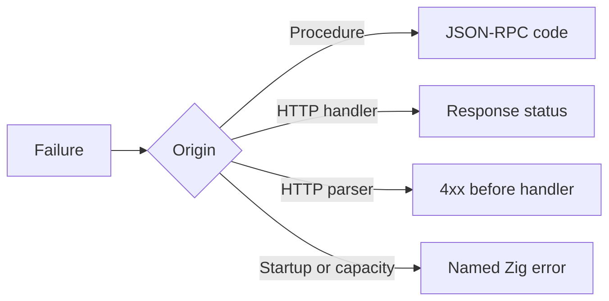

µWebZockets báo failure qua Zig error set, không phải status code ẩn trong response
object. Error name nói điều gì fail, và boundary quyết định cách trình bày: HTTP
status trong route, JSON-RPC code trong procedure, hoặc startup failure trước khi
listener bind.

## Các error set public

| Error set                       | Member                                                                                                                   | Boundary        |
| ------------------------------- | ------------------------------------------------------------------------------------------------------------------------ | --------------- |
| `uz.json_rpc.HandlerError`      | `Aborted`, `ApplicationError`, `InternalError`, `InvalidParams`, `OutOfMemory`, `ResultAlreadyWritten`, `ResultTooLarge` | Procedure       |
| `uz.json_rpc.RegistrationError` | `DuplicateProcedure`, `InvalidMethodName`, `MethodStorageCapacityReached`, `ProcedureCapacityReached`, `RegistryLocked`  | Startup         |
| `uz.json_rpc.DispatchError`     | `Aborted`, `ResponseTooLarge`                                                                                            | Dispatch        |
| Schema validation               | `MalformedJson`, `ConstraintViolation`, `SchemaMustBeStruct`, `OutOfMemory`                                              | Request decode  |
| `uz.cluster.MessageError`       | `EmptyTopic`, `TopicTooLong`, `ClusterMessageTooLarge`                                                                   | Cluster publish |
| `uz.cluster.QueueError`         | Message error cộng `ClusterQueueFull`                                                                                    | Cluster inbox   |
| `uz.cluster.PublishError`       | Message error cộng lifecycle rejection                                                                                   | Cluster publish |
| `uz.cluster.RunError`           | Lifecycle, spawn, `InvalidWorkerCount` và `ClusterWorkerFailed`                                                          | Cluster run     |

Route registration, response write và client call dùng inferred error set. Đọc
method signature cho tên chính xác; không giả định một global error type duy nhất.

## Map lỗi



| Failure                               | Trình bày                                |
| ------------------------------------- | ---------------------------------------- |
| `HandlerError.InvalidParams`          | `-32602 Invalid params`                  |
| `HandlerError.ApplicationError`       | Code và message từ `Call.fail`           |
| `HandlerError.Aborted`                | Không response; không chuyển thành fault |
| `HandlerError.ResultTooLarge`         | `-32603 Internal error` khi vừa          |
| `RegistrationError.*`                 | Startup failure; log rồi exit            |
| `DispatchError.ResponseTooLarge`      | HTTP `500`; document không thể hoàn tất  |
| `ConstraintViolation`                 | `422 Unprocessable Entity` trong ví dụ   |
| `MalformedJson`                       | `400 Bad Request` trong ví dụ            |
| `WouldBlock`                          | Backpressure; retry sau khi drain        |
| `ResponseAlreadyStarted`              | Programming error; không write hai lần   |
| `InvalidStatus` hoặc `InvalidHeaders` | Programming error; sửa response call     |

HTTP status cho schema failure là lựa chọn của application. Framework không chọn
`400` hay `422` thay bạn.

## Xử lý ở boundary

```zig
fn load(req: *uz.Request, res: *uz.Response) void {
    const parsed = req.json(Query, std.heap.page_allocator) catch |err| switch (err) {
        error.OutOfMemory => {
            res.end_best_effort("500 Internal Server Error", "");
            return;
        },
        else => {
            res.end_best_effort("400 Bad Request", "invalid json");
            return;
        },
    };
    defer parsed.deinit();

    res.text(parsed.value.name) catch |err| {
        std.log.err("response failed: {}", .{err});
    };
}
```

`switch` làm allocation failure tường minh và nhóm mọi parse failure dưới `else`.
Không dùng `catch {}` rỗng; hoặc map error, translate nó, hoặc trả về. Đoạn code là
excerpt; `Query` là parsed request type của bạn.

## Giữ Aborted riêng

`Call.checkpoint()` và `DispatchError.Aborted` nghĩa là peer hoặc request đã mất.
Chuyển nó thành `-32603` hoặc HTTP 500 tạo error sai cho client sẽ không bao giờ
đọc. Để `Aborted` propagate qua dispatcher.

```zig
fn scan(call: *uz.json_rpc.Call) uz.json_rpc.HandlerError!void {
    for (items) |item| {
        try call.checkpoint();
        _ = item;
    }
    try call.result(.{ .done = true });
}
```

## Không mở rộng boundary

`uz.StreamProducer` trả `anyerror!StreamStatus` vì producer có thể trả bất kỳ
transport error nào. Đó là ngoại lệ có chủ đích. Public function ở nơi khác dùng
explicit set để caller quyết định phải làm gì.

| Rule                                    | Lý do                                     |
| --------------------------------------- | ----------------------------------------- |
| Không `anyerror` trong public API mới   | Caller không enumerate được recovery case |
| Không `catch {}` thiếu comment          | Failure biến mất khỏi log và test         |
| Không status code trong domain function | Boundary sở hữu presentation              |
| Không chuyển `Aborted` thành fault      | Peer đã mất                               |
| Không biến capacity error thành success | Truncate âm thầm tệ hơn failure           |

## Tiếp theo

- [Typed RPC](/docs/type-safety/typed-rpc) map `HandlerError` từ đầu đến cuối.
- [JSON-RPC errors](/docs/json-rpc/errors) liệt kê mọi protocol code.
- [Errors và failure mode](/docs/concepts/errors) map HTTP status và retry.
