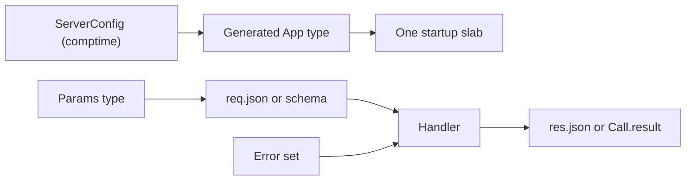

Type safety trong µWebZockets nghĩa là compiler biết shape của application trước
khi listener start. Capacity quyết định kích thước type được sinh ra, route callback có signature
có tên, JSON decode thành kiểu Zig đã khai báo, và failure nằm trong error set
tường minh. Không có runtime type registry và không có reflection-driven
serializer.

Mental model nằm ở [Type safety](/docs/concepts/type-safety). Phần này trình bày từng
boundary theo task order và link về trang đó cho phần model.

## Bắt đầu

<CardGroup cols={2}>
  <Card title="Typed handlers" href="/docs/type-safety/handlers" icon="braces">
    Dùng callback alias, named function và explicit context pointer.
  </Card>
  <Card title="Typed JSON" href="/docs/type-safety/json" icon="file-json">
    Decode request body, render response và giải phóng parsed value đúng một lần.
  </Card>
  <Card title="Schema validation" href="/docs/type-safety/schema-validation" icon="shield-check">
    Khai báo field rule lúc compile và báo constraint bị từ chối đầu tiên.
  </Card>
  <Card title="Typed RPC" href="/docs/type-safety/typed-rpc" icon="network">
    Mang parameter và result type xuyên suốt JSON-RPC procedure.
  </Card>
</CardGroup>

## Capacity và lỗi

<CardGroup cols={2}>
  <Card
    title="Compile-time capacities"
    href="/docs/type-safety/compile-time-capacities"
    icon="ruler"
  >
    Chọn capacity quyết định kích thước type application được sinh ra.
  </Card>
  <Card title="Error sets và failure" href="/docs/type-safety/error-sets" icon="shield-alert">
    Đọc từng public error set và HTTP status hoặc protocol code được map.
  </Card>
  <Card title="C ABI types" href="/docs/type-safety/c-abi-types" icon="file-code">
    Dùng C surface capacity cố định và biết nó không cung cấp gì.
  </Card>
  <Card title="Design rules cho consumer" href="/docs/type-safety/design-rules" icon="list-checks">
    Áp dụng consumer rule để typed boundary không bị drift.
  </Card>
</CardGroup>

## Luồng type

Bên trái được cố định khi chương trình compile. Bên phải là transformation theo
request: parse, validate, xử lý, serialize. Runtime JSON shape error vẫn có thể
xảy ra ở bên phải; type system thu hẹp value sau khi parse, nhưng không thể chứng
minh client bên ngoài gửi đúng document bạn mong đợi.

## Compiler chứng minh gì

| Property                                  | Chứng minh bởi                            |
| ----------------------------------------- | ----------------------------------------- |
| Connection và buffer capacity             | `App(N)`, `ConfiguredApp`, `ServerConfig` |
| Handler nhận đúng route signature         | Callback alias                            |
| JSON decode thành declared type           | `req.json(T, allocator)`                  |
| Schema rule tồn tại cho field đã khai báo | `pub const validation`                    |
| Result khớp procedure contract            | `register_typed(..., Result, handler)`    |
| Failure name đã biết                      | Explicit error set                        |
| C ABI struct layout ổn định               | Frozen header type và versioned enum      |

## Điều nó không chứng minh

| Giới hạn                                 | Xử lý ở đâu                          |
| ---------------------------------------- | ------------------------------------ |
| Client gửi JSON hợp lệ                   | Parse error, rồi `400` hoặc `-32700` |
| String là email hoặc slug có nghĩa       | Application semantic validation      |
| Result vừa response buffer               | Capacity check và error mapping      |
| Procedure an toàn để chia sẻ giữa worker | Một service cho một event loop       |
| C caller truyền đúng handle              | ABI contract và `uwz_error` return   |

## Tiếp theo

Bắt đầu với [Typed handlers](/docs/type-safety/handlers), sau đó đọc
[Typed JSON](/docs/type-safety/json) và
[Schema validation](/docs/type-safety/schema-validation) trước khi thêm JSON-RPC
service.
