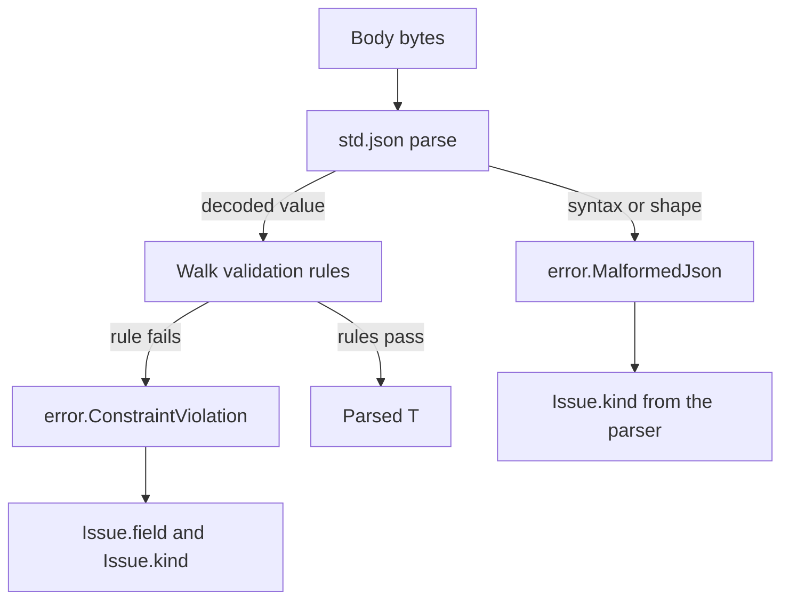

`uz.schema` biến struct declaration thành bước parse-and-check. Type khai báo rule
trong value `pub const validation`, và validator đi qua value đã decode, báo field
bị từ chối đầu tiên. Không có schema string, runtime registry hay reflection
metadata.

## Khai báo rule trên type

```zig
const std = @import("std");
const uz = @import("uWebZockets");

const Role = enum {
    member,
    admin,
};

const CreateUser = struct {
    name: []const u8,
    age: u8,
    role: Role = .member,

    pub const validation = .{
        .name = uz.schema.Rule{ .min_length = 1, .max_length = 64 },
        .age = uz.schema.Rule{ .min = 18, .max = 120 },
        .role = uz.schema.Rule{ .allowed = &.{ "member", "admin" } },
    };
};
```

`validation` là anonymous struct có field name khớp data field và value là
`uz.schema.Rule`. Field không có rule không nhận direct constraint. Struct, array,
slice và optional lồng nhau được đi qua khi element type cũng khai báo
`validation`.

## Quy tắc field

| Field                      | Áp dụng cho                                        |
| -------------------------- | -------------------------------------------------- |
| `min`, `max`               | Integer field                                      |
| `min_float`, `max_float`   | Float field; integer bound bị bỏ qua               |
| `min_length`, `max_length` | String và value `[]u8` hoặc `[]const u8`           |
| `min_items`, `max_items`   | Array và slice không phải `u8`                     |
| `allowed`                  | Enum tag name hoặc whole string value; rỗng là tắt |

`allowed` khớp toàn bộ string, không phải prefix hay substring. Với enum nó so
sánh tag name. List `allowed` rỗng tắt membership check.

## Validate body

```zig
fn create_user(req: *uz.Request, res: *uz.Response) void {
    var issue = uz.schema.Issue{};

    const parsed = uz.schema.validate_json_detailed(
        CreateUser,
        std.heap.page_allocator,
        req.text(),
        &issue,
    ) catch |err| {
        if (err == error.ConstraintViolation) {
            res.end_best_effort("422 Unprocessable Entity", @tagName(issue.kind));
            return;
        }
        if (err == error.MalformedJson) {
            res.end_best_effort("400 Bad Request", @tagName(issue.kind));
            return;
        }
        res.end_best_effort("500 Internal Server Error", "validation failed");
        return;
    };
    defer parsed.deinit();

    var buffer: [256]u8 = undefined;
    res.json_buf(.{ .name = parsed.value.name }, &buffer) catch |err| std.log.err("json response failed: {}", .{err});
}
```

Request như `{"name":"Ada","age":17}` trả `error.ConstraintViolation` với
`issue.field == "age"` và `issue.kind == .below_minimum`.

## Chọn validator

| Function                                                        | Trả về                | Báo                                   |
| --------------------------------------------------------------- | --------------------- | ------------------------------------- |
| `req.validate_json(T, allocator)`                               | `!std.json.Parsed(T)` | Chỉ tên error                         |
| `req.validate_json_detailed(T, allocator, &issue)`              | `!std.json.Parsed(T)` | `Issue` đầu tiên                      |
| `uz.schema.validate(T, value, &issue)`                          | `!void`               | `Issue` đầu tiên trên value đã decode |
| `uz.schema.validate_json(T, allocator, bytes)`                  | `!std.json.Parsed(T)` | Chỉ tên error                         |
| `uz.schema.validate_json_detailed(T, allocator, bytes, &issue)` | `!std.json.Parsed(T)` | `Issue` đầu tiên                      |

Biến thể `req.*` đọc `req.body`. Biến thể trực tiếp nhận byte slice, nên dùng được
trong unit test.

## Các issue kind

| Nhóm  | Kind                                                                                                                                                                                                             |
| ----- | ---------------------------------------------------------------------------------------------------------------------------------------------------------------------------------------------------------------- |
| Parse | `malformed_json`, `syntax_error`, `unexpected_end_of_input`, `unexpected_token`, `invalid_number`, `number_overflow`, `invalid_enum_tag`, `length_mismatch`, `missing_field`, `duplicate_field`, `unknown_field` |
| Rule  | `below_minimum`, `above_maximum`, `too_short`, `too_long`, `too_few_items`, `too_many_items`, `invalid_enum_tag`                                                                                                 |
| Depth | `too_deep`                                                                                                                                                                                                       |

`invalid_enum_tag` có thể đến từ JSON parser hoặc từ rule `allowed`. Dùng
`issue.field` để biết field nào fail. `issue.field` rỗng khi decode fail trước khi
validator tới field có tên.

## Thứ tự validation



Parse chạy trước. Document sai định dạng không bao giờ tới rule. Document decode
được nhưng vi phạm rule trả `ConstraintViolation`, và value đã decode được giải
phóng trước khi error trả về.

## Giới hạn độ sâu

`uz.schema.max_nested_depth` là `4`. Walker bắt đầu ở depth `0` và từ chối node ở
depth `4`, nên nó validate bốn level và fail level thứ năm với `too_deep`. Bound là
runtime value để schema type tự tham chiếu không recurse vô hạn.

Struct phẳng với scalar field dùng một level. Struct field thêm một level,
collection element thêm một level, và optional chỉ thêm một level khi value hiện
diện.

## Giới hạn

| Giới hạn                                 | Xử lý bởi                       |
| ---------------------------------------- | ------------------------------- |
| JSON syntax và shape                     | `std.json` và parser issue kind |
| Field bound đã khai báo                  | `Rule` và `IssueKind`           |
| Semantic rule như email hoặc slug format | Application code                |
| Cross-field rule                         | Application code                |
| Chọn HTTP status                         | Handler, không phải schema      |
| Request body size                        | `ServerConfig.max_body_size`    |

Schema không thể diễn đạt "field B bắt buộc khi field A true" hoặc "string này là
email hợp lệ". Giữ các check đó trong named function sau validation và trả một
issue type của riêng bạn.

`uz.schema.validate` yêu cầu struct type. Non-struct type trả
`error.SchemaMustBeStruct` trước khi rule nào chạy.

## Tiếp theo

- [Typed JSON](/docs/type-safety/json) trình bày parse và response ownership.
- [Typed RPC](/docs/type-safety/typed-rpc) dùng cùng parameter type trong
  JSON-RPC service.
- [Errors và failure mode](/docs/concepts/errors) map failure thành status.
