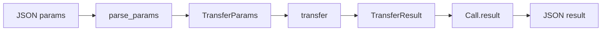

Typed RPC procedure là function bình thường với named parameter type và named
result type. `register_typed` sinh ra bước decode và serialize, nên thân procedure
chỉ thấy Zig value. JSON boundary vẫn tồn tại, nhưng nó là một adapter thay vì
parse tay trong mọi handler.

## Định nghĩa procedure

```zig
const std = @import("std");
const uz = @import("uWebZockets");

const TransferParams = struct {
    account: []const u8,
    amount: u64,
};

const TransferResult = struct {
    accepted: bool,
    balance: u64,
};

fn transfer(params: TransferParams) uz.json_rpc.HandlerError!TransferResult {
    if (params.amount == 0 or params.amount > 100) return error.InvalidParams;
    return .{ .accepted = true, .balance = 100 - params.amount };
}

var rpc = uz.json_rpc.Service{};
try rpc.register_typed("ledger.transfer", TransferParams, TransferResult, transfer);
_ = try app.rpc("/rpc", &rpc);
```

Compiler kiểm tra function signature. Handler trả result type khác hoặc nhận
parameter type khác sẽ không compile.

## Luồng type



Adapter sở hữu bước parse và serialize. Procedure sở hữu business rule. Service sở
hữu response buffer.

## Chọn typed hay raw

| Nhu cầu                               | Registration                  | Decode storage       |
| ------------------------------------- | ----------------------------- | -------------------- |
| Parameter dưới 4 KiB                  | `register_typed`              | 4 KiB stack scratch  |
| Parameter trên 4 KiB                  | `register` với `parse_params` | Allocator của caller |
| State do caller sở hữu                | `register_typed_context`      | 4 KiB stack scratch  |
| Custom wire format hoặc partial parse | `register`                    | Allocator của caller |
| Không có runtime registry             | `comptime_service`            | Compile-time table   |

`register_typed` là mặc định. Chuyển sang `register` khi parameter type có thể vượt
4 KiB hoặc decoder cần policy riêng.

## Map lỗi procedure

| Procedure result           | JSON-RPC response               |
| -------------------------- | ------------------------------- |
| `TransferResult`           | `result` với value đã serialize |
| `error.InvalidParams`      | `-32602 Invalid params`         |
| `Call.fail(code, message)` | `error` với application code    |
| `error.OutOfMemory`        | `-32603 Internal error`         |
| `error.ResultTooLarge`     | `-32603 Internal error` khi vừa |
| `error.Aborted`            | Không response                  |
| `HandlerError` khác        | `-32603 Internal error`         |

Application chọn code range cho `Call.fail`. Dùng `-32000` đến `-32099` cho
server-defined error. Xem [JSON-RPC errors](/docs/json-rpc/errors) cho mapping đầy
đủ.

## Typed context

```zig
const Ledger = struct {
    balance: u64 = 100,
};

fn debit(self: *Ledger, params: TransferParams) uz.json_rpc.HandlerError!TransferResult {
    if (params.amount > self.balance) {
        return error.InvalidParams;
    }
    self.balance -= params.amount;
    return .{ .accepted = true, .balance = self.balance };
}

var ledger = Ledger{};
try rpc.register_typed_context("ledger.debit", &ledger, TransferParams, TransferResult, debit);
```

Context là mutable single-item pointer và phải sống lâu hơn service. Một context
thuộc một procedure; đăng ký cùng pointer cho nhiều procedure để chia sẻ state trên
một event loop.

## Giới hạn runtime

| Giới hạn                          | Kết quả                               |
| --------------------------------- | ------------------------------------- |
| Parameter document trên 4 KiB     | `error.OutOfMemory`, rồi `-32603`     |
| Result trên response buffer       | `error.ResultTooLarge`, rồi `-32603`  |
| Request body trên `max_body_size` | `413 Payload Too Large` trước adapter |
| Method name không hợp lệ          | `error.InvalidMethodName` lúc đăng ký |
| Registry đã seal                  | `error.RegistryLocked` lúc đăng ký    |

Type safety không chứng minh client gửi JSON hợp lệ. Adapter vẫn báo parse failure,
và procedure vẫn quyết định value đã decode có hợp lệ về mặt ngữ nghĩa không.

## Test procedure

Type boundary làm procedure test trực tiếp được:

```zig
test "zero transfer is invalid" {
    try std.testing.expectError(
        error.InvalidParams,
        transfer(.{ .account = "a", .amount = 0 }),
    );
}
```

Test không cần socket, service hay JSON. Test adapter riêng bằng `service.dispatch`
khi wire shape quan trọng.

## Tiếp theo

- [JSON-RPC quickstart](/docs/json-rpc/quickstart) mount service từ đầu đến cuối.
- [Typed procedures](/docs/json-rpc/typed-procedures) trình bày adapter và
  compile-time dispatch.
- [Schema validation](/docs/type-safety/schema-validation) thêm field rule vào
  parameter type.
