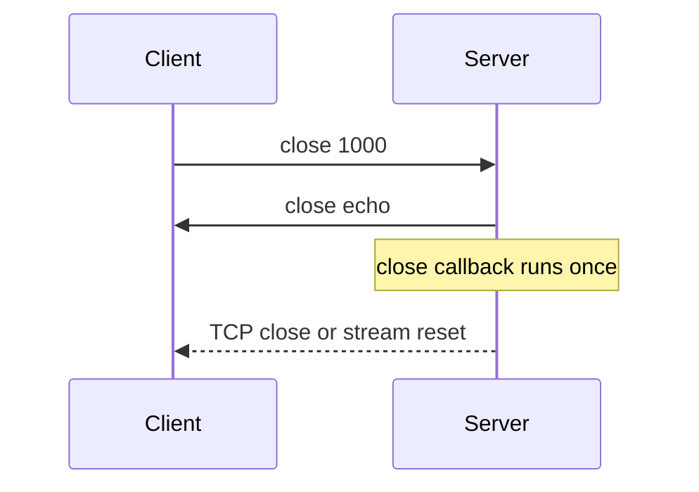

Close frame mang status code hai byte và reason UTF-8 tùy chọn dài tối đa 123
byte. µWebZockets validate code, gửi frame và hoàn tất closing handshake. Trang
này liệt kê các code được phép và khác biệt giữa close êm và `terminate`.

## Gửi close

```zig
try ws.send_close(1000, "done");
```

`send_close`:

1. Trả về mà không gửi khi close frame đã được gửi.
2. Từ chối reason dài hơn 123 byte với `error.ControlFrameTooLarge`.
3. Từ chối code ngoài khoảng được phép với `error.InvalidCloseCode`.
4. Từ chối reason không phải UTF-8 với `error.InvalidUtf8`.
5. Gửi frame, đánh dấu close đã gửi và đóng sau khi queue drain.

Không application message nào được gửi sau `send_close`; `send` trả
`error.ConnectionClosed`.

## Code được phép

| Code        | Tên                | Dùng cho                                    |
| ----------- | ------------------ | ------------------------------------------- |
| `1000`      | Normal             | Mục đích connection đã hoàn tất             |
| `1001`      | Going away         | Server shutdown hoặc peer rời đi            |
| `1002`      | Protocol error     | Frame sai hoặc state không hợp lệ           |
| `1003`      | Unsupported data   | Kiểu dữ liệu endpoint không nhận            |
| `1007`      | Invalid payload    | Text hoặc close reason không phải UTF-8     |
| `1008`      | Policy violation   | Policy application từ chối message          |
| `1009`      | Message too big    | Payload vượt `max_message_size`             |
| `1010`      | Extension required | Chỉ client; server fail handshake thay thế  |
| `1011`      | Internal error     | Server không xử lý được request             |
| `1012`      | Service restart    | Server đang restart                         |
| `1013`      | Try again later    | Quá tải tạm thời                            |
| `1014`      | Bad gateway        | Dependency downstream fail                  |
| `3000-3999` | Registered         | Được IANA đăng ký cho library hoặc protocol |
| `4000-4999` | Private            | Application tự định nghĩa; dùng khoảng này  |

Parser chấp nhận `1000` đến `1003`, `1007` đến `1014` và `3000` đến `4999`. Mọi
giá trị khác là protocol error.

Bốn code không bao giờ hợp lệ trên wire:

| Code   | Vì sao không gửi được                                   |
| ------ | ------------------------------------------------------- |
| `1004` | Reserved                                                |
| `1005` | Nghĩa là "không có status code" và không được xuất hiện |
| `1006` | Nghĩa là "connection đóng bất thường" và không có frame |
| `1015` | Nghĩa là "TLS handshake fail" và không có frame         |

`1005` và `1006` mô tả quan sát cục bộ. Không cố gửi chúng; bỏ payload khi cần
close frame không có code.

## Nhận close

Khi peer gửi close frame hợp lệ:



1. Payload được validate. Code sai gửi `1002`; UTF-8 sai gửi `1007`.
2. Nếu server chưa gửi close, nó echo payload của peer.
3. Callback `close` chạy đúng một lần.
4. HTTP/1.1 đóng connection sau khi frame trong queue drain. Tunnel HTTP/2 reset
   stream của nó.

Callback `close` cũng chạy sau parser failure và sau `terminate`. Nó không bao giờ
chạy hai lần cho một socket.

## Terminate ngay

```zig
ws.terminate();
```

`terminate` đóng transport mà không gửi close frame. Đây là lựa chọn đúng cho peer
đã vi phạm protocol, cho state application không thể phục hồi và cho shutdown path
mà chờ frame trong queue sẽ trì hoãn process.

| Lệnh                    | Gửi close frame | Chờ queue | Chạy `close` |
| ----------------------- | --------------- | --------- | ------------ |
| `send_close`            | Có              | Có        | Có           |
| `send(payload, .close)` | Có              | Có        | Có           |
| `terminate`             | Không           | Không     | Có           |
| Peer close              | Echo khi cần    | Có        | Có           |

Ưu tiên `send_close` khi application chủ động kết thúc. Dành `terminate` cho
failure và shutdown cưỡng bức.

## Chọn application code

Dùng `1000` cho session hoàn tất và `1008` cho policy refusal mà peer phân biệt
được với frame sai. Dùng code trong `4000-4999` khi client cần rẽ nhánh theo lý do
mà không parse text.

```zig
const quota_exceeded = 4001;

fn on_message(ws: *uz.WebSocket, message: []const u8, _: uz.Opcode) void {
    if (message.len > quota) {
        ws.send_close(quota_exceeded, "quota exceeded") catch ws.terminate();
        return;
    }
    handle(ws, message);
}
```

Giữ reason ngắn và không chứa secret. Browser đưa code và reason cho JavaScript
của page, nên coi cả hai là công khai.

## Thứ tự shutdown

Khi graceful shutdown, ngừng nhận connection mới trước, rồi đóng socket active.
Worker đang dừng không thể flush, nên gửi close trước khi request shutdown; nếu
không peer thấy connection rơi.

Cho trình tự cấp process, xem
[response lifecycle](/docs/concepts/response-lifecycle) và cluster model tại
[shared-nothing workers](/docs/concepts/shared-nothing).

## Kiểm tra

```console
$ npx wscat -c ws://127.0.0.1:3000/echo
Connected (press CTRL+C to quit)
> hello
< hello
> ^C
```

Đóng `wscat` gửi `1000` và server log một close. Để test server close, gọi
`send_close` từ một timer route và xác nhận client thoát với code `1000` và reason
của bạn.

## Tiếp theo

- [Heartbeat và peer im lặng](/docs/websocket/heartbeats) cho timeout terminate
  không gửi close frame.
- [WebSocket limits](/docs/websocket/limits) cho giới hạn size đứng sau `1009`.
