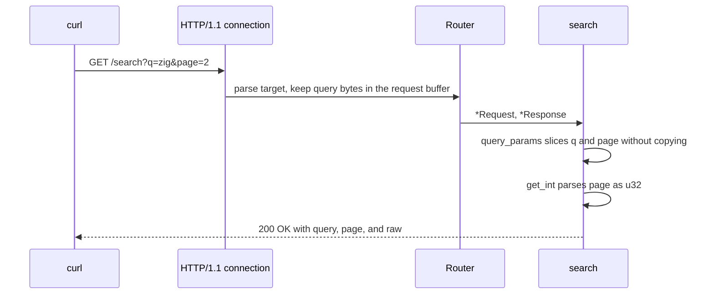

Ví dụ này là một JSON service nhỏ dựng từ `Presets.microservice`. Nó đăng ký
`GET /health`, `POST /echo` và `GET /search`, rồi listen trên port 3000. Preset
chọn 256 connection, request body 64 KiB, và write queue cùng WebSocket storage
nhỏ hơn cấu hình mặc định. Chương trình là `examples/basic_microservice.zig`
trong framework repository.

## Source [#source]

```zig src/main.zig
//! Microservice preset: small JSON payloads with a bounded connection pool.
//!
//! Build and run:
//!   zig build basic_microservice -Doptimize=ReleaseSafe
//!   curl -s http://127.0.0.1:3000/health
//!   curl -s -X POST http://127.0.0.1:3000/echo -d '{"ping":true}'
//!   curl -s 'http://127.0.0.1:3000/search?q=zig&page=2'

const std = @import("std");
const uz = @import("uWebZockets");

fn health(_: *uz.Request, res: *uz.Response) void {
    var scratch: [128]u8 = undefined;
    res.json_buf(.{ .status = "ok", .preset = "microservice" }, &scratch) catch {};
}

fn echo(req: *uz.Request, res: *uz.Response) void {
    // Request bodies borrow the connection buffer for this callback only.
    res.bytes(req.bytes()) catch {};
}

fn search(req: *uz.Request, res: *uz.Response) void {
    // Routes match on the path only; query pairs are sliced zero-copy.
    const params = req.query_params() catch {
        res.end("400 Bad Request", "invalid query") catch {};
        return;
    };
    const page = params.get_int(u32, "page") catch {
        res.end("400 Bad Request", "page must be a non-negative integer") catch {};
        return;
    };

    var scratch: [192]u8 = undefined;
    res.json_buf(.{
        .query = params.get("q") orelse "",
        .page = page orelse 1,
        .raw = params.get("page") orelse "",
    }, &scratch) catch {};
}

pub fn main(init: std.process.Init) !void {
    var server = try uz.Server.builder(init.io)
        .preset(uz.Presets.microservice)
        .with_max_clients(256)
        .build(std.heap.page_allocator);
    defer server.deinit();

    _ = try server.get("/health", health);
    _ = try server.post("/echo", echo);
    _ = try server.get("/search", search);

    try server.listen("0.0.0.0", 3000);
    try server.run();
}
```

[Full source](https://github.com/farbenbuilds/uWebZockets/blob/v2.1.6/examples/basic_microservice.zig)

`health` format một JSON object cố định vào stack buffer 128 byte. `echo` trả
request body đang borrow dưới dạng `application/octet-stream`. `search` parse
query string không copy và format JSON object vào 192 byte. Không handler nào
allocate.

## Build wiring [#build-wiring]

Sao chép chương trình vào `src/main.zig` của project import package. Dependency
fetch và module `build.zig` dùng chung cho mọi example:

```sh
zig fetch --save 'https://github.com/farbenbuilds/uWebZockets/archive/refs/tags/v2.1.6.tar.gz'
```

Làm theo [Run an example in your project](/examples#run-an-example-in-your-project)
để lấy block `build.zig` và bước `run`. Build thêm module import `uWebZockets`
và không cần framework checkout.

Dòng `zig build basic_microservice` trong module header là bước trong framework
checkout. Lệnh đó là contributor shortcut, không phải application path.

## Run [#run]

```sh
zig build run
```

Process bind `0.0.0.0:3000` và block trong `server.run()`. Chương trình không
gọi `catch_shutdown_signals`, nên Ctrl+C kết thúc process mà không qua graceful
drain path. Thêm `try server.catch_shutdown_signals();` trước `listen` khi các
request đang xử lý cần hoàn tất sạch.

## Verify [#verify]

```sh
curl -s http://127.0.0.1:3000/health
```

```console
{"status":"ok","preset":"microservice"}
```

```sh
curl -s -X POST http://127.0.0.1:3000/echo -d '{"ping":true}'
```

```console
{"ping":true}
```

```sh
curl -s 'http://127.0.0.1:3000/search?q=zig&page=2'
```

```console
{"query":"zig","page":2,"raw":"2"}
```

Response body không có newline ở cuối. `echo` copy request body vào write queue
của connection và đặt `Content-Type: application/octet-stream`, kể cả khi
payload là JSON. `search` trả cả `page` đã parse và chuỗi `page` raw.

`page` thiếu thì mặc định là `1`. Giá trị không phải số hoặc âm trả
`400 Bad Request` với plain-text body:

```sh
curl -s 'http://127.0.0.1:3000/search?q=zig&page=two'
```

```console
page must be a non-negative integer
```

`q` giữ nguyên percent-encoding vì `query_params` slice các byte raw trên wire.
Dùng `percent_decode` khi cần decode giá trị. Query string có hơn 32 cặp fail
cùng cách và trả `invalid query`. Request body lớn hơn 64 KiB bị transport từ
chối với `413` có cấu trúc trước khi `echo` chạy.

## Request path [#request-path]



Router chỉ match path; các byte query vẫn nằm trong request buffer. Handler nhận
`*Request` và `*Response`, `query_params` chỉ slice, `get_int` parse `page`, và
response được format vào scratch 192 byte.

## Key APIs [#key-apis]

| Call                               | Effect                                                                                |
| ---------------------------------- | ------------------------------------------------------------------------------------- |
| `uz.Server.builder(init.io)`       | Bắt đầu fluent configuration từ capacity mặc định                                     |
| `.preset(uz.Presets.microservice)` | Áp dụng 256 connection, message 8 KiB, queue 16 KiB, body 64 KiB và idle timeout 30 s |
| `.with_max_clients(256)`           | Lặp lại giá trị preset; bỏ lệnh gọi này không đổi capacity                            |
| `.build(std.heap.page_allocator)`  | Thực hiện allocation slab khởi động duy nhất                                          |
| `server.get` / `server.post`       | Đăng ký route chính xác trước khi listener khóa registration                          |
| `req.query_params()`               | Trả view 32 cặp borrow từ request target                                              |
| `params.get_int(u32, "page")`      | Parse số nguyên base-10 và giữ khác biệt giữa thiếu và không hợp lệ                   |
| `req.bytes()`                      | Borrow request body cho callback                                                      |
| `res.json_buf(...)`                | Format JSON vào scratch của caller, không allocate                                    |
| `res.bytes(...)`                   | Ghi body với `Content-Type: application/octet-stream`                                 |
| `res.end(status, body)`            | Ghi complete response không thêm field                                                |

## Capacities [#capacities]

| Capacity          |                  Value | Set by                                             | Consequence                                     |
| ----------------- | ---------------------: | -------------------------------------------------- | ----------------------------------------------- |
| Connections       |                    256 | `Presets.microservice` và `.with_max_clients(256)` | Connection đồng thời thứ 257 bị từ chối         |
| WebSocket message |                  8 KiB | `Presets.microservice`                             | Message lớn hơn bị từ chối trên route WebSocket |
| Write queue       |                 16 KiB | `Presets.microservice`                             | Queue đầy trả `error.WouldBlock`                |
| Request body      |                 64 KiB | `Presets.microservice`                             | Body lớn hơn nhận `413`                         |
| Idle timeout      |                   30 s | `Presets.microservice`                             | Keep-alive connection đã drain sẽ đóng          |
| Request line      |                  8 KiB | Default                                            | Request line lớn hơn nhận `431`                 |
| Headers           |      16 KiB, 64 fields | Default                                            | Header block lớn hơn nhận `431`                 |
| Query pairs       |                     32 | Default                                            | Query view rộng hơn bị từ chối trước handler    |
| Router            | 256 nodes, 64 patterns | Default                                            | Route table lớn hơn không đăng ký được          |

Preset dành byte cho request buffer 64 KiB và 256 connection slot. Nó giảm
WebSocket message storage xuống 8 KiB và write queue xuống 16 KiB vì JSON
microservice không giữ chat socket dài hạn hay buffer response lớn. Request
buffer được reserve cho mỗi connection, nên giới hạn body 64 KiB nhân với 256
trước khi cộng embedded HTTP/2 session, write queue và router storage.

`with_max_clients(256)` trùng với preset. Nó ghi lại ý định trong chương trình
mà không đổi slab.

## Variation [#variation]

Nhận JSON body 128 KiB:

```zig
var server = try uz.Server.builder(init.io)
    .preset(uz.Presets.microservice)
    .with_max_clients(256)
    .with_max_body_size(128 * 1024)
    .build(std.heap.page_allocator);
```

Mỗi connection reserve request buffer lớn hơn, nên startup slab tăng khoảng
16 MiB trước các vùng HTTP/2 và queue. Gọi `slab_bytes()` trên builder để thấy
thay đổi chính xác. Chỉ tăng giới hạn khi service nhận upload hoặc document có
kích thước đó; nếu không, phần dự trữ thêm không mang lại gì.

## Next [#next]

- [Custom builder](/examples/custom-builder) đổi connection count lấy body
  50 MiB và in slab trước khi allocate.
- [Hello world](/examples/hello-world) dạy routing,
  response error và shutdown watcher từng bước.
- [Capacity model](/docs/concepts/capacity-model) giải thích các giá trị này
  trở thành một startup slab như thế nào.
- [ServerConfig](/reference/server-config#presets) liệt kê mọi preset và
  default.
