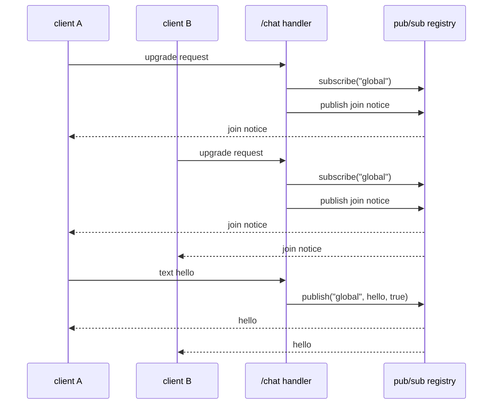

Ví dụ này là một WebSocket group chat. Nó đăng ký một upgrade route tại
`/chat`, subscribe mọi peer vào topic `global`, republish từng message cho
room và xóa subscription khi close. Nó dùng `App(128)` và default message path.
Chương trình là `examples/chat_server.zig` trong framework repository.

## Source [#source]

```zig src/main.zig
const std = @import("std");
const uz = @import("uWebZockets");

fn on_ws_open(ws: *uz.WebSocket) void {
    // upon connection, join the client to the "global" room
    ws.subscribe("global") catch {
        std.debug.print("error: unable to join room.\n", .{});
        return;
    };

    // notify the whole room about the new user
    _ = ws.publish("global", "system: a new user just joined", true);
}

fn on_ws_message(ws: *uz.WebSocket, message: []const u8, opcode: uz.Opcode) void {
    // broadcast this person's message to everyone in the "global" room
    const is_text = (opcode == .text);
    _ = ws.publish("global", message, is_text);
}

fn on_ws_close(ws: *uz.WebSocket) void {
    _ = ws.unsubscribe("global");
}

pub fn main(init: std.process.Init) !void {
    var app = try uz.App(128).init(init.io);
    defer app.deinit();

    _ = try app.ws("/chat", .{
        .open = on_ws_open,
        .message = on_ws_message,
        .close = on_ws_close,
    });
    try app.listen("0.0.0.0", 3000);

    std.debug.print("group chat server is running on port 3000\n", .{});
    try app.run();
}
```

[Full source](https://github.com/farbenbuilds/uWebZockets/blob/v2.1.6/examples/chat_server.zig)

`app.ws` đăng ký HTTP/1.1 upgrade route trên cùng application value với HTTP
router. `on_ws_open` chạy sau khi handshake thành công; nó subscribe socket
trước khi publish join notice, nên notice đến cả peer mới và các thành viên cũ.

## Build wiring [#build-wiring]

Sao chép chương trình vào `src/main.zig` của project import package. Dependency
fetch và module `build.zig` dùng chung cho mọi example:

```sh
zig fetch --save 'https://github.com/farbenbuilds/uWebZockets/archive/refs/tags/v2.1.6.tar.gz'
```

Làm theo [Run an example in your project](/examples#run-an-example-in-your-project)
để lấy block `build.zig` và bước `run`. Build thêm module import `uWebZockets`
và không cần framework checkout.

Trong framework checkout, `zig build chat_server` chạy cùng file. Lệnh đó là
contributor shortcut, không phải application path.

## Run [#run]

```sh
zig build run
```

Process bind `0.0.0.0:3000` và block trong `app.run()`. Nó in
`group chat server is running on port 3000` trước khi vào loop. Chương trình
không gọi `catch_shutdown_signals`, nên Ctrl+C kết thúc process mà không qua
graceful drain path.

## Verify [#verify]

Kết nối client đầu tiên từ terminal khác:

```sh
npx wscat -c ws://127.0.0.1:3000/chat
```

```console
Connected (press CTRL+C to quit)
< system: a new user just joined
```

Mở client thứ hai ở terminal thứ ba. Nó nhận cùng join notice, và client đầu
tiên nhận thêm một bản vì room có subscriber mới:

```console
Connected (press CTRL+C to quit)
< system: a new user just joined
```

Gửi từ client đầu tiên:

```console
> hello
< hello
```

Client gửi nhận message của chính nó vì nó là subscriber của `global`. Client
thứ hai in `< hello` cùng lúc. Text frame được republish thành text; binary
frame giữ opcode binary.

Đóng một client. `on_ws_close` xóa subscription, client còn lại vẫn subscribed.
Pub/sub engine cũng xóa mọi subscription khi socket deinit, nên `unsubscribe`
tường minh chủ yếu giải phóng topic slot sớm; nó không phải điều kiện bắt buộc
để chương trình đúng.

## Request path [#request-path]



`publish` đóng gói một message thành frame cho mỗi live subscriber vào write
queue của connection đó. Nó bỏ qua subscriber có queue đầy và trả số delivery
thành công. Chương trình bỏ qua con số này; một room trong production có thể log
hoặc dùng nó để phát hiện peer bị nghẽn.

## Key APIs [#key-apis]

| Call                                  | Effect                                                                     |
| ------------------------------------- | -------------------------------------------------------------------------- |
| `uz.App(128).init(init.io)`           | Cấp phát slab 128 connection và pub/sub registry embedded                  |
| `app.ws("/chat", .{...})`             | Đăng ký một HTTP/1.1 upgrade route                                         |
| `.open = on_ws_open`                  | Chạy sau handshake thành công                                              |
| `.message = on_ws_message`            | Chạy cho mỗi complete text hoặc binary message; slice chỉ valid trong call |
| `.close = on_ws_close`                | Chạy đúng một lần khi socket close                                         |
| `ws.subscribe("global")`              | Thêm subscription idempotent và copy topic name nếu mới                    |
| `ws.publish(topic, message, is_text)` | Frame message vào queue của từng live subscriber và trả delivery count     |
| `ws.unsubscribe("global")`            | Xóa subscription của socket này và báo nó có tồn tại hay không             |
| `uz.Opcode`                           | Phân biệt `.text` với `.binary` khi republish                              |
| `app.listen` / `app.run()`            | Bind port 3000 và chạy event loop                                          |

`subscribe` trả `error.SubscriptionCapacityReached` khi bảng subscription đầy,
và `error.TopicCapacityReached` khi không còn topic slot. Ví dụ log lần thất bại
đầu tiên và để socket connected nhưng chưa subscribe. Server production nên
đóng peer đó hoặc báo trạng thái degraded thay vì để một room member im lặng.

## Capacities [#capacities]

| Capacity              |  Value | Set by          | Consequence                                                     |
| --------------------- | -----: | --------------- | --------------------------------------------------------------- |
| Connections           |    128 | `App(128)`      | Connection đồng thời thứ 129 bị từ chối                         |
| WebSocket message     | 16 KiB | Default         | Message lớn hơn bị từ chối                                      |
| Write queue           | 64 KiB | Default         | Queue đầy trả `error.WouldBlock` cho direct send                |
| Idle timeout          |  120 s | Default         | Keep-alive connection đã drain sẽ đóng                          |
| Active topics         |  1.024 | Pub/sub default | Topic mới trả `error.TopicCapacityReached`                      |
| Subscriptions         |  8.192 | Pub/sub default | Subscription mới trả `error.SubscriptionCapacityReached`        |
| Subscribers per topic | 65.535 | Pub/sub default | Subscriber tiếp theo trả `error.TopicSubscriberCapacityReached` |
| Topic name            |  127 B | Pub/sub default | Tên dài hơn trả `error.TopicTooLong`                            |
| Request body          | 16 KiB | Default         | Không dùng bởi chương trình WebSocket-only này                  |

Chat server dùng message path mặc định: `App(128)` giữ giới hạn message 16 KiB,
write queue 64 KiB mỗi connection và idle timeout 120 s. Như vậy đủ cho text
chat và tránh phần compression scratch thêm cho mỗi connection. Room registry
có capacity cố định và thuộc application, không thuộc connection. Mọi peer trong
chương trình này chia sẻ topic `global`.

Preset `Presets.websocket_chat` là lựa chọn lớn hơn: 512 connection, message
32 KiB, queue 32 KiB, body 4 KiB, idle timeout 120 s và reserve compression
scratch. Route vẫn phải bật `.permessage_deflate` trước khi compression được
negotiate.

## Variation [#variation]

Bật per-message deflate cho chat route:

```zig
_ = try app.ws("/chat", .{
    .open = on_ws_open,
    .message = on_ws_message,
    .close = on_ws_close,
    .compression = .permessage_deflate,
});
```

Compression chỉ được negotiate trên HTTP/1.1 upgrade; RFC 8441 tunnel trên
HTTP/2 mang frame không nén. Nó thêm paired receive và send scratch cho mỗi
connection, và message processing vẫn không allocate. Message nén có kích thước
sau giải nén vượt `max_message_size` bị từ chối thay vì buffer không giới hạn.
So sánh startup slab trước khi bật cho mọi route.

## Next [#next]

- [Pub/sub](/docs/websocket/pub-sub) trình bày registry bound, delivery count
  và hành vi slow subscriber.
- [Cluster pub/sub](/docs/websocket/cluster-pub-sub) broadcast cùng topic qua
  các shared-nothing worker.
- [Per-message deflate](/docs/websocket/compression) trình bày negotiation và
  expansion limit.
- [Your first WebSocket](/examples/first-websocket) dạy upgrade lifecycle
  từng bước.
- [RPC server](/examples/rpc-server) là example tiếp theo.
