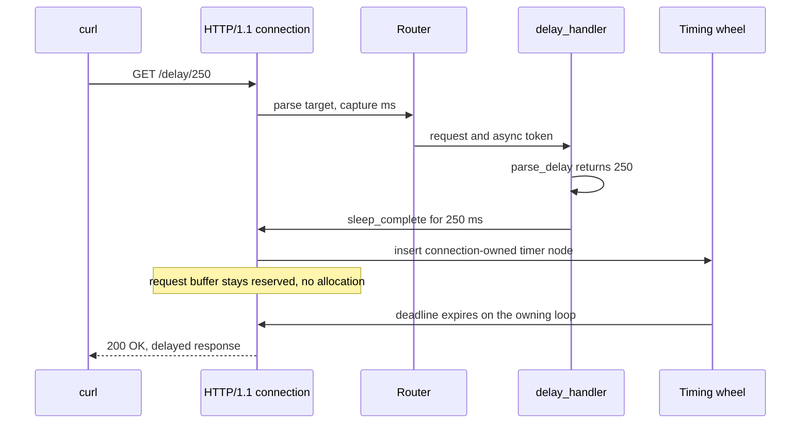

Đây là chương trình deferred-response nhỏ nhất của µWebZockets. Nó cấp phát một
slab `App(128)`, đăng ký `GET /delay/:ms` dưới dạng async route, parse capture
rồi park response trên timing wheel của worker. Delay bị giới hạn ở 60.000 ms và
input không hợp lệ nhận `400 Bad Request`. Chương trình là
`examples/delay_server.zig` trong framework repository.

## Source [#source]

```zig src/main.zig
const std = @import("std");
const uz = @import("uWebZockets");

/// Largest delay the example accepts; keeps parked requests bounded.
const max_delay_ms: u64 = 60_000;

fn parse_delay(raw: []const u8) ?u64 {
    if (raw.len == 0) return null;
    const value = std.fmt.parseInt(u64, raw, 10) catch return null;
    return @min(value, max_delay_ms);
}

fn delay_handler(req: *uz.Request, token: uz.AsyncResponse) void {
    const delay = parse_delay(req.get_param("ms") orelse "");
    if (delay == null) {
        token.complete("400 Bad Request", "Invalid delay") catch |err| {
            std.log.err("delay response failed: {}", .{err});
        };
        return;
    }

    // The response fields are static, so the parked request needs no
    // allocation while it waits on the worker's timing wheel.
    token.sleep_complete(
        delay.?,
        "200 OK",
        "Content-Type: text/plain\r\n",
        "delayed response",
    ) catch |err| {
        token.complete("500 Internal Server Error", @errorName(err)) catch |complete_err| {
            std.log.err("delay response failed: {} (after {})", .{ complete_err, err });
        };
    };
}

pub fn main(init: std.process.Init) !void {
    var app = try uz.App(128).init(init.io);
    defer app.deinit();

    _ = try app.route_async(.get, "/delay/:ms", delay_handler);

    try app.listen("0.0.0.0", 3000);
    try app.run();
}
```

[Full source](https://github.com/farbenbuilds/uWebZockets/blob/v2.1.6/examples/delay_server.zig)

Handler signature là `fn (*uz.Request, uz.AsyncResponse) void`. Nó trả về trước
khi response tồn tại, và token cung cấp completion path. `parse_delay` là hàm
thuần: trả `null` cho chuỗi rỗng, số âm, chuỗi không phải số thập phân hoặc giá
trị tràn `u64`. Giá trị hợp lệ vượt cap bị clamp bằng `@min` thay vì bị từ chối.

## Build wiring [#build-wiring]

Sao chép chương trình vào `src/main.zig` của project đã import package.
Bước fetch dependency và module `build.zig` dùng chung cho mọi example:

```sh
zig fetch --save 'https://github.com/farbenbuilds/uWebZockets/archive/refs/tags/v2.1.6.tar.gz'
```

Theo [Run an example in your project](/examples#run-an-example-in-your-project)
để lấy block `build.zig` và bước `run`. Async route dùng cùng module
`@import("uWebZockets")` như route đồng bộ.

Trong framework checkout, `zig build delay_server` chạy chính file này. Đây là
contributor shortcut, không phải consumer path.

## Run [#run]

```sh
zig build run
```

Tiến trình listen trên TCP port 3000 và block trong `run()`. Ví dụ này không cài
signal watcher, nên Ctrl+C kết thúc process mà không đi qua graceful drain path.
Nếu client disconnect khi response đang park, token của response đó bị cancel.

## Verify [#verify]

```sh
time curl -s http://127.0.0.1:3000/delay/250
```

Một lần chạy local đại diện:

```console
delayed response
real    0m0.251s
user    0m0.001s
sys     0m0.001s
```

Body đến sau khoảng 250 ms. Giá trị `real` chính xác phụ thuộc timer tick và
scheduling, nên assert body và một lower bound thay vì duration chính xác.
Response dùng header `Content-Type: text/plain` tường minh từ source.

Từ chối delay không hợp lệ:

```sh
curl -s -o /dev/null -w '%{http_code}' http://127.0.0.1:3000/delay/nope
```

```console
400
```

Nếu bỏ `-o /dev/null`, body là `Invalid delay`. `parse_delay` cũng từ chối
chuỗi rỗng, số âm và số bị tràn `u64`. Request `/delay/120000` bị clamp về
60.000 ms, nên chờ một phút thay vì hai phút.

## Request path [#request-path]



Router giữ response ở trạng thái suspended cho tới khi token complete. Request
buffer không được tái sử dụng khi token còn pending.

## Key APIs [#key-apis]

| Call                                                 | Effect                                                                      |
| ---------------------------------------------------- | --------------------------------------------------------------------------- |
| `uz.App(128).init(init.io)`                          | Cấp phát slab 128 connection.                                               |
| `app.route_async(.get, "/delay/:ms", delay_handler)` | Đăng ký callback nhận `*Request` và `AsyncResponse` thay vì `*Response`.    |
| `app.listen("0.0.0.0", 3000)`                        | Bind TCP 3000, tạo timing wheel của worker và khóa route mutation.          |
| `req.get_param("ms") orelse ""`                      | Đọc capture `:ms` đã borrow. Bản thân `*Request` chỉ hợp lệ trong callback. |
| `parse_delay`                                        | Trả delay đã cap hoặc `null`; không allocate.                               |
| `token.complete("400 Bad Request", "Invalid delay")` | Complete ngay và đúng một lần. Lỗi được log.                                |
| `token.sleep_complete(...)`                          | Park status, headers và body vào slot thuộc connection rồi arm timer.       |
| `token.complete("500 Internal Server Error", ...)`   | Fallback best-effort khi park fail; lỗi thứ hai được log.                   |

`AsyncResponse` là giá trị nhỏ, copy được: con trỏ tới state thuộc connection
hoặc stream cộng generation. Copy an toàn, completion đầu tiên thắng.
Generation cũ trả `error.AsyncResponseExpired`.

## Parking model [#parking-model]

Parked response không allocate. Token nằm trong slot thuộc connection hoặc
stream, và timer node được nhúng trong pooled connection. `sleep_complete` lưu
ba slice đã borrow ở đó, nên string static trong ví dụ vẫn hợp lệ suốt delay.
Response head và body được copy vào transport storage đã cấp phát trước khi
deadline fire.

HTTP/1.1 có một parking slot mỗi connection; HTTP/2 map một slot mỗi stream,
nên mỗi connection HTTP/1.1 hoặc mỗi stream HTTP/2 chỉ có một response được
defer tại một thời điểm.

Token complete trên owning loop. `complete`, `complete_with_headers`, `sleep` và
`sleep_complete` đều event-loop confined. Truyền token sang thread khác không di
chuyển slot và không làm completion thread-safe: marshal kết quả về owning loop
rồi complete ở đó.

Timing wheel mỗi worker có bốn level, từ 1 ms tới khoảng 17,5 phút, và wake theo
tick 5 ms có giới hạn. Delay 60.000 ms nằm ở level thứ ba, nên cap vẫn thấp hơn
nhiều so với giới hạn engine. Peer disconnect tăng generation và mọi bản copy
đang mở fail closed; token pending cũng giữ request buffer hoặc stream không bị
tái sử dụng.

## Capacities [#capacities]

| Capacity       |                     Value | Set by                | Consequence                                                      |
| -------------- | ------------------------: | --------------------- | ---------------------------------------------------------------- |
| Connections    |                       128 | `App(128)`            | Connection đồng thời thứ 129 bị từ chối                          |
| Delay cap      |                 60.000 ms | `max_delay_ms`        | Giá trị hợp lệ lớn hơn bị clamp; giá trị không hợp lệ nhận `400` |
| Parking slots  | 1 mỗi connection HTTP/1.1 | Slot thuộc connection | Một deferred response mỗi connection tại một thời điểm           |
| Timer tick     |                      5 ms | Timer của worker      | Deadline fire ở tick kế tiếp sau khi hết hạn                     |
| Write queue    |                    64 KiB | Default               | Body hoàn tất bị giới hạn bởi queue                              |
| Route patterns |                        64 | Default               | `/delay/:ms` dùng một pattern route                              |

Capacity 128 connection giới hạn số parked response đồng thời ở 128 trên
HTTP/1.1, một response mỗi connection. Hạ cap hoặc giảm connection count khi
endpoint public không nên giữ connection cho delay dài.

## Variation [#variation]

Giảm cap cho deployment public:

```zig
const max_delay_ms: u64 = 5_000;
```

`/delay/9000` sau đó complete sau năm giây thay vì chín giây. Connection slot
được giải phóng sớm hơn, và client không thể giữ một connection cả phút bằng
cách yêu cầu delay dài. Giữ cap cao hơn delay hợp lệ dài nhất để caller thực tế
không nhận response ngắn hơn yêu cầu.

## Next [#next]

- [Asynchronous responses](/docs/concepts/async-responses) giải thích token
  generation, cancellation và completion error.
- [Response lifecycle](/docs/concepts/response-lifecycle) trình bày synchronous
  ending, streaming và best-effort completion.
- [Routing](/docs/http/routing) trình bày path capture và registration order.
- [HTTP/3 server](/examples/http3-server) là example trước đó.
