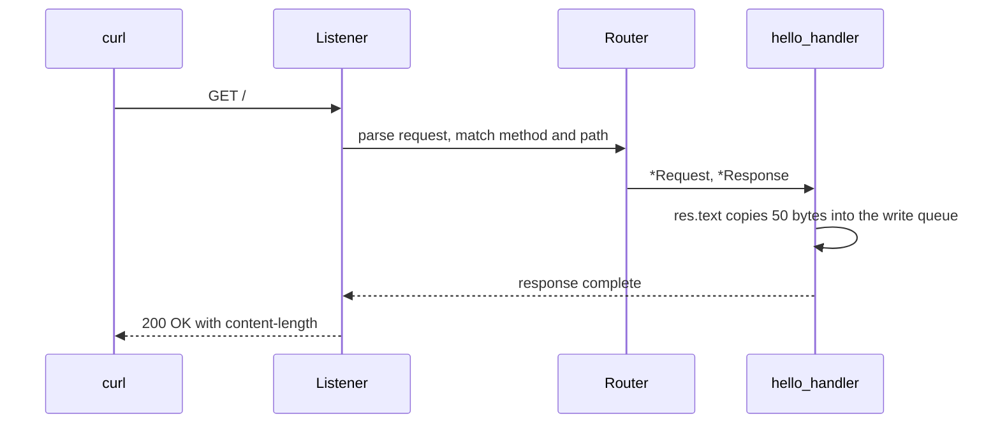

Ví dụ này là server µWebZockets hoàn chỉnh nhỏ nhất. Nó cấp phát một slab
`App(128)`, đăng ký `GET /`, listen trên port 3000 và trả về một text body.
Chương trình là `examples/hello_world.zig` trong framework repository.

## Source [#source]

```zig src/main.zig
const std = @import("std");
const uz = @import("uWebZockets");

fn hello_handler(_: *uz.Request, res: *uz.Response) void {
    res.text("Hello from µWebZockets! Zero allocation achieved.") catch |err| {
        std.debug.print("response error: {}\n", .{err});
    };
}

pub fn main(init: std.process.Init) !void {
    var app = try uz.App(128).init(init.io);
    defer app.deinit();

    _ = try app.get("/", hello_handler);

    try app.listen("0.0.0.0", 3000);
    try app.run();
}
```

[Full source](https://github.com/farbenbuilds/uWebZockets/blob/v2.1.6/examples/hello_world.zig)

## Build wiring [#build-wiring]

Thêm package và import module trong `build.zig` của bạn:

```sh
zig fetch --save 'https://github.com/farbenbuilds/uWebZockets/archive/refs/tags/v2.1.6.tar.gz'
```

```zig build.zig
const std = @import("std");

pub fn build(b: *std.Build) void {
    const target = b.standardTargetOptions(.{});
    const optimize = b.standardOptimizeOption(.{});
    const uz = b.dependency("uWebZockets", .{
        .target = target,
        .optimize = optimize,
    });

    const exe = b.addExecutable(.{
        .name = "hello-world",
        .root_module = b.createModule(.{
            .root_source_file = b.path("src/main.zig"),
            .target = target,
            .optimize = optimize,
        }),
    });
    exe.root_module.addImport("uWebZockets", uz.module("uWebZockets"));
    b.installArtifact(exe);

    const run = b.addRunArtifact(exe);
    b.step("run", "Run the hello-world server").dependOn(&run.step);
}
```

## Run [#run]

```sh
zig build run
```

Server block trong `app.run()` cho đến khi nhận `SIGINT` hoặc `SIGTERM`. Ví dụ
này không gọi `catch_shutdown_signals`, nên Ctrl+C kết thúc process mà không đi
qua graceful drain path. Thêm watcher khi server sở hữu công việc cần dừng sạch:

```zig
try app.catch_shutdown_signals();
try app.run();
```

## Verify [#verify]

```sh
curl -i http://127.0.0.1:3000/
```

```console
HTTP/1.1 200 OK
content-length: 50
content-type: text/plain; charset=utf-8

Hello from µWebZockets! Zero allocation achieved.
```

Body dài 50 byte. Thứ tự header và casing chính xác của `content-length` là chi
tiết transport; hãy assert status và body trong application test.

## Request path [#request-path]



## Capacities [#capacities]

| Capacity     |             Value | Set by     | Consequence                             |
| ------------ | ----------------: | ---------- | --------------------------------------- |
| Connections  |               128 | `App(128)` | Connection đồng thời thứ 129 bị từ chối |
| Request line |             8 KiB | Default    | Request line lớn hơn nhận `431`         |
| Headers      | 16 KiB, 64 fields | Default    | Header block lớn hơn nhận `431`         |
| Body         |            16 KiB | Default    | Body lớn hơn nhận `413`                 |
| Write queue  |            64 KiB | Default    | Queue đầy trả `error.WouldBlock`        |
| Idle timeout |             120 s | Default    | Keep-alive connection đã drain sẽ đóng  |

`App(128)` là đường ngắn nhất. Dùng `Server.builder(init.io)` khi một giá trị
phải chọn lúc runtime hoặc khi bạn muốn dùng
[preset](/reference/server-config#presets) có tên.

## What the example demonstrates [#what-the-example-demonstrates]

| Call                          | Effect                                           |
| ----------------------------- | ------------------------------------------------ |
| `uz.App(128).init(init.io)`   | Tính slab layout và thực hiện một allocation     |
| `app.get("/", hello_handler)` | Lưu route trước khi listener khóa registration   |
| `app.listen("0.0.0.0", 3000)` | Bind mọi local interface và bắt đầu accept       |
| `app.run()`                   | Chạy event loop cho đến khi process dừng         |
| `app.deinit()`                | Giải phóng slab đúng một lần sau khi loop trả về |

Handler signature là `fn (*uz.Request, *uz.Response) void`. `res.text` copy body
vào bounded connection storage trước khi callback trả về, nên literal có thể nằm
trong static memory.

## Variations [#variations]

### Bind loopback only [#bind-loopback-only]

```zig
try app.listen("127.0.0.1", 8080);
```

Dùng loopback cho service local và `0.0.0.0` chỉ khi proxy hoặc load balancer
kết nối từ host khác.

### Raise the connection capacity [#raise-the-connection-capacity]

```zig
var app = try uz.App(2048).init(init.io);
```

Capacity là compile-time vì nó quyết định kích thước application type. Slab lớn
lên theo connection count; gọi `slab_bytes()` qua builder khi cần biết chính xác
footprint trước khi allocate.

## Next [#next]

- [Your first HTTP server](/docs/examples/first-http-server) thêm route
  parameters, response errors và shutdown watcher.
- [HTTPS server](/examples/https-server) bọc cùng route trong TLS 1.3.
- [ServerConfig](/reference/server-config) liệt kê mọi capacity và default.
