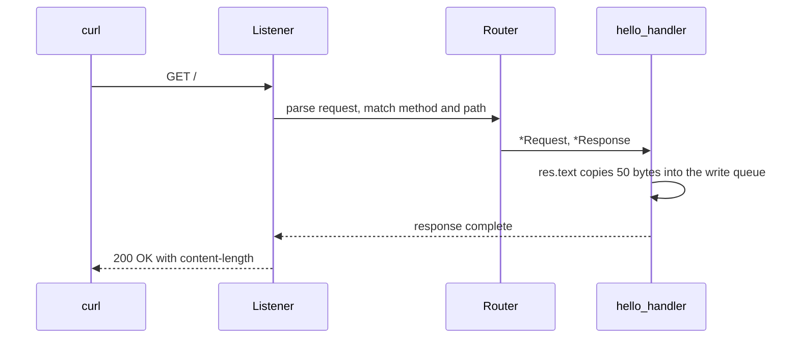

Trang này vừa là chương trình Hello world canonical vừa là tutorial HTTP đầu tiên.
Nó bắt đầu bằng server hoàn chỉnh nhỏ nhất, rồi thêm route parameter, route POST
và shutdown watcher. Chương trình là `examples/hello_world.zig` trong framework
repository.

## Source [#source]

```zig src/main.zig
const std = @import("std");
const uz = @import("uWebZockets");

fn hello_handler(_: *uz.Request, res: *uz.Response) void {
    res.text("Hello from µWebZockets! Zero allocation achieved.") catch |err| {
        std.debug.print("response error: {}\n", .{err});
    };
}

pub fn main(init: std.process.Init) !void {
    var app = try uz.App(128).init(init.io);
    defer app.deinit();

    _ = try app.get("/", hello_handler);

    try app.listen("0.0.0.0", 3000);
    try app.run();
}
```

[Full source](https://github.com/farbenbuilds/uWebZockets/blob/v2.1.6/examples/hello_world.zig)

## Build wiring [#build-wiring]

Thêm package và import module trong `build.zig` của bạn:

```sh
zig fetch --save 'https://github.com/farbenbuilds/uWebZockets/archive/refs/tags/v2.1.6.tar.gz'
```

```zig build.zig
const std = @import("std");

pub fn build(b: *std.Build) void {
    const target = b.standardTargetOptions(.{});
    const optimize = b.standardOptimizeOption(.{});
    const uz = b.dependency("uWebZockets", .{
        .target = target,
        .optimize = optimize,
    });

    const exe = b.addExecutable(.{
        .name = "hello-world",
        .root_module = b.createModule(.{
            .root_source_file = b.path("src/main.zig"),
            .target = target,
            .optimize = optimize,
        }),
    });
    exe.root_module.addImport("uWebZockets", uz.module("uWebZockets"));
    b.installArtifact(exe);

    const run = b.addRunArtifact(exe);
    b.step("run", "Run the hello-world server").dependOn(&run.step);
}
```

## Run [#run]

```sh
zig build run
```

Server block trong `app.run()` cho đến khi nhận `SIGINT` hoặc `SIGTERM`. Chương
trình canonical không gọi `catch_shutdown_signals`; phần
[Stop it cleanly](#stop-it-cleanly) thêm watcher đó.

## Verify [#verify]

```sh
curl -i http://127.0.0.1:3000/
```

```console
HTTP/1.1 200 OK
content-length: 50
content-type: text/plain; charset=utf-8

Hello from µWebZockets! Zero allocation achieved.
```

Body dài 50 byte. Thứ tự header và casing chính xác của `content-length` là chi
tiết transport; hãy assert status và body trong application test.

## Add a route parameter [#add-a-route-parameter]

Thêm một handler và đăng ký nó trước `listen`:

```zig
fn greet(req: *uz.Request, res: *uz.Response) void {
    const name = req.get_param("name") orelse "world";
    var buffer: [128]u8 = undefined;
    const body = std.fmt.bufPrint(&buffer, "hello {s}", .{name}) catch |err| {
        std.log.err("format failed: {}", .{err});
        res.text("hello") catch |res_err| {
            std.log.err("response failed: {}", .{res_err});
        };
        return;
    };
    res.text(body) catch |err| {
        std.log.err("response failed: {}", .{err});
    };
}

_ = try app.get("/greet/:name", greet);
```

Kiểm tra cả hai route:

```sh
curl -s http://127.0.0.1:3000/
curl -s http://127.0.0.1:3000/greet/Ada
```

```console
Hello from µWebZockets! Zero allocation achieved.
hello Ada
```

`/greet` không match `/greet/:name` vì parameter yêu cầu một segment không rỗng.
Đăng ký `/greet` riêng nếu bạn muốn route không có capture. Fallback
`orelse "world"` xử lý capture bị thiếu, không phải route bị thiếu.

## Add another method [#add-another-method]

Các helper đăng ký route theo tên method. Route POST có thể đọc body đã buffer
bằng `req.text()`:

```zig
fn create(req: *uz.Request, res: *uz.Response) void {
    const body = req.text();
    res.text(body) catch |err| {
        std.log.err("response failed: {}", .{err});
    };
}

_ = try app.post("/items", create);
```

`req.text()` trả body đã buffer. Body capacity mặc định là 16 KiB; tăng bằng
`ServerConfig` hoặc `with_max_body_size` khi application cần upload lớn hơn.

## Request path [#request-path]



## What happens at startup [#what-happens-at-startup]

| Step            | Detail                                                                                                               |
| --------------- | -------------------------------------------------------------------------------------------------------------------- |
| `App(128).init` | Tính slab layout và thực hiện một allocation cho 128 connection slot, request buffer, write queue và router storage. |
| `app.get`       | Ghi route vào fixed router storage. Đăng ký trước `listen` giữ array bất biến khi worker chạy.                       |
| `listen`        | Bind socket, bắt đầu accept và khóa route registration.                                                              |
| `run`           | Chạy event loop cho đến khi shutdown hoàn tất.                                                                       |
| `deinit`        | Giải phóng slab đúng một lần. Nó panic nếu được gọi từ trong loop.                                                   |

## Capacities [#capacities]

| Capacity     |             Value | Set by     | Consequence                             |
| ------------ | ----------------: | ---------- | --------------------------------------- |
| Connections  |               128 | `App(128)` | Connection đồng thời thứ 129 bị từ chối |
| Request line |             8 KiB | Default    | Request line lớn hơn nhận `431`         |
| Headers      | 16 KiB, 64 fields | Default    | Header block lớn hơn nhận `431`         |
| Body         |            16 KiB | Default    | Body lớn hơn nhận `413`                 |
| Write queue  |            64 KiB | Default    | Queue đầy trả `error.WouldBlock`        |
| Idle timeout |             120 s | Default    | Keep-alive connection đã drain sẽ đóng  |

`App(128)` là đường ngắn nhất. Dùng `Server.builder(init.io)` khi một giá trị
phải chọn lúc runtime hoặc khi bạn muốn dùng
[preset](/reference/server-config#presets) có tên.

## Stop it cleanly [#stop-it-cleanly]

Thêm watcher trước `listen`:

```zig
try app.catch_shutdown_signals();
try app.listen("0.0.0.0", 3000);
try app.run();
```

Nhấn Ctrl+C. Watcher request shutdown, dừng accept, hủy recurring timer, đóng
connection đang hoạt động và drain completion trước khi `run` trả về. Request
đang xử lý không được đảm bảo hoàn tất. `defer app.deinit()` sau đó giải phóng
slab.

## Variations [#variations]

### Bind loopback only [#bind-loopback-only]

```zig
try app.listen("127.0.0.1", 8080);
```

Dùng loopback cho service local và `0.0.0.0` chỉ khi proxy hoặc load balancer
kết nối từ host khác.

### Raise the connection capacity [#raise-the-connection-capacity]

```zig
var app = try uz.App(2048).init(init.io);
```

Capacity là compile-time vì nó quyết định kích thước application type. Slab lớn
lên theo connection count; gọi `slab_bytes()` qua builder khi cần biết chính xác
footprint trước khi allocate.

## Next [#next]

- [WebSocket quickstart](/docs/websocket/quickstart) thêm route hai chiều.
- [RPC server](/examples/rpc-server) phục vụ typed
  procedure trên cùng application.
- [HTTPS server](/examples/https-server) bọc listener trong TLS 1.3.
- [ServerConfig](/reference/server-config) liệt kê mọi capacity và default.
