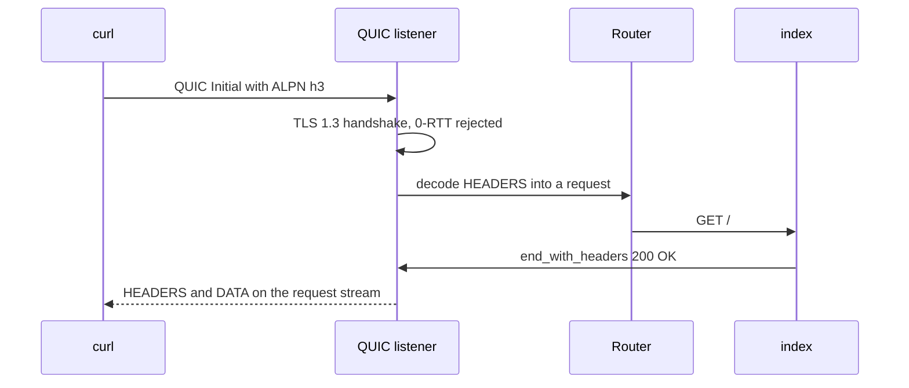

Đây là chương trình HTTP/3 hoàn chỉnh nhỏ nhất của µWebZockets. Nó cấp phát một
slab `App(128)`, đăng ký `GET /`, bind UDP port 8443 và cài shutdown watcher
trước khi vào event loop. Chương trình là `examples/http3_server.zig` trong
framework repository.

## Source [#source]

```zig src/main.zig
const std = @import("std");
const uz = @import("uWebZockets");

fn index(_: *uz.Request, response: *uz.Response) void {
    response.end_with_headers(
        "200 OK",
        "Content-Type: text/plain\r\n",
        "Hello from bounded HTTP/3",
    ) catch |err| std.log.err("response failed: {}", .{err});
}

pub fn main(init: std.process.Init) !void {
    var server = try uz.App(128).init_http3_ephemeral(init.io);
    defer server.deinit();

    _ = try server.get("/", index);
    try server.listen_udp("0.0.0.0", 8443);
    // SIGINT/SIGTERM must reach the normal drain path so `deinit` can assert
    // that every engine pool was returned.
    try server.catch_shutdown_signals();
    try server.run();
}
```

[Full source](https://github.com/farbenbuilds/uWebZockets/blob/v2.1.6/examples/http3_server.zig)

`init_http3_ephemeral` tạo hai TLS 1.3 context tách biệt. Context TCP quảng bá
`h2` và `http/1.1`; context QUIC chỉ quảng bá `h3` qua ALPN. Chương trình này
chỉ bind endpoint QUIC, nên mọi request trên UDP 8443 đều dùng HTTP/3. Context
TCP vẫn nằm trong giá trị `App` nhưng chưa được bind cho tới khi bạn thêm
listener.

## Build wiring [#build-wiring]

Sao chép chương trình vào `src/main.zig` của project đã import package.
Bước fetch dependency và module `build.zig` dùng chung cho mọi example:

```sh
zig fetch --save 'https://github.com/farbenbuilds/uWebZockets/archive/refs/tags/v2.1.6.tar.gz'
```

Theo [Run an example in your project](/examples#run-an-example-in-your-project)
để lấy block `build.zig` và bước `run`. Chương trình đi tới QUIC engine qua cùng
module `@import("uWebZockets")`.

Trong framework checkout, `zig build http3_server` chạy chính file này. Đây là
contributor shortcut, không phải consumer path.

## Run [#run]

```sh
zig build run
```

Tiến trình bind UDP 8443 và block trong `run()`. `catch_shutdown_signals` được
cài trước event loop, nên Ctrl+C đi vào drain path bình thường. Sau đó `deinit`
kiểm tra mọi QUIC engine pool đã được trả lại.

## Verify [#verify]

```sh
curl --http3-only -k https://127.0.0.1:8443/
```

```console
Hello from bounded HTTP/3
```

`--http3-only` buộc curl fail khi QUIC handshake không hoàn tất và không cho
fallback sang HTTP/2. Chương trình này không có TCP listener, nên UDP 8443 là
endpoint duy nhất. `-k` chấp nhận certificate self-signed mà
`init_http3_ephemeral` tạo cho `localhost`, `127.0.0.1` và `::1`. Nếu bản curl
đang cài không có HTTP/3, lệnh fail trước khi gửi request.

## Request path [#request-path]



Adapter giải mã HTTP/3 pseudo-header thành `*uz.Request` hiện có. Nó ghi QPACK
response header có cấu trúc thay vì chuyển qua response text HTTP/1.1.

## Key APIs [#key-apis]

| Call                                        | Effect                                                                                                                              |
| ------------------------------------------- | ----------------------------------------------------------------------------------------------------------------------------------- |
| `uz.App(128).init_http3_ephemeral(init.io)` | Cấp phát slab 128 connection và tạo cả hai TLS context với certificate self-signed trong bộ nhớ.                                    |
| `server.get("/", index)`                    | Đăng ký route trên router dùng chung trước khi listener khóa registration.                                                          |
| `server.listen_udp("0.0.0.0", 8443)`        | Khởi động QUIC transport, cấp phát startup pool của engine và khóa route mutation. Giá trị `App` không được di chuyển sau lệnh này. |
| `server.catch_shutdown_signals()`           | Cài handler SIGINT và SIGTERM để yêu cầu drain path bình thường.                                                                    |
| `server.run()`                              | Chạy event loop tới khi shutdown hoàn tất.                                                                                          |
| `response.end_with_headers(...)`            | Ghi status, header `Content-Type` và body; lỗi ghi được log.                                                                        |
| `server.deinit()`                           | Giải phóng slab và cả hai TLS context sau khi loop drain.                                                                           |

`end_with_headers` nhận status, header block và body. `res.text` là helper ngắn
hơn khi header mặc định `text/plain; charset=utf-8` phù hợp.

## Capacities [#capacities]

| Capacity        |                  Value | Set by                                                                | Consequence                                                         |
| --------------- | ---------------------: | --------------------------------------------------------------------- | ------------------------------------------------------------------- |
| Connections     |                    128 | `App(128)`                                                            | Connection QUIC đồng thời thứ 129 bị từ chối                        |
| Request headers |      16 KiB, 64 fields | Default `max_header_size`, `max_header_count`                         | Header set lớn hơn hoặc nhiều field hơn bị từ chối                  |
| Request body    |      16 KiB mỗi stream | Default `max_h3_body_size`                                            | Body lớn hơn nhận `413 Payload Too Large`                           |
| Response head   |       4 KiB, 64 fields | Default `max_h3_response_header_size`, `max_h3_response_header_count` | Head lớn hơn làm stream fail với `error.BufferOverflow`             |
| Response body   |      64 KiB mỗi stream | Default `write_queue_size`                                            | Body one-shot vượt giới hạn trả `error.WouldBlock`                  |
| Packet payload  |             2.048 byte | QUIC packet slot                                                      | PLPMTU bị giới hạn ở 1.472 byte                                     |
| Engine storage  | Ngoài application slab | Startup pool                                                          | Kích thước tính từ connection count, header limit và queue capacity |

Engine cấp phát header, body, response và packet storage trước khi event loop
chạy. Trang [HTTP/3 limits](/docs/http3/limits#memory) có công thức. Với 128
connection, footprint nhỏ hơn nhiều so với kích thước mặc định cho 1.024
connection, nhưng vẫn tách khỏi application slab.

## Boundaries [#boundaries]

- **Clustering:** HTTP/3 và QUIC không có cluster mode. `init_http3` và
  `listen_udp` chỉ dành cho một application, worker group không có UDP
  listener. Xem [HTTP/3 limits](/docs/http3/limits#clustering).
- **WebTransport:** các extension module đã có, nhưng live listener chưa nối
  vào chúng. Request CONNECT nhận `501 Not Implemented`. Xem
  [WebTransport status](/docs/http3/webtransport).
- **Metrics:** HTTP/3 ghi một record `http_request` trong development log cho
  mỗi exchange hoàn tất nhưng không tăng counter registry. Xem
  [HTTP/3 observability](/docs/http3/observability).
- **0-RTT:** live listener từ chối early data, nên request có thể replay không
  bao giờ tới handler. Xem [early data](/docs/http3/early-data).
- **Congestion control:** BBRv1 với pacing theo từng connection. Public API
  không cho cấu hình giá trị này.

## Variation [#variation]

Bind thêm TCP context trên cùng giá trị `App` để phục vụ HTTPS và HTTP/3 từ một
route table:

```zig
_ = try server.get("/", index);
try server.listen("0.0.0.0", 3443);
try server.listen_udp("0.0.0.0", 8443);
try server.catch_shutdown_signals();
try server.run();
```

```sh
curl --http2 -k https://127.0.0.1:3443/
```

TCP listener quảng bá `h2` và `http/1.1`; UDP listener quảng bá `h3`. Đăng ký
mọi route trước lệnh listen đầu tiên vì bind đầu tiên sẽ khóa route mutation.

## Next [#next]

- [Your first HTTP/3 server](/docs/examples/first-http3-server) hướng dẫn cùng
  đường đi từng bước.
- [HTTP/3 and QUIC](/docs/http3) trình bày QPACK, request validation và engine.
- [Delayed response](/examples/delay-server) là example tiếp theo.
- [ServerConfig](/reference/server-config) liệt kê mọi H3 capacity và default.
