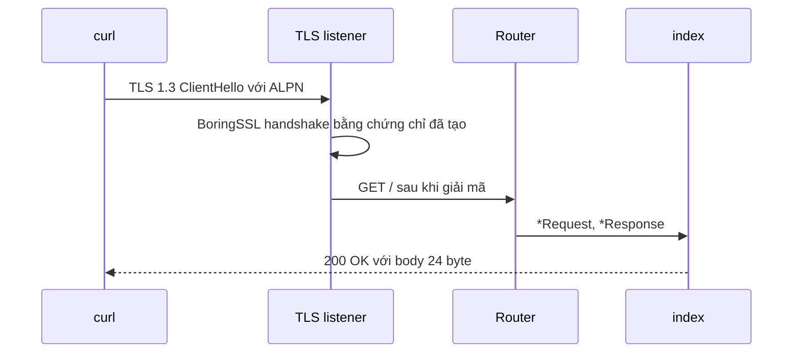

Ví dụ này là HTTPS server µWebZockets hoàn chỉnh nhỏ nhất. Nó cấp phát một slab
`App(128)`, tạo chứng chỉ self-signed trong bộ nhớ, đăng ký `GET /` và listen
trên port 3443. Chương trình là `examples/https_server.zig` trong framework
repository.

## Source [#source]

```zig src/main.zig
const std = @import("std");
const uz = @import("uWebZockets");

fn index(_: *uz.Request, response: *uz.Response) void {
    response.text("hello from ephemeral TLS") catch |err| {
        std.log.err("response failed: {}", .{err});
    };
}

pub fn main(init: std.process.Init) !void {
    var server = try uz.App(128).init_https_ephemeral(init.io);
    defer server.deinit();

    _ = try server.get("/", index);
    try server.listen("0.0.0.0", 3443);
    try server.run();
}
```

[Full source](https://github.com/farbenbuilds/uWebZockets/blob/v2.1.6/examples/https_server.zig)

## Điều kiện trước [#prerequisites]

- Project từ [Hello world](/examples/hello-world).
- Zig 0.16.0.
- `curl`.

## Build wiring [#build-wiring]

Thêm dependency vào project của bạn:

```sh
zig fetch --save 'https://github.com/farbenbuilds/uWebZockets/archive/refs/tags/v2.1.6.tar.gz'
```

Wire module vào `build.zig` như trong
[Run an example in your project](/examples#run-an-example-in-your-project), copy
chương trình trên vào `src/main.zig` và chạy `zig build run`. Build thêm module
import `uWebZockets` và không cần framework checkout.

## Run [#run]

```sh
zig build run
```

Process bind `0.0.0.0:3443` và block trong `server.run()` cho đến khi nhận
`SIGINT` hoặc `SIGTERM`. Chương trình này không gọi `catch_shutdown_signals`,
nên Ctrl+C kết thúc process mà không qua graceful drain path. Thêm
`try server.catch_shutdown_signals();` trước `listen` khi server sở hữu công
việc cần dừng sạch.

Trong framework checkout, `zig build https_server -Doptimize=ReleaseSafe` chạy
cùng chương trình. Đó là contributor shortcut, không phải application path.

## Verify [#verify]

```sh
curl -k https://127.0.0.1:3443/
```

```console
hello from ephemeral TLS
```

Body dài 24 byte. `-k` tắt xác minh chứng chỉ vì chứng chỉ được tạo là
self-signed. Nó bao gồm `localhost`, `127.0.0.1` và `::1`, dùng key ECDSA P-256
và có hiệu lực 90 ngày từ lúc khởi động.

TLS context chỉ dùng TLS 1.3 và quảng bá `h2` rồi `http/1.1` qua ALPN. Bản
`curl` có hỗ trợ HTTP/2 thương lượng `h2`; bản không có thương lượng
`http/1.1`.

## Request path [#request-path]



## Key APIs [#key-apis]

| Lệnh gọi                                    | Tác dụng                                                          |
| ------------------------------------------- | ----------------------------------------------------------------- |
| `uz.App(128).init_https_ephemeral(init.io)` | Cấp phát slab 128 connection và tạo chứng chỉ trước khi loop chạy |
| `server.get("/", index)`                    | Đăng ký route trước khi listener khóa registration                |
| `server.listen("0.0.0.0", 3443)`            | Bind mọi local interface và bắt đầu accept TLS connection         |
| `server.run()`                              | Chạy event loop cho đến khi process dừng                          |
| `response.text(...)`                        | Copy body vào write queue của connection trước khi handler trả về |
| `server.deinit()`                           | Giải phóng slab đúng một lần sau khi loop trả về                  |

## Capacities [#capacities]

| Capacity     |             Value | Set by                                | Consequence                             |
| ------------ | ----------------: | ------------------------------------- | --------------------------------------- |
| Connections  |               128 | `App(128)`                            | Connection đồng thời thứ 129 bị từ chối |
| Request line |             8 KiB | Default                               | Request line lớn hơn nhận `431`         |
| Headers      | 16 KiB, 64 fields | Default                               | Header block lớn hơn nhận `431`         |
| Body         |            16 KiB | Default                               | Body lớn hơn nhận `413`                 |
| Write queue  |            64 KiB | Default                               | Queue đầy trả `error.WouldBlock`        |
| Idle timeout |             120 s | Default                               | Keep-alive connection đã drain sẽ đóng  |
| TLS          |       Chỉ TLS 1.3 | `init_https_ephemeral` / `init_https` | Protocol cũ hơn bị từ chối              |

Chứng chỉ được tạo một lần, trước event loop. Sau lệnh gọi đó, handshake, xử lý
record và mọi request path không allocate.

## Variation [#variation]

Dùng file PEM khi client phải xác minh chứng chỉ:

```zig
var server = try uz.App(128).init_https(
    init.io,
    "certs/fullchain.pem",
    "certs/privkey.pem",
);
defer server.deinit();
```

Tham số chứng chỉ là PEM chain với leaf đầu tiên. Tham số key là private key
PEM. BoringSSL kiểm tra cặp khớp khi load, nên lệch cặp fail lúc khởi động với
`error.PrivateKeyLoadFailed` thay vì trong handshake đầu tiên. Đường dẫn là
slice Zig kết thúc bằng NUL; trong lệnh gọi literal, string literal đã có kiểu
cần thiết. Với chain mà client tin, bỏ `-k` khỏi lệnh verify.

## Next [#next]

- [Mutual TLS](/docs/security/mtls) trình bày client CA bundle, mode `.optional`
  và `.required`, early-data behavior và giới hạn CRL.
- [TLS clusters](/docs/security/tls-clusters) trình bày worker lifecycle và
  cross-worker resumption.
- [Shared-nothing cluster](/examples/shared-nothing-cluster) giữ một slab và
  một event loop cho mỗi worker.
- [TLS cluster](/examples/tls-cluster) cấp TLS context riêng cho từng worker.
- [Ephemeral certificates](/docs/security/ephemeral-certificates) trình bày
  certificate sinh trong bộ nhớ và giới hạn của nó.
- [HTTPS deployment](/docs/deployment/tls) trình bày credential production và
  rotation.
- [ServerConfig](/reference/server-config) liệt kê mọi capacity và default.
