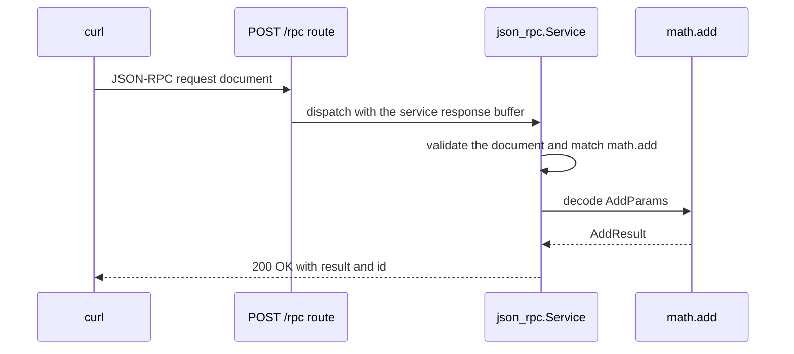

Ví dụ này mount một typed JSON-RPC 2.0 service trên `POST /rpc`. Nó định nghĩa
một procedure, `math.add`, decode named parameter vào struct Zig và serialize
typed result. Nó dùng `App(128)` và capacity mặc định của `Service`. Chương
trình là `examples/rpc_server.zig` trong framework repository.

## Source [#source]

```zig src/main.zig
const std = @import("std");
const uz = @import("uWebZockets");

const AddParams = struct {
    left: i64,
    right: i64,
};

const AddResult = struct {
    sum: i64,
};

fn add(params: AddParams) uz.json_rpc.HandlerError!AddResult {
    return .{ .sum = params.left + params.right };
}

pub fn main(init: std.process.Init) !void {
    var server = try uz.App(128).init(init.io);
    defer server.deinit();

    var rpc = uz.json_rpc.Service{};
    try rpc.register_typed("math.add", AddParams, AddResult, add);
    _ = try server.rpc("/rpc", &rpc);

    try server.listen("0.0.0.0", 3000);
    try server.run();
}
```

[Full source](https://github.com/farbenbuilds/uWebZockets/blob/v2.1.6/examples/rpc_server.zig)

`register_typed` tạo parameter decoder và result writer lúc compile time.
Handler nhận `AddParams` đã decode và trả `AddResult` hoặc một trong các
`HandlerError`. `server.rpc` mount một POST route, không copy procedure name lúc
request và seal registry. Đăng ký mọi procedure trước khi mount; đăng ký sau
trả `error.RegistryLocked`.

## Build wiring [#build-wiring]

Sao chép chương trình vào `src/main.zig` của project import package. Dependency
fetch và module `build.zig` dùng chung cho mọi example:

```sh
zig fetch --save 'https://github.com/farbenbuilds/uWebZockets/archive/refs/tags/v2.1.6.tar.gz'
```

Làm theo [Run an example in your project](/examples#run-an-example-in-your-project)
để lấy block `build.zig` và bước `run`. Build thêm module import `uWebZockets`
và không cần framework checkout.

Trong framework checkout, `zig build rpc_server` chạy cùng file. Lệnh đó là
contributor shortcut, không phải application path.

## Run [#run]

```sh
zig build run
```

Process bind `0.0.0.0:3000` và block trong `server.run()`. Chương trình không
gọi `catch_shutdown_signals`, nên Ctrl+C kết thúc process mà không qua graceful
drain path. Giá trị `rpc` nằm trong `main` và tồn tại lâu hơn server loop; giữ
service ở địa chỉ ổn định và không copy sau khi mount.

## Verify [#verify]

Gửi request:

```sh
curl -s http://127.0.0.1:3000/rpc \
  -H 'Content-Type: application/json' \
  --data '{"jsonrpc":"2.0","method":"math.add","params":{"left":2,"right":3},"id":1}'
```

Request document:

```json
{
  "jsonrpc": "2.0",
  "method": "math.add",
  "params": { "left": 2, "right": 3 },
  "id": 1
}
```

Response:

```console
{"jsonrpc":"2.0","result":{"sum":5},"id":1}
```

Response trả HTTP 200 với `Content-Type: application/json; charset=utf-8`.
Named parameter được decode thành `AddParams`; result serializer ghi `AddResult`
thành `{"sum":5}`. Notification không có `id` trả HTTP 204 vì không cần
response body.

Gọi một method chưa đăng ký:

```sh
curl -s http://127.0.0.1:3000/rpc \
  -H 'Content-Type: application/json' \
  --data '{"jsonrpc":"2.0","method":"math.divide","params":{"left":2,"right":3},"id":2}'
```

```console
{"jsonrpc":"2.0","error":{"code":-32601,"message":"Method not found"},"id":2}
```

Request phải mang đúng một header `Content-Type: application/json` hoặc
`application/json-rpc`. Media type thiếu, trùng hoặc khác nhận
`415 Unsupported Media Type` trước khi service chạy.

## Request path [#request-path]



Một complete JSON document được validate trước khi batch gọi procedure đầu
tiên. Batch malformed không chạy gì. Procedure name được copy lúc đăng ký, nên
chuỗi nguồn có thể là tạm thời; registry sở hữu bản copy đến khi seal.

## Key APIs [#key-apis]

| Call                                                        | Effect                                                                       |
| ----------------------------------------------------------- | ---------------------------------------------------------------------------- |
| `uz.App(128).init(init.io)`                                 | Cấp phát slab 128 connection                                                 |
| `uz.json_rpc.Service{}`                                     | Tạo service với 64 procedure, 4 KiB method storage và response buffer 16 KiB |
| `rpc.register_typed("math.add", AddParams, AddResult, add)` | Đăng ký typed procedure và copy method name                                  |
| `fn add(AddParams) uz.json_rpc.HandlerError!AddResult`      | Nhận value đã decode và trả typed result                                     |
| `server.rpc("/rpc", &rpc)`                                  | Mount POST route, bind service và seal registry                              |
| `server.listen` / `server.run()`                            | Bind port 3000 và chạy event loop                                            |
| `server.deinit()`                                           | Giải phóng slab sau khi loop trả về                                          |

Typed adapter dùng 4 KiB fixed stack scratch cho parameter đã decode. Với
parameter type lớn hơn, dùng API `register` cấp thấp với `Call.parse_params` và
allocator tường minh. Xem
[Your first JSON-RPC service](/examples/first-json-rpc-service) cho dạng
đó.

## Capacities [#capacities]

| Capacity             |  Value | Set by              | Consequence                                             |
| -------------------- | -----: | ------------------- | ------------------------------------------------------- |
| Connections          |    128 | `App(128)`          | Connection đồng thời thứ 129 bị từ chối                 |
| Request body         | 16 KiB | Default             | Document lớn hơn nhận `413` trước dispatch              |
| Write queue          | 64 KiB | Default             | Queue đầy trả `error.WouldBlock`                        |
| Idle timeout         |  120 s | Default             | Keep-alive connection đã drain sẽ đóng                  |
| Procedures           |     64 | `Service` default   | Lần đăng ký thứ 65 trả `error.ProcedureCapacityReached` |
| Method storage       |  4 KiB | `Service` default   | Tổng độ dài tên được copy bị giới hạn                   |
| Response buffer      | 16 KiB | `Service` default   | Result hoặc batch không vừa làm response thất bại       |
| Typed params scratch |  4 KiB | Typed adapter       | Parameter document lớn hơn cần API cấp thấp             |
| Method name          |  255 B | `max_method_length` | Tên dài hơn không đăng ký được                          |
| Route method         | `POST` | `server.rpc`        | Method khác không đến service                           |

Service là một value chứa các mảng cố định, không phải registry tự grow. 64
procedure và response 16 KiB thuộc service, còn 128 connection và request body
16 KiB thuộc application. Response vượt buffer trở thành JSON-RPC internal error
khi error còn vừa, hoặc HTTP 500 khi cả envelope cũng không ghi được.

Một service đã mount sở hữu một response buffer và thuộc một event loop. Trong
worker group, tạo một service cho mỗi worker và mount nó bên trong `configure`.
Chia sẻ service giữa các worker sẽ gây race trên response storage của nó.

## Variation [#variation]

Tăng capacity procedure, method storage và response:

```zig
const Rpc = uz.json_rpc.configured_service(
    128,
    8 * 1024,
    32 * 1024,
);
var rpc = Rpc{};
try rpc.register_typed("math.add", AddParams, AddResult, add);
_ = try server.rpc("/rpc", &rpc);
```

Cả ba argument là compile-time và trở thành array bên trong service value.
Response capacity chứa complete JSON-RPC document cho một HTTP request, gồm
envelope và `id`, nên batch cần chỗ cho mọi non-notification response. Chọn
kích thước buffer theo document lớn nhất dự kiến, không theo result trung bình.
Result lớn hơn buffer không thể stream qua JSON-RPC; dùng HTTP stream thông
thường cho workload đó.

## Next [#next]

- [JSON-RPC](/docs/json-rpc) trình bày protocol behavior, batch và transport.
- [JSON-RPC capacities](/docs/json-rpc/capacities) liệt kê mọi bound và quy tắc
  sizing.
- [JSON-RPC errors](/docs/json-rpc/errors) trình bày protocol error và
  application error object.
- [Your first JSON-RPC service](/examples/first-json-rpc-service) trình bày
  parameter lớn hơn và custom decoding.
- [HTTP/3 server](/examples/http3-server) là example tiếp theo.
