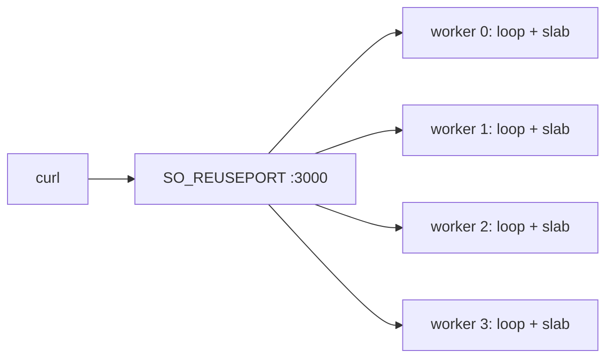

Ví dụ này khởi động bốn worker shared-nothing. Mỗi worker cấp phát slab riêng,
chạy event loop riêng và bind port 3000 qua `SO_REUSEPORT` ở nền tảng hỗ trợ.
Không connection state, request buffer hay queue nào được chia sẻ giữa các
worker. Chương trình là `examples/shared_nothing_cluster.zig` trong framework
repository.

## Source [#source]

```zig src/main.zig
//! Shared-nothing worker group: one libxev loop and slab set per core.
//!
//! Build and run:
//!   zig build shared_nothing_cluster -Doptimize=ReleaseSafe
//!   curl -s http://127.0.0.1:3000/
//!
//! Each worker binds the same port through SO_REUSEPORT and is pinned to a
//! distinct physical core where the platform allows it. No connection state,
//! request buffer, or event loop is shared between workers.

const std = @import("std");
const uz = @import("uWebZockets");

const worker_count = 4;

fn hello(_: *uz.Request, res: *uz.Response) void {
    res.text("hello from a pinned shared-nothing worker") catch {};
}

pub fn main(init: std.process.Init) !void {
    var group = try uz.Server.builder(init.io)
        .with_max_clients(128)
        .with_write_queue_size(32 * 1024)
        .with_idle_timeout_ms(60_000)
        .build_cluster(std.heap.page_allocator, worker_count, .{});
    defer group.deinit();

    const Cluster = @TypeOf(group);
    try group.configure(struct {
        fn routes(worker: *Cluster.Worker, index: usize) !void {
            _ = index;
            _ = try worker.get("/", hello);
        }
    }.routes);

    try group.listen("0.0.0.0", 3000);
    try group.run();
}
```

[Full source](https://github.com/farbenbuilds/uWebZockets/blob/v2.1.6/examples/shared_nothing_cluster.zig)

Dòng `zig build shared_nothing_cluster` trong module header là bước trong
framework checkout. Trong project của bạn, dùng `zig build run` như bên dưới.

## Build wiring [#build-wiring]

Thêm dependency vào project của bạn:

```sh
zig fetch --save 'https://github.com/farbenbuilds/uWebZockets/archive/refs/tags/v2.1.6.tar.gz'
```

Wire module vào `build.zig` như trong
[Run an example in your project](/examples#run-an-example-in-your-project), copy
chương trình trên vào `src/main.zig` và chạy `zig build run`. Build thêm module
import `uWebZockets` và không cần framework checkout.

## Run [#run]

```sh
zig build run
```

Process khởi động bốn worker thread. Mỗi worker in record development log riêng
và sở hữu một slab. Chương trình không gọi `catch_shutdown_signals`, nên Ctrl+C
kết thúc process mà không drain. Thêm `try group.catch_shutdown_signals();`
trước `listen` khi worker sở hữu công việc cần dừng sạch.

Trong framework checkout,
`zig build shared_nothing_cluster -Doptimize=ReleaseSafe` chạy cùng chương
trình. Đó là contributor shortcut, không phải application path.

## Verify [#verify]

```sh
curl -s http://127.0.0.1:3000/
```

```console
hello from a pinned shared-nothing worker
```

Body dài 41 byte. Lặp request vài lần. Trên nền tảng có `SO_REUSEPORT`, kernel
phân phối connection mới trên bốn listening socket; một TCP connection riêng lẻ
nằm trên worker đã accept nó.

## Worker layout [#worker-layout]



Pinning là best effort. Linux chọn một CPU đại diện cho mỗi physical core và
gọi `sched_setaffinity`. Windows dùng process affinity mask. macOS không có API
hard-affinity, nên worker chạy không pin. Affinity call fail sẽ log một lần và
để worker unpinned thay vì từ chối khởi động.

Windows cluster bind địa chỉ chia sẻ bằng `SO_REUSEADDR` vì không có
`SO_REUSEPORT`. Kernel phân phối connection giữa các listener không được đảm
bảo trên nền tảng đó.

## Key APIs [#key-apis]

| Lệnh gọi                                            | Tác dụng                                                   |
| --------------------------------------------------- | ---------------------------------------------------------- |
| `uz.Server.builder(init.io)`                        | Bắt đầu cấu hình fluent cho một worker group               |
| `.with_max_clients(128)`                            | Đặt 128 connection slot cho mỗi worker                     |
| `.with_write_queue_size(32 * 1024)`                 | Đặt write queue 32 KiB cho mỗi connection                  |
| `.with_idle_timeout_ms(60_000)`                     | Đóng keep-alive connection đã drain sau 60 s               |
| `.build_cluster(page_allocator, worker_count, .{})` | Compile bốn worker và allocate slab cho từng worker        |
| `group.configure(...)`                              | Đăng ký route một lần mỗi worker trước khi thread nào chạy |
| `group.listen("0.0.0.0", 3000)`                     | Bind mọi worker vào cùng port                              |
| `group.run()`                                       | Spawn worker, join và trả về failure đầu tiên              |
| `group.deinit()`                                    | Giải phóng worker storage sau khi mọi loop dừng            |

`build_cluster` nhận worker capacity lúc compile. Tham số cuối là
`ClusterOptions`, có thể chọn số worker active nhỏ hơn. Dùng
`build_cluster_from_environment` khi muốn `UWEBZOCKETS_WORKERS` ghi đè mặc
định CPU count.

## Capacities [#capacities]

| Capacity               |             Value | Set by                                  | Consequence                                    |
| ---------------------- | ----------------: | --------------------------------------- | ---------------------------------------------- |
| Workers                |                 4 | `build_cluster(..., worker_count, .{})` | Bốn slab, bốn loop, bốn listener               |
| Connections mỗi worker |               128 | `.with_max_clients(128)`                | Worker đó từ chối connection đồng thời thứ 129 |
| Write queue            |            32 KiB | `.with_write_queue_size(32 * 1024)`     | Queue đầy trả `error.WouldBlock`               |
| Idle timeout           |              60 s | `.with_idle_timeout_ms(60_000)`         | Keep-alive connection đã drain sẽ đóng         |
| Body                   |            16 KiB | Default                                 | Body lớn hơn nhận `413`                        |
| Request line           |             8 KiB | Default                                 | Request line lớn hơn nhận `431`                |
| Headers                | 16 KiB, 64 fields | Default                                 | Header block lớn hơn nhận `431`                |
| WebSocket message      |            16 KiB | Default                                 | Message lớn hơn bị từ chối                     |
| Cluster inbox          |        64 message | Default                                 | Inbox đầy trả `error.ClusterQueueFull`         |

Write queue là per connection và connection count là per worker, nên group giữ
bốn slab độc lập. Worker count lớn hơn số physical core sẽ quấn vòng trên các
core đã chọn thay vì giữ slab cho worker không dùng.

## Variation [#variation]

Chọn số worker active lúc khởi động thay vì compile vào lệnh gọi:

```zig
var group = try uz.Server.builder(init.io)
    .with_max_clients(128)
    .with_write_queue_size(32 * 1024)
    .with_idle_timeout_ms(60_000)
    .build_cluster_from_environment(
        std.heap.page_allocator,
        8,
        init.environ_map,
        .{},
    );
```

Ở đây 8 là compiled capacity. Chạy `UWEBZOCKETS_WORKERS=6 zig build run` để
khởi động sáu worker active. `ClusterOptions.worker_count` tường minh thắng
environment, và environment thắng CPU count. Zero, giá trị không phải số hoặc
giá trị vượt capacity fail trước khi slab nào được allocate.

## Next [#next]

- [Hello world](/examples/hello-world) là điểm bắt đầu cho single application.
- [TLS cluster](/examples/tls-cluster) thêm một TLS context cho mỗi worker.
- [Your first cluster](/examples/first-cluster) đi qua cluster lifecycle
  và failure reporting.
- [Shared-nothing workers](/docs/concepts/shared-nothing) giải thích ownership
  model chi tiết.
