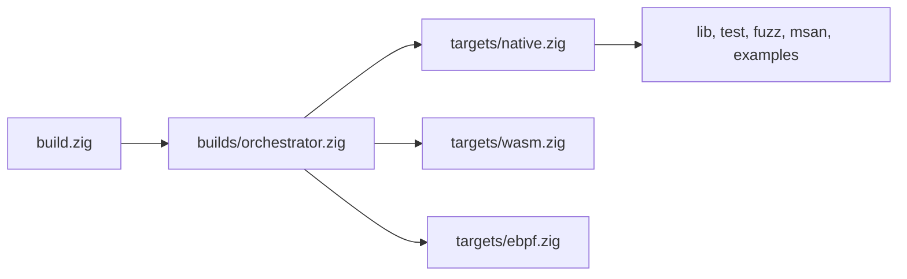

:::note[Contributing to µWebZockets]
Trang này mô tả framework repository tại
[farbenbuilds/uWebZockets](https://github.com/farbenbuilds/uWebZockets), không
phải application project. Mọi command ở đây chạy từ framework checkout. Đọc
[CONTRIBUTE.md](https://github.com/farbenbuilds/uWebZockets/blob/main/CONTRIBUTE.md)
trước khi thay đổi hoặc verify framework. Application dùng `zig fetch --save` và
`build.zig` của riêng nó; xem [Installation](/docs/getting-started/installation)
và [C ABI consumer build](/reference/c-abi#consumer-buildzig).
:::

Root `build.zig` chỉ khởi tạo graph. Target, vendor, sanitizer, test, fuzz và
example construction nằm trong `builds/*.zig`. Mỗi named step dưới đây là
contributor command; không step nào dành cho application.

## Build graph [#build-graph]



| Module                      | Owns                                                       |
| --------------------------- | ---------------------------------------------------------- |
| `builds/orchestrator.zig`   | Target selection, `clangd` và `all-targets`                |
| `builds/targets/native.zig` | Native library, header, vendor archive và graph wiring     |
| `builds/targets/wasm.zig`   | `wasm-freestanding`, `wasm-wasi` và `wasm`                 |
| `builds/targets/ebpf.zig`   | `uwz_xdp.o` và `uwz_latency.o`                             |
| `builds/testing.zig`        | `test`, `test-compile`, `h1spec`, `autobahn` và `msan`     |
| `builds/fuzzing.zig`        | `fuzz`, `oss-fuzz-objects`, `oss-fuzz-smoke` và `oss-fuzz` |
| `builds/examples.zig`       | Một run step cho mỗi example                               |
| `builds/sanitizers.zig`     | Sanitizer flag và run environment                          |

## Build steps [#build-steps]

| Step                     | Purpose                                                                           | Command                                 | Audience                              |
| ------------------------ | --------------------------------------------------------------------------------- | --------------------------------------- | ------------------------------------- |
| Default install          | Build và install native library, header, vendor archive và example executable     | `zig build`                             | Contributor                           |
| `test`                   | Chạy unit suite, archive check, C ABI smoke và C++ header check                   | `zig build test --summary all`          | Contributor                           |
| `test-compile`           | Compile test, C smoke và C++ header object, chạy archive check mà không chạy test | `zig build test-compile`                | Contributor                           |
| `lib`                    | Build và install static library, header và năm dependency archive                 | `zig build lib -Doptimize=ReleaseFast`  | Contributor; tạo archive cho consumer |
| `clangd`                 | Ghi `compile_flags.txt` ở repository root từ pinned dependency                    | `zig build clangd`                      | Contributor                           |
| `fuzz`                   | Chạy deterministic parser fuzz smoke input; nhận `--fuzz=<count>`                 | `zig build fuzz --fuzz=100K`            | Contributor                           |
| `oss-fuzz-objects`       | Build năm libFuzzer ABI object và verify sanitizer coverage section               | `zig build oss-fuzz-objects`            | Contributor                           |
| `oss-fuzz-smoke`         | Chạy năm deterministic protocol-boundary smoke input                              | `zig build oss-fuzz-smoke`              | Contributor                           |
| `oss-fuzz`               | Build OSS-Fuzz object và chạy smoke input                                         | `zig build oss-fuzz`                    | Contributor                           |
| `msan`                   | Chạy instrumented C và C++ dependency-boundary smoke                              | `zig build msan -Dmemory-sanitize=true` | Contributor                           |
| `autobahn`               | Build và chạy Autobahn compliance server                                          | `zig build autobahn`                    | Contributor                           |
| `h1spec`                 | Build và chạy h1spec compliance server                                            | `zig build h1spec`                      | Contributor                           |
| `ebpf`                   | Build AF_XDP redirect và latency eBPF object                                      | `zig build ebpf`                        | Contributor                           |
| `wasm-freestanding`      | Build V8 isolate WebAssembly target                                               | `zig build wasm-freestanding`           | Contributor                           |
| `wasm-wasi`              | Build WASI WebAssembly target                                                     | `zig build wasm-wasi`                   | Contributor                           |
| `wasm`                   | Build cả hai WebAssembly target                                                   | `zig build wasm`                        | Contributor                           |
| `all-targets`            | Build native install artifact, cả hai WebAssembly target và eBPF object           | `zig build all-targets`                 | Contributor                           |
| `hello_world`            | Chạy hello-world example server                                                   | `zig build hello_world`                 | Contributor; shortcut cho example     |
| `https_server`           | Chạy ephemeral HTTPS example server                                               | `zig build https_server`                | Contributor; shortcut cho example     |
| `chat_server`            | Chạy WebSocket chat example server                                                | `zig build chat_server`                 | Contributor; shortcut cho example     |
| `http3_server`           | Chạy HTTP/3 example server                                                        | `zig build http3_server`                | Contributor; shortcut cho example     |
| `rpc_server`             | Chạy JSON-RPC example server                                                      | `zig build rpc_server`                  | Contributor; shortcut cho example     |
| `basic_microservice`     | Chạy microservice preset example                                                  | `zig build basic_microservice`          | Contributor; shortcut cho example     |
| `custom_builder`         | Chạy custom builder example                                                       | `zig build custom_builder`              | Contributor; shortcut cho example     |
| `shared_nothing_cluster` | Chạy shared-nothing worker group example                                          | `zig build shared_nothing_cluster`      | Contributor; shortcut cho example     |
| `tls_cluster`            | Chạy TLS-enabled worker group example                                             | `zig build tls_cluster`                 | Contributor; shortcut cho example     |
| `delay_server`           | Chạy async delay timing-wheel example                                             | `zig build delay_server`                | Contributor; shortcut cho example     |

Các compliance step khởi động một server và block đến khi external suite hoặc signal
dừng nó. Step `h1spec` cần `vendor/h1spec` submodule đã pin. Các example step là
wrapper tiện dụng quanh framework binary; application chạy `zig build run` target
của riêng nó.

## Flags [#flags]

| Flag                                | Values                                                | Effect                                                                                        |
| ----------------------------------- | ----------------------------------------------------- | --------------------------------------------------------------------------------------------- |
| `-Dtarget=<triple>`                 | Mọi Zig target resolve được sang OS hỗ trợ            | Chọn build target; `wasm32` phải dùng `freestanding` hoặc `wasi`                              |
| `-Doptimize=<mode>`                 | `Debug`, `ReleaseSafe`, `ReleaseFast`, `ReleaseSmall` | Đặt optimization mode; `Debug` là default                                                     |
| `-Dsanitize=true`                   | Boolean                                               | Bật ASan, UBSan và LSan native Linux trên C/C++ dependency và C ABI graph                     |
| `-Dmemory-sanitize=true`            | Boolean                                               | Bật MemorySanitizer dependency-boundary smoke riêng cho x86_64 Linux                          |
| `-Dsanitizer-lib-dir=<path>`        | Directory                                             | Trỏ đến LLVM sanitizer runtime; cũng dùng `UWEBZOCKETS_SANITIZER_LIB_DIR`                     |
| `-Dsanitizer-libc-dir=<path>`       | Directory                                             | Trỏ đến libc mà sanitizer runtime dùng; cũng dùng `UWEBZOCKETS_SANITIZER_LIBC_DIR`            |
| `-Dsanitizer-dynamic-linker=<path>` | File                                                  | Đặt dynamic linker cho sanitizer executable; cũng dùng `UWEBZOCKETS_SANITIZER_DYNAMIC_LINKER` |

`-Dsanitize=true` và `-Dmemory-sanitize=true` loại trừ nhau, và cả hai yêu cầu
native Linux target. ASan/UBSan hỗ trợ `x86_64` và `aarch64`; MSan chỉ hỗ trợ
`x86_64`. Sanitizer build thiếu `-Dsanitizer-lib-dir` hoặc environment fallback
sẽ fail lúc configure. `-Dsanitizer-libc-dir` và `-Dsanitizer-dynamic-linker`
phải được truyền cùng nhau.

`UWEBZOCKETS_DEFAULT_TARGET` đặt default target khi không có `-Dtarget`. Giá trị
phải parse được thành Zig target triple.

### Sanitizer commands [#sanitizer-commands]

```sh
zig build test -Dsanitize=true -Doptimize=ReleaseSafe --summary all
zig build test -Dsanitize=true -Doptimize=ReleaseSafe \
  -Dsanitizer-lib-dir=/path/to/compiler-rt/lib --summary all
zig build msan -Dmemory-sanitize=true -Doptimize=ReleaseSafe \
  -Dsanitizer-lib-dir=/path/to/compiler-rt/lib --summary all
```

Trong Nix development shell, các biến `UWEBZOCKETS_SANITIZER_*` cung cấp runtime,
libc và linker path khớp. Ngoài Nix, truyền runtime directory rõ ràng. Step
`msan` không có `-Dmemory-sanitize=true` sẽ fail theo thiết kế.

## Cross-compilation [#cross-compilation]

```sh
zig build test-compile -Dtarget=x86_64-windows-gnu -Doptimize=ReleaseSafe
zig build lib -Dtarget=x86_64-windows-gnu -Doptimize=ReleaseFast
zig build -Dtarget=aarch64-linux-musl -Doptimize=ReleaseSafe
zig build -Dtarget=wasm32-wasi -Doptimize=ReleaseSafe
```

`-Dtarget` chọn native hoặc cross target. Khi chọn `wasm32`, build cài trực
tiếp WebAssembly artifact đã chọn và không đăng ký native step graph, gồm các
named `wasm-*` step. Các named step `wasm`, `wasm-freestanding` và `wasm-wasi`
dành cho host target không phải WASM.

`all-targets` gồm step `ebpf`, step này fail trên build host không phải Linux.
Dùng `zig build` hoặc `zig build lib` trên macOS và Windows.

## Outputs [#outputs]

| Output             | Path                                                                           |
| ------------------ | ------------------------------------------------------------------------------ |
| C ABI archive      | `zig-out/lib/libuWebZockets.a`                                                 |
| Dependency archive | `zig-out/lib/libssl.a`, `libcrypto.a`, `liblsquic.a`, `libdeflate.a`, `libz.a` |
| C header           | `zig-out/include/uWebZockets.h`                                                |
| Freestanding WASM  | `zig-out/wasm/uWebZockets-freestanding.wasm`                                   |
| WASI WASM          | `zig-out/wasm/uWebZockets-wasi.wasm`                                           |
| eBPF object        | `zig-out/share/uwebzockets/uwz_xdp.o`, `uwz_latency.o`                         |
| OSS-Fuzz object    | `zig-out/oss-fuzz/*.o`                                                         |
| clangd flags       | `compile_flags.txt` ở repository root                                          |

`lib` là step duy nhất cài sáu link archive và header cùng nhau. Một
consumer project thường nhận cùng artifact qua `uz.artifact("uWebZockets")` và
năm dependency artifact thay vì build local; xem
[C ABI reference](/reference/c-abi#linking).

## Application boundary [#application-boundary]

Application project không chạy command nào trên trang này. Nó thêm package bằng
`zig fetch --save`, import `uWebZockets` trong `build.zig` của mình, và chạy
`zig build` hoặc `run` step riêng. C ABI consumer pattern ở
[C ABI](/reference/c-abi#consumer-buildzig), và chương trình C đầy đủ ở
[Embed from C or C++](/docs/guides/c-abi).

Dùng contributor workflow cho công việc tương ứng:
[Build from source](/docs/operations/build), [Tests](/docs/operations/testing),
[Sanitizers](/docs/operations/sanitizers), [Fuzzing](/docs/operations/fuzzing),
[Cross-compilation](/docs/operations/cross-compilation) và
[WASM](/docs/operations/wasm).

## Related [#related]

- [C ABI](/reference/c-abi) sở hữu archive list và consumer build.
- [Operations](/docs/operations) bao phủ contributor workflow.
- [Compatibility](/reference/compatibility) nêu baseline Zig và platform được
  hỗ trợ.
