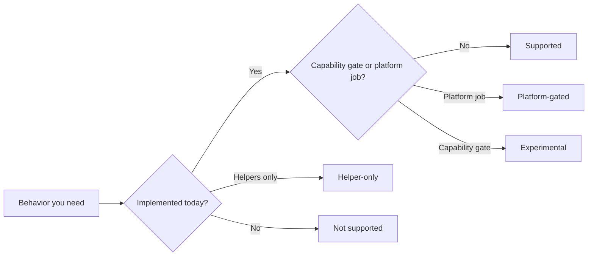

Ma trận này là boundary register cho µWebZockets 2.1.6. Mỗi row nêu feature,
status, public surface, trang sở hữu behavior và evidence đằng sau claim. Status
lấy từ coverage matrix của project và site không nâng cấp chúng. Khi một row và
owner page mâu thuẫn, báo conflict thay vì chọn câu trả lời dễ chịu hơn.

## Cách đọc một row [#how-to-read-a-row]

| Cột            | Ý nghĩa                                                                   |
| -------------- | ------------------------------------------------------------------------- |
| Feature        | Behavior hoặc protocol surface mà design phụ thuộc vào                    |
| Status         | Một trong năm status bên dưới, cộng qualifier từ coverage matrix          |
| Public surface | Type, function, build step hoặc header mà application dùng                |
| Owner page     | Trang giải thích behavior, limit và rejection path                        |
| Evidence       | Source module, framework document dưới `docs/`, ADR hoặc compliance suite |

Evidence path như `src/router/app.zig` và `docs/http.md` thuộc repository
[farbenbuilds/uWebZockets](https://github.com/farbenbuilds/uWebZockets), không
thuộc site này. Chúng xác định claim, không phải tài liệu bắt buộc phải đọc.

## Ý nghĩa status [#status-meanings]

| Status         | Ý nghĩa                                                                                    | Kiểm tra trước khi dựa vào                     |
| -------------- | ------------------------------------------------------------------------------------------ | ---------------------------------------------- |
| Supported      | Đã implement và truy cập được qua public surface đã document                               | Limit ở owner page vẫn áp dụng                 |
| Helper-only    | Helper module được ship, nhưng live server path không dùng nó                              | Server không dùng nó trong live path           |
| Experimental   | Surface đã ship nhưng nằm sau capability gate đã document; API hoặc behavior có thể đổi    | Xác nhận capability gate và độ ổn định API     |
| Platform-gated | Code path build được hoặc chạy được, nhưng support claim chờ platform job hoặc CI coverage | Kiểm tra platform page trước khi claim support |
| Not supported  | Boundary có chủ đích, không phải thiếu undocumented                                        | Dùng alternative được nêu                      |

Từ gốc là status. Text trong ngoặc là qualifier từ coverage matrix, ví dụ
opt-in, bounded, one per connection hoặc development only. Qualifier thu hẹp
cam kết và không bao giờ nâng nó. Khi coverage matrix dùng boundary label như
Optional hoặc Community build only, trang này map nó vào base status gần nhất và
giữ label gốc làm qualifier.

Experimental là một phần của vocabulary nhưng không có row hiện tại. WebTransport
helper là Helper-only, và Windows claim là Platform-gated.

## Application và cluster [#application-and-cluster]

| Feature                                               | Status    | Public surface                           | Owner page                                            | Evidence                 |
| ----------------------------------------------------- | --------- | ---------------------------------------- | ----------------------------------------------------- | ------------------------ |
| `App(N)`, `ConfiguredApp`, `ConfiguredAppWithTimeout` | Supported | `uz.App`, `uz.ConfiguredApp`             | [Application model](/docs/concepts/application-model) | `src/router/app.zig`     |
| Fluent `Server.builder`                               | Supported | `uz.Server`                              | [Server lifecycle](/docs/http/server-lifecycle)       | `src/router/builder.zig` |
| Thread-per-core cluster                               | Supported | `uz.Server.builder(...).build_cluster`   | [Cluster model](/docs/concepts/cluster-model)         | `docs/architecture.md`   |
| Cluster TLS                                           | Supported | `enable_https`, `enable_https_ephemeral` | [TLS cluster](/docs/security/tls-clusters)            | `docs/tls.md`            |

## HTTP/1.1 và helper [#http11-and-helpers]

| Feature                           | Status             | Public surface                                 | Owner page                                                          | Evidence                          |
| --------------------------------- | ------------------ | ---------------------------------------------- | ------------------------------------------------------------------- | --------------------------------- |
| HTTP/1.1 parsing và routing       | Supported          | `Request`, `Response`, router                  | [HTTP](/docs/http)                                                  | `docs/http.md`, h1spec            |
| HTTP/1.1 pipelining               | Supported          | Transparent                                    | [HTTP](/docs/http)                                                  | `docs/http.md`                    |
| Static file                       | Supported          | `App.static`, `static_files`                   | [Static file](/docs/http/static-files)                              | `src/http/static_files.zig`       |
| Streaming response                | Supported          | `begin_stream`, `StreamProducer`               | [Streaming](/docs/http/streaming)                                   | `src/http/response.zig`           |
| Chunked response                  | Supported          | `begin_chunked`, `write_chunk`                 | [Chunked](/docs/http/chunked)                                       | `src/http/response.zig`           |
| SSE                               | Supported          | `Response.sse`                                 | [Server-sent events](/docs/http/server-sent-events)                 | `src/http/response.zig`           |
| JSON helper                       | Supported          | `json`, `json_buf`, `begin_json`               | [JSON](/docs/http/json)                                             | `src/http/response.zig`           |
| Schema validation                 | Supported          | `uz.schema`                                    | [Schema validation](/docs/type-safety/schema-validation)            | `src/http/schema.zig`             |
| Query và form parsing             | Supported          | `query`, `form`, `Request` helper              | [Query và form](/docs/http/helpers/query-and-forms)                 | `src/http/query.zig`              |
| Multipart parsing                 | Supported          | `uz.multipart`                                 | [Multipart](/docs/http/helpers/multipart)                           | `src/http/multipart.zig`          |
| Cookie và chữ ký                  | Supported          | `uz.cookie`, `Response.set_cookie`             | [Cookie](/docs/http/helpers/cookies)                                | `src/http/cookie.zig`             |
| Gzip response                     | Supported          | `Response.end_gzip`                            | [Compression](/docs/http/helpers/compression)                       | `src/http/response.zig`           |
| Compression stream và pool        | Supported          | `uz.compression_stream`, `uz.compression_pool` | [Compression](/docs/http/helpers/compression)                       | `src/http/compression_stream.zig` |
| Fetch, streams và abort primitive | Supported          | `uz.fetch`, `uz.streams`, `uz.abort`           | [Fetch, streams, abort](/docs/http/helpers/fetch-streams-and-abort) | `src/http/fetch.zig`              |
| ETag và cache helper              | Supported          | `uz.cache`                                     | [Caching](/docs/http/helpers/caching)                               | `src/http/cache.zig`              |
| Content negotiation               | Supported          | `uz.negotiate`                                 | [Content negotiation](/docs/http/helpers/content-negotiation)       | `src/http/negotiate.zig`          |
| CORS                              | Supported          | `middleware.Cors`                              | [CORS](/docs/http/cors)                                             | `src/http/middleware.zig`         |
| Security header                   | Supported          | `middleware.SecurityHeaders`                   | [Security header](/docs/http/security-headers)                      | `src/http/middleware.zig`         |
| Basic và Bearer auth              | Supported          | `middleware.Auth`                              | [Authentication](/docs/http/authentication)                         | `src/http/middleware.zig`         |
| Rate limiting                     | Supported          | `middleware.RateLimit`                         | [Rate limiting](/docs/http/rate-limiting)                           | `src/http/middleware.zig`         |
| OpenAPI output                    | Supported          | `App.openapi`                                  | [OpenAPI](/docs/http/openapi)                                       | `src/http/openapi.zig`            |
| RFC 10008 `QUERY`                 | Supported          | `App.query`                                    | [QUERY method](/docs/http/query-method)                             | `docs/quic.md`                    |
| `TRACE`                           | Supported (opt-in) | `App.trace`                                    | [TRACE](/docs/http/trace)                                           | `docs/roadmap.md`                 |

## WebSocket [#websocket]

| Feature                                     | Status                         | Public surface                             | Owner page                                         | Evidence            |
| ------------------------------------------- | ------------------------------ | ------------------------------------------ | -------------------------------------------------- | ------------------- |
| WebSocket server                            | Supported                      | `App.ws`, `WebSocket`                      | [WebSocket](/docs/websocket)                       | Autobahn            |
| RFC 7692 compression                        | Supported                      | `WsBehavior.compression`                   | [WS compression](/docs/websocket/compression)      | `docs/websocket.md` |
| WebSocket pub/sub                           | Supported                      | `subscribe`, `publish`                     | [Pub/sub](/docs/websocket/pub-sub)                 | `docs/websocket.md` |
| WebSocket stream adapter                    | Supported                      | `WebSocketStream`, `NativeWebSocketStream` | [WS stream](/docs/http/helpers/websocket-streams)  | `src/ws/stream.zig` |
| Cluster pub/sub                             | Supported                      | `Cluster.publish`                          | [Cluster pub/sub](/docs/websocket/cluster-pub-sub) | ADR 0007            |
| RFC 8441 HTTP/2 tunnel                      | Supported (one per connection) | Extended CONNECT                           | [HTTP/2 tunnel](/docs/websocket/http2-tunnels)     | `docs/http2.md`     |
| WebSocket client                            | Not supported                  | None                                       | [WebSocket](/docs/websocket)                       | Roadmap             |
| WebSocket origin và subprotocol negotiation | Supported (application-owned)  | `Request` header                           | [WS security](/docs/security/websocket-security)   | `docs/websocket.md` |

## HTTP/2 [#http2]

| Feature                   | Status                                            | Public surface                  | Owner page                               | Evidence              |
| ------------------------- | ------------------------------------------------- | ------------------------------- | ---------------------------------------- | --------------------- |
| HTTP/2 request routing    | Supported (bounded)                               | `init_https`, plaintext preface | [HTTP/2](/docs/http2)                    | `docs/http2.md`       |
| HTTP/2 HPACK              | Supported (bounded)                               | `uz.http2_hpack`                | [HPACK](/docs/http2/hpack)               | `src/http2/hpack.zig` |
| HTTP/2 flow control       | Supported                                         | Transparent                     | [Flow control](/docs/http2/flow-control) | `src/http2`           |
| HTTP/2 server push        | Not supported                                     | None                            | [HTTP/2](/docs/http2)                    | Roadmap               |
| h2c Upgrade               | Not supported                                     | Prior knowledge only            | [HTTP/2](/docs/http2)                    | Roadmap               |
| HTTP/2 nhiều hơn 8 stream | Not supported (without connection specialization) | Compile-time                    | [HTTP/2 limit](/docs/http2/limits)       | Roadmap               |

## HTTP/3 và WebTransport [#http3-and-webtransport]

| Feature                | Status                        | Public surface                           | Owner page                                    | Evidence             |
| ---------------------- | ----------------------------- | ---------------------------------------- | --------------------------------------------- | -------------------- |
| HTTP/3 request routing | Supported                     | `init_http3`, `listen_udp`               | [HTTP/3](/docs/http3)                         | curl/ngtcp2, aioquic |
| HTTP/3 QPACK           | Supported (bounded)           | `src/quic/stream.zig`                    | [QPACK](/docs/http3/qpack)                    | `docs/quic.md`       |
| HTTP/3 0-RTT           | Not supported (live listener) | Disabled on the live listener            | [Early data](/docs/http3/early-data)          | `docs/quic.md`       |
| HTTP/3 clustering      | Not supported                 | None                                     | [HTTP/3](/docs/http3)                         | Roadmap              |
| HTTP/3 metrics parity  | Not supported                 | Development log only                     | [H3 observability](/docs/http3/observability) | Roadmap              |
| WebTransport live      | Not supported                 | Helper model only                        | [WebTransport](/docs/http3/webtransport)      | ADR 0001             |
| WebTransport helper    | Helper-only                   | `uz.webtransport`, `uz.http3_extensions` | [WebTransport](/docs/http3/webtransport)      | Source               |

## JSON-RPC và client [#json-rpc-and-client]

| Feature                               | Status                             | Public surface    | Owner page                                         | Evidence           |
| ------------------------------------- | ---------------------------------- | ----------------- | -------------------------------------------------- | ------------------ |
| Typed JSON-RPC                        | Supported                          | `register_typed`  | [Typed procedure](/docs/json-rpc/typed-procedures) | `docs/json_rpc.md` |
| HTTP/1.1 client                       | Supported (bounded)                | `uz.client`       | [Client](/docs/client)                             | `docs/client.md`   |
| Client DNS                            | Not supported (numeric hosts only) | Numeric host only | [Client limit](/docs/client/limits)                | `docs/client.md`   |
| Client redirect, cookie, proxy, retry | Not supported                      | None              | [Client limit](/docs/client/limits)                | `docs/client.md`   |
| Client mTLS                           | Not supported                      | None              | [TLS trust](/docs/client/tls-trust)                | `docs/client.md`   |
| Client HTTP/2 và HTTP/3               | Not supported                      | None              | [Client limit](/docs/client/limits)                | `docs/client.md`   |

## TLS [#tls]

| Feature                | Status                          | Public surface                  | Owner page                                                       | Evidence      |
| ---------------------- | ------------------------------- | ------------------------------- | ---------------------------------------------------------------- | ------------- |
| TLS 1.3 termination    | Supported                       | `init_https`, `init_https_mtls` | [TLS](/docs/security/tls)                                        | `docs/tls.md` |
| Ephemeral certificate  | Supported (development)         | `init_https_ephemeral`          | [Ephemeral certificate](/docs/security/ephemeral-certificates)   | `docs/tls.md` |
| Production PEM         | Supported                       | `init_https`                    | [Production certificate](/docs/security/production-certificates) | `docs/tls.md` |
| mTLS                   | Supported (TCP only)            | `init_https_mtls`               | [mTLS](/docs/security/mtls)                                      | `docs/tls.md` |
| TLS 1.2                | Not supported                   | None                            | [TLS](/docs/security/tls)                                        | Roadmap       |
| Hot certificate reload | Not supported (rolling restart) | Rolling restart                 | [Certificate rotation](/docs/security/certificate-rotation)      | ADR 0003      |

## Operations và platform [#operations-and-platforms]

| Feature                       | Status                                 | Public surface                           | Owner page                                            | Evidence             |
| ----------------------------- | -------------------------------------- | ---------------------------------------- | ----------------------------------------------------- | -------------------- |
| C ABI                         | Supported (high-level subset)          | `include/uWebZockets.h`                  | [C ABI](/reference/c-abi)                             | Header, C test       |
| Metrics registry              | Supported (TCP only)                   | `metrics`, `/metrics`                    | [Metrics](/docs/operations/metrics)                   | `src/observability`  |
| Development log               | Supported                              | `dev_log`, `ServerConfig.enable_dev_log` | [Logging](/docs/operations/logging)                   | `src/observability`  |
| eBPF histogram                | Supported (optional)                   | `ebpf` build step, pinned map            | [eBPF](/docs/operations/ebpf)                         | `docs/operations.md` |
| kTLS                          | Helper-only                            | `uz.ktls`                                | [kTLS](/docs/operations/ktls)                         | Roadmap              |
| AF_XDP                        | Helper-only (data path unwired)        | `uz.xdp`, `uz.xdp_transport`             | [AF_XDP](/docs/operations/af-xdp)                     | Roadmap              |
| WASM edge                     | Supported (build targets, bounded API) | `wasm-freestanding`, `wasm-wasi`         | [WASM](/docs/operations/wasm)                         | `docs/operations.md` |
| Shared memory và Cap'n Proto  | Supported (module)                     | `uz.shared_memory`                       | [Architecture](/docs/architecture)                    | Source               |
| Tập con Web Crypto            | Supported                              | `uz.crypto_subtle`                       | [Security](/docs/security)                            | Source               |
| Fuzzing                       | Supported                              | `zig build fuzz`, OSS-Fuzz               | [Fuzzing](/docs/operations/fuzzing)                   | `docs/operations.md` |
| Hỗ trợ chính thức cho Windows | Platform-gated                         | Compile cộng runtime job                 | [Windows](/docs/deployment/windows)                   | ADR 0004, roadmap    |
| Hỗ trợ runtime BSD            | Platform-gated (community builds)      | Shared build graph                       | [BSD](/docs/deployment/bsd)                           | Roadmap              |
| Tăng capacity động            | Not supported (fixed slabs)            | Slab cố định                             | [Capacity model](/docs/concepts/capacity-model)       | Roadmap              |
| Streaming request body        | Not supported (buffered)               | Buffered body                            | [Request lifecycle](/docs/concepts/request-lifecycle) | Roadmap              |

## Trang liên quan [#related]

- [Compatibility](/reference/compatibility) nêu version, platform, dependency và
  release policy phía sau các status này.
- [Protocol matrix](/reference/protocol-matrix) so sánh wire behavior của các
  transport được hỗ trợ.
- [Limits](/reference/limits) liệt kê capacity áp dụng sau khi một status là
  Supported.
- [Migration](/docs/migration) map framework khác lên các boundary này.
