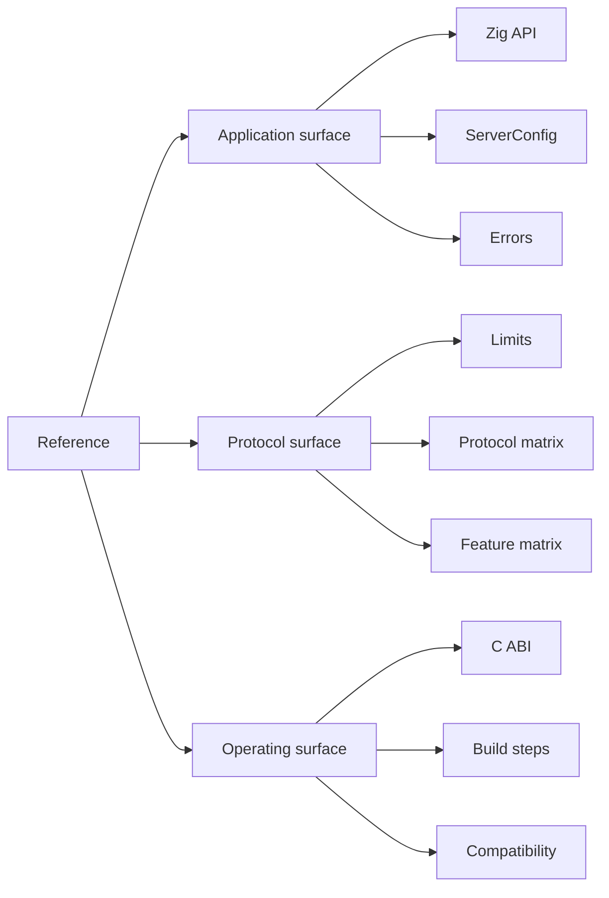

Reference là lookup surface cho fact chính xác. Nó theo µWebZockets 2.1.6 và Zig
0.16.0. Dùng task page cho procedure, rồi quay lại đây cho signature, default,
error hoặc capacity.

Mỗi bảng gọi tên source sở hữu fact đó. Khi một giá trị thay đổi trong framework,
reference page thay đổi trong cùng release; tutorial dùng giá trị đó link về đây
thay vì copy.

## Start with the fact you need [#start-with-the-fact-you-need]

| Fact                               | Page                                          | Use it for                                       |
| ---------------------------------- | --------------------------------------------- | ------------------------------------------------ |
| Public Zig name hoặc module        | [Zig API index](/reference/zig)               | Tìm owning type, module hoặc task page           |
| Startup capacity hoặc timeout      | [ServerConfig](/reference/server-config)      | So sánh default, override và constraint          |
| Protocol hoặc router limit         | [Limits](/reference/limits)                   | Size deployment và dự đoán rejection             |
| Zig error name                     | [Errors](/reference/errors)                   | Xác định cause, status và fix                    |
| C handle, function hoặc enum       | [C ABI](/reference/c-abi)                     | Nhúng server từ C hoặc C++                       |
| Build step hoặc flag               | [Build steps](/reference/build-steps)         | Compile, test, sanitize, fuzz hoặc cross-compile |
| Feature supported hoặc unsupported | [Feature matrix](/reference/feature-matrix)   | Quyết định design có implement được không        |
| Version hoặc platform              | [Compatibility](/reference/compatibility)     | Kiểm tra Zig, OS, dependency và release policy   |
| Wire protocol behavior             | [Protocol matrix](/reference/protocol-matrix) | So sánh transport, ALPN, framing và compliance   |
| Term definition                    | [Glossary lookup](/reference/glossary)        | Giải quyết vocabulary dùng across site           |

## How the reference is organized [#how-the-reference-is-organized]

Ba nhóm khớp với ba thứ reader kiểm tra trước một thay đổi: application type,
wire behavior bên dưới, và build hoặc deployment contract xung quanh.

## Source of truth [#source-of-truth]

| Claim class              | Owning source                                                   | Reference page                              |
| ------------------------ | --------------------------------------------------------------- | ------------------------------------------- |
| Public export            | `src/root.zig`                                                  | [Zig API index](/reference/zig)             |
| Startup field và default | `src/router/config.zig`                                         | [ServerConfig](/reference/server-config)    |
| Protocol limit           | `src/router/config.zig`, `src/http/parser.zig`, protocol module | [Limits](/reference/limits)                 |
| Error name               | Module trả về nó                                                | [Errors](/reference/errors)                 |
| C declaration            | `include/uWebZockets.h`                                         | [C ABI](/reference/c-abi)                   |
| Build step               | `builds/*.zig`                                                  | [Build steps](/reference/build-steps)       |
| Boundary hoặc status     | `docs/roadmap.md`, ADR, `CHANGELOG.md`                          | [Feature matrix](/reference/feature-matrix) |

Site không phải source of truth cho behavior. Nếu reference row và source hiện
tại mâu thuẫn, báo conflict thay vì chọn giá trị dễ chịu hơn.

## Version baseline [#version-baseline]

| Item                   | Value                                                                  |
| ---------------------- | ---------------------------------------------------------------------- |
| µWebZockets            | 2.1.6                                                                  |
| Zig                    | 0.16.0                                                                 |
| Documentation baseline | 2026-11-06                                                             |
| Update rule            | Public behavior hoặc limit change cập nhật reference trong cùng change |

## Related [#related]

- [Migration](/docs/migration) map framework khác lên surface này.
- [Operations](/docs/operations) bao phủ contributor workflow phía sau release.
- [Compatibility](/reference/compatibility) nêu support policy.
