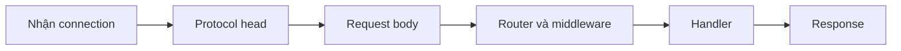

Mọi giới hạn được cố định trước khi listener khởi động. Bảng này trả lời ba câu
hỏi cho từng bề mặt protocol: bound là bao nhiêu, field cấu hình hoặc giá trị
compile-time nào đặt nó, và caller thấy gì khi input vượt qua. Hình dạng
rejection document và status của HTTP nằm ở
[HTTP limits](/docs/http/limits); trang này sở hữu ma trận cross-protocol.

## Cách đọc bảng [#how-to-read]

- `Giá trị` là default của µWebZockets 2.1.6. `Fixed` nghĩa là không có builder
  override.
- `Đặt bởi` nêu field `ServerConfig`, hằng số compile-time hoặc giá trị ABI cố
  định sở hữu bound.
- `Khi vượt` mô tả kết quả caller thấy. Connection bị đóng thì không có
  application callback và không có HTTP response.
- `Source` nêu module enforce bound, không phải trang giải thích nó.

## Bound áp dụng ở đâu [#where-the-bounds-apply]

Các dòng HTTP và WebSocket đi theo đường này. Bound ở lớp trước ngăn lớp sau
chạy, nên một request thường chỉ báo giới hạn đầu tiên nó vượt. Các nhóm client,
cluster và C ABI là bề mặt riêng.

## Giới hạn [#limits-table]

| Nhóm         | Giới hạn                    |                                               Giá trị | Đặt bởi                                     | Khi vượt                                                                     | Source                         |
| ------------ | --------------------------- | ----------------------------------------------------: | ------------------------------------------- | ---------------------------------------------------------------------------- | ------------------------------ |
| HTTP/1.1     | Request line                |                                                 8 KiB | `max_request_line_size`                     | `431` với JSON document                                                      | `src/http/parser.zig`          |
| HTTP/1.1     | Header block                |                                                16 KiB | `max_header_size`                           | `431` với JSON document                                                      | `src/http/parser.zig`          |
| HTTP/1.1     | Header count                |                              64 inline; cấu hình được | `max_header_count`                          | Phần vượt tràn vào slab storage; quá cap thì `431` với JSON document         | `src/http/request.zig`         |
| HTTP/1.1     | Request body                |                                                16 KiB | `max_body_size`                             | `413` với JSON document                                                      | `src/http/parser.zig`          |
| HTTP/1.1     | Header read deadline        |                                                  30 s | `header_read_timeout_ms`                    | Connection bị đóng                                                           | `src/core/tcp.zig`             |
| HTTP/1.1     | Idle keep-alive deadline    |                                                 120 s | `idle_timeout_ms`                           | Connection bị đóng                                                           | `src/core/tcp.zig`             |
| Connection   | Connection đồng thời        |                                                 1.024 | `max_connections`                           | TCP connection mới bị đóng                                                   | `src/core/pool.zig`            |
| Connection   | Write queue                 |                                                64 KiB | `write_queue_size`                          | `error.WouldBlock`; streaming producer tạm dừng và tiếp tục khi drain        | `src/core/tcp.zig`             |
| Router       | Radix node                  |                                                   256 | `max_route_nodes`                           | `error.RouteCapacityReached` lúc đăng ký                                     | `src/router/radix.zig`         |
| Router       | Pattern route               |                                                    64 | `max_pattern_routes`                        | `error.RouteCapacityReached` lúc đăng ký                                     | `src/router/radix.zig`         |
| Router       | Route capture               |                              16 inline; cấu hình được | `max_route_params`                          | `error.RouteParameterCapacityReached` lúc đăng ký                            | `src/router/radix.zig`         |
| Router       | Route path                  |                                                 2 KiB | `max_route_path_size`                       | `error.InvalidRoutePath` lúc đăng ký                                         | `src/router/radix_pattern.zig` |
| Router       | Middleware callback         |                                                    32 | `max_middleware`                            | `error.MiddlewareCapacityReached`                                            | `src/router/radix.zig`         |
| Router       | Route registry              |                                                64 KiB | `max_route_registry_size`                   | `error.RouteStorageCapacityReached`                                          | `src/router/radix.zig`         |
| Router       | OpenAPI route record        |                                                   320 | `max_route_nodes` cộng `max_pattern_routes` | `error.RouteCapacityReached`                                                 | `src/router/radix.zig`         |
| Static files | Static directory mount      |                                                     8 | Fixed                                       | `error.StaticRouteCapacityReached`                                           | `src/router/app.zig`           |
| HTTP/2       | Header block                |                                                16 KiB | `max_h2_header_block_size`                  | `GOAWAY` với `ENHANCE_YOUR_CALM`                                             | `src/http2/server.zig`         |
| HTTP/2       | Request body                |        16 KiB; `min(max_body_size, max_h2_body_size)` | `max_body_size`, `max_h2_body_size`         | Stream hoặc connection fail; không có HTTP response                          | `src/http2/server.zig`         |
| HTTP/2       | Response header block       |                                                 4 KiB | `max_h2_response_header_size`               | Response fail closed                                                         | `src/http2/server.zig`         |
| HTTP/2       | Response header field       |                                                    32 | `max_h2_response_header_count`              | Response fail closed                                                         | `src/http2/server.zig`         |
| HTTP/2       | Stream đồng thời            |                                                     8 | Fixed `max_http2_streams`                   | `RST_STREAM` với `REFUSED_STREAM` cho stream vượt                            | `src/core/tcp.zig`             |
| HTTP/2       | WebSocket tunnel            |                                      1 mỗi connection | Fixed                                       | `CONNECT` thứ hai nhận `503 Service Unavailable`                             | `src/core/tcp.zig`             |
| HTTP/3       | Request body                |                                                16 KiB | `max_h3_body_size`                          | `413 Payload Too Large`                                                      | `src/quic/stream.zig`          |
| HTTP/3       | Response header storage     |                                4.096 B; tối đa 65.535 | `max_h3_response_header_size`               | Response fail closed                                                         | `src/quic/stream.zig`          |
| HTTP/3       | Response header field       |                                      64; tối đa 4.096 | `max_h3_response_header_count`              | Response fail closed                                                         | `src/quic/stream.zig`          |
| HTTP/3       | Decoded request header      | 16 KiB và 64 field; tối đa 65.535 byte khi HTTP/3 bật | `max_header_size`, `max_header_count`       | Stream fail closed với H3 message error                                      | `src/quic/stream.zig`          |
| QUIC         | UDP payload                 |                                                 2 KiB | Fixed                                       | Datagram lớn hơn 2 KiB bị drop                                               | `src/quic/lsquic_api.zig`      |
| QUIC         | Connection và stream active |                                     `max_connections` | `max_connections`                           | Connection hoặc stream mới bị từ chối                                        | `src/quic/engine.zig`          |
| WebSocket    | Message                     |                                                16 KiB | `max_ws_message_size`                       | Connection đóng với protocol failure                                         | `src/ws/socket.zig`            |
| WebSocket    | Control-frame payload       |                                                 125 B | Fixed bởi RFC 6455                          | Control frame bị từ chối; connection đóng                                    | `src/ws/socket.zig`            |
| JSON-RPC     | Procedure                   |                                                    64 | Default `default_max_procedures`            | `error.ProcedureCapacityReached` lúc đăng ký                                 | `src/rpc/json_rpc.zig`         |
| JSON-RPC     | Method storage              |                                                 4 KiB | Default `default_method_storage_capacity`   | `error.MethodStorageCapacityReached` lúc đăng ký                             | `src/rpc/json_rpc.zig`         |
| JSON-RPC     | Response document           |                                                16 KiB | Default `default_response_capacity`         | `error.ResponseTooLarge`; không có JSON-RPC document                         | `src/rpc/json_rpc.zig`         |
| Client       | Response head               |                                                16 KiB | Fixed                                       | Fetch fail với `FailureKind.capacity`                                        | `src/client/types.zig`         |
| Client       | Response body               |                  64 KiB mặc định; có thể đặt thấp hơn | `FetchOptions.response_body_capacity`       | Fetch fail với `FailureKind.capacity`                                        | `src/client/types.zig`         |
| Client       | Response header field       |                                                    64 | Fixed                                       | Fetch fail với `FailureKind.capacity`                                        | `src/client/types.zig`         |
| Client       | Request head                |                                                 8 KiB | Fixed                                       | `error.HeadTooLarge`; `fetch_blocking` báo `FailureKind.protocol`            | `src/client/request.zig`       |
| Client       | Connect timeout             |                                                   5 s | `FetchOptions.connect_timeout_ms`           | Fetch fail với `FailureKind.timeout`                                         | `src/client/types.zig`         |
| Client       | Read timeout                |                                                  10 s | `FetchOptions.read_timeout_ms`              | Fetch fail với `FailureKind.timeout`                                         | `src/client/types.zig`         |
| Cluster      | Worker inbox                |                                            64 message | Fixed `queue_capacity`                      | `PublishReport` ghi `dropped` và `first_dropped_worker`; publish không block | `src/router/cluster.zig`       |
| C ABI        | Connection đồng thời        |                                                 1.024 | Fixed                                       | Connection mới bị đóng                                                       | `src/c_api/types.zig`          |
| C ABI        | Route                       |                                                    64 | Fixed                                       | `UWZ_ERROR_CAPACITY`                                                         | `src/c_api/app.zig`            |
| C ABI        | Middleware callback         |                                                    32 | Fixed                                       | `UWZ_ERROR_CAPACITY`                                                         | `src/c_api/app.zig`            |
| C ABI        | Inline route parameter      |                                                    16 | Fixed                                       | `UWZ_ERROR_CAPACITY` lúc đăng ký                                             | `src/c_api/app.zig`            |
| C ABI        | Route path                  |                                               2.048 B | Fixed                                       | `UWZ_ERROR_INVALID_ARGUMENT`                                                 | `src/c_api/app.zig`            |

## Giới hạn nhiều lớp [#layered-limits]

Một số bound được ghép từ nhiều giá trị. Bound nhỏ hơn thắng.

| Giới hạn                   | Cách ghép                                                                                                |
| -------------------------- | -------------------------------------------------------------------------------------------------------- |
| HTTP/2 request body        | `min(max_body_size, max_h2_body_size)`; giá trị đầu đặt ceiling runtime, giá trị sau định cỡ stream slab |
| HTTP/3 request header byte | Dùng chung `max_header_size`; `listen_udp` từ chối giá trị trên 65.535 dù HTTP/1.1 và HTTP/2 vẫn nhận    |
| Static file body           | `write_queue_size - 4096` khi queue lớn hơn 4 KiB, ngược lại là `write_queue_size`                       |
| OpenAPI route record       | `max_route_nodes + max_pattern_routes`, tức 320 ở default                                                |
| Cluster inbox memory       | `64 * max_ws_message_size` cộng một scratch buffer cỡ một message cho mỗi worker active                  |
| C ABI capacity             | Fixed 1.024 connection, 64 route, 32 middleware callback, 16 inline capture và path 2.048 byte           |

## Ghi chú [#notes]

Trên HTTP/1.1, rejection document là một phần của bề mặt HTTP, không phải kết
quả từ handler. Transport format document vào stack storage cố định và ghi qua
bounded response path, nên request quá lớn không bao giờ chạm middleware hay
route callback. Document nêu tên giới hạn và giá trị byte. HTTP/3 trả body `413`
gọn; HTTP/2 fail stream hoặc connection. Xem
[HTTP limits](/docs/http/limits) để biết hình dạng JSON và status code chính xác.

HTTP/2 body cap được enforce hai lần: session từ chối `content-length` khai báo
lớn hơn `request_body_limit`, và reset stream có DATA frame vượt slab theo
stream. QUIC engine áp body limit theo từng stream và trả `413` trước dispatch.

Capacity không hot-reload được. Restart process sau khi đổi một field
`ServerConfig`; application type được sinh, slab layout và mọi bảng trên trang
này thay đổi cùng nhau.

## Liên quan [#related]

- [ServerConfig](/reference/server-config) liệt kê từng field, default, ràng
  buộc và validation error.
- [HTTP limits](/docs/http/limits) sở hữu chi tiết rejection của HTTP.
- [Capacity model](/docs/concepts/capacity-model) giải thích cách carve slab.
- [Zig API index](/reference/zig) nối từng module trong cột source tới trang tác
  vụ của nó.
