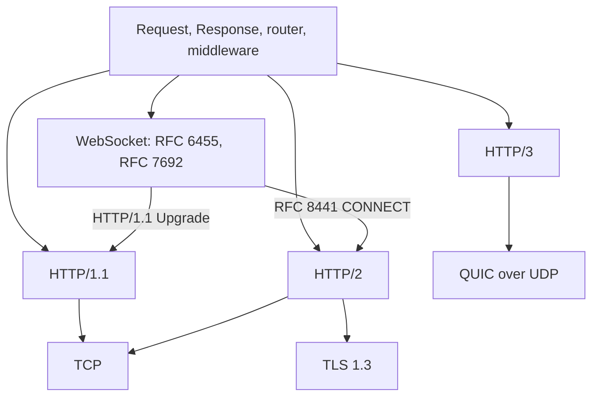

µWebZockets expose một application boundary, gồm `Request`, `Response`, radix
router và middleware, trên mọi transport mà nó phục vụ. Một handler viết một lần
chạy nguyên vẹn trên HTTP/1.1, HTTP/2 và HTTP/3. WebSocket route dùng cùng
application và router, và JSON-RPC mount trên cùng HTTP path.

## Một boundary, bốn transport [#one-boundary-four-transports]

Framing layer thay đổi. Handler contract, route table, borrowed request data,
async token rule và bounded output model thì không.

## Negotiation và điểm vào [#negotiation-and-entry-points]

| Điểm vào                                  | Protocol                                          | Negotiation                                                                      |
| ----------------------------------------- | ------------------------------------------------- | -------------------------------------------------------------------------------- |
| `init` và `listen`                        | HTTP/1.1 hoặc HTTP/2                              | HTTP/1.1 mặc định; client mở bằng HTTP/2 connection preface dùng prior knowledge |
| `init_https` và `listen`                  | HTTP/2 hoặc HTTP/1.1                              | TLS ALPN ưu tiên `h2` hơn `http/1.1`                                             |
| `init_https_mtls` và `listen`             | HTTP/2 hoặc HTTP/1.1                              | Cùng ALPN policy với client certificate; chỉ TCP                                 |
| `init_http3` với `listen` và `listen_udp` | HTTP/3 trên QUIC cộng HTTP/1.1 và HTTP/2 trên TCP | QUIC context chỉ advertise `h3`; TCP context advertise `h2` rồi `http/1.1`       |
| `app.ws`                                  | WebSocket                                         | HTTP/1.1 `Upgrade` hoặc RFC 8441 extended CONNECT trên HTTP/2                    |
| `app.rpc`                                 | JSON-RPC 2.0                                      | Mount tại HTTP path; thừa hưởng limit của HTTP transport                         |
| `uz.client`                               | HTTP/1.1 outbound                                 | Chỉ gửi `http/1.1` trong ALPN; TLS 1.3 được pin                                  |

## So sánh protocol [#protocol-comparison]

| Transport | ALPN và negotiation                                                              | Framing                                                                             | Header compression                                                 | Concurrency                                                                              | Request body                                                        | Response streaming                                                                | Compliance evidence                                                                              |
| --------- | -------------------------------------------------------------------------------- | ----------------------------------------------------------------------------------- | ------------------------------------------------------------------ | ---------------------------------------------------------------------------------------- | ------------------------------------------------------------------- | --------------------------------------------------------------------------------- | ------------------------------------------------------------------------------------------------ |
| HTTP/1.1  | Byte đầu tiên ở cleartext; TLS ALPN chọn `http/1.1` khi `h2` không có trong ALPN | Request line và field dạng text; `Content-Length`, chunked hoặc close-delimited     | Không có                                                           | Một request tại một thời điểm mỗi connection; request pipelined dispatch theo thứ tự đọc | Buffer tới `max_body_size`, mặc định 16 KiB                         | `begin_stream`, `begin_chunked` và SSE; write-ring drain                          | h1spec suite cộng unit case adversarial deterministic                                            |
| HTTP/2    | ALPN ưu tiên `h2`; cleartext chỉ prior knowledge; không có h2c Upgrade           | Binary frame; frame payload 16 KiB; HEADERS, DATA, SETTINGS, GOAWAY, RST_STREAM     | HPACK; dynamic table 4 KiB; decode có bound                        | 8 concurrent stream mỗi connection, cố định; một RFC 8441 tunnel                         | `min(max_body_size, max_h2_body_size)`, mặc định 16 KiB             | Async token và drain-driven producer mỗi stream; DATA frame                       | Bounded RFC 9113 session suite cho frame, setting, flow control, HPACK và stream reuse           |
| HTTP/3    | QUIC ALPN chỉ advertise `h3`; endpoint `listen_udp` riêng                        | QUIC stream cộng HTTP/3 frame; QPACK field section                                  | QPACK; decoder table 0 byte; một header set outstanding            | Bound bởi `max_connections` và engine stream; một engine mỗi process; không cluster      | `max_h3_body_size`, mặc định 16 KiB                                 | `begin_stream`; DATA frame; stream flow-control window; drain trên write callback | Interop gate curl/ngtcp2 và aioquic, gồm trailer và malformed pseudo-header                      |
| WebSocket | HTTP/1.1 `Upgrade` hoặc RFC 8441 extended CONNECT trên HTTP/2                    | RFC 6455 frame; masking, fragmentation và control frame; RFC 7692 chỉ trên HTTP/1.1 | Không có ở frame layer; per-message deflate là payload compression | Một RFC 8441 tunnel mỗi HTTP/2 connection; connection upgrade dùng chung pool            | Không áp dụng sau upgrade; message capacity mặc định 16 KiB         | Message send resume khi drain; HTTP response streaming không áp dụng              | 517/517 Autobahn server case: 514 `OK`, 3 `INFORMATIONAL`, gồm RFC 7692 group 12 và 13           |
| JSON-RPC  | Mount trên mọi HTTP transport bằng `app.rpc(path, &service)`                     | JSON-RPC 2.0 trong HTTP body; single call, notification và batch                    | Thừa hưởng từ HTTP transport                                       | Một service mỗi event loop và một response buffer; không chia sẻ giữa các worker         | Bound bởi HTTP body limit; parameter typed dùng 4 KiB stack scratch | Không stream; response service bound 16 KiB                                       | Unit suite cho batch, notification, decode và error mapping; không có external conformance suite |
| TLS       | ALPN `h2` rồi `http/1.1` trên TCP; `h3` trên QUIC; chỉ TLS 1.3                   | TLS record                                                                          | Không có                                                           | Một TLS session mỗi connection; mỗi cluster worker sở hữu một `SSL_CTX`                  | Không áp dụng                                                       | Không áp dụng                                                                     | Test TLS 1.3 handshake, ALPN, mTLS và client trust                                               |
| Client    | Chỉ gửi `http/1.1` trong ALPN; TLS 1.3 là cả minimum và maximum                  | HTTP/1.1 response parser; `Content-Length`, chunked và close-delimited              | Không có                                                           | `max_inflight` slot compile-time; một request mỗi connection                             | Body do caller mượn, không bound ngoài transport                    | Không stream; response body buffer mặc định tới 64 KiB                            | Parser suite, trust failure, loopback fetch plaintext và TLS, slot reuse                         |

## Request tại boundary [#the-request-at-the-boundary]

| Phần của request | HTTP/1.1                            | HTTP/2                                            | HTTP/3                                          |
| ---------------- | ----------------------------------- | ------------------------------------------------- | ----------------------------------------------- |
| Method và target | Request line                        | Pseudo-field `:method`, `:path` và `:authority`   | Pseudo-field `:method`, `:path` và `:authority` |
| Header field     | Field dạng text, mặc định 64 inline | Field decode bằng HPACK, có bound                 | Field decode bằng QPACK, có bound               |
| Body             | Buffer tới `max_body_size`          | Buffer tới `min(max_body_size, max_h2_body_size)` | Buffer tới `max_h3_body_size`                   |
| Route capture    | Router sau khi parse                | Router sau khi decode pseudo-header               | Router sau khi decode pseudo-header             |
| Response head    | Status line và field dạng text      | HEADERS với HPACK                                 | HEADERS với QPACK                               |

Sau khi decode, mọi transport điền cùng các field `Request` và gọi cùng route.
Handler đọc method, target, header, body và route capture không cần branch theo
transport.

## Điều giữ nguyên [#what-stays-the-same]

| Behavior             | HTTP/1.1                             | HTTP/2                               | HTTP/3                                 |
| -------------------- | ------------------------------------ | ------------------------------------ | -------------------------------------- |
| Router và middleware | Giống nhau                           | Giống nhau                           | Giống nhau                             |
| Handler shape        | Giống nhau                           | Giống nhau                           | Giống nhau                             |
| Async response token | Có                                   | Có                                   | Có                                     |
| Request capture      | Borrowed                             | Borrowed                             | Borrowed                               |
| Request body         | Buffered                             | Buffered                             | Buffered                               |
| Response streaming   | Chunked, SSE hoặc producer           | Producer và DATA frame               | Producer và DATA frame                 |
| Development log      | Một record mỗi exchange cộng counter | Một record mỗi exchange cộng counter | Một record mỗi exchange, không counter |

WebSocket connection đăng ký bằng `App.ws` và dùng open, message, close cùng
drain callback sau handshake. JSON-RPC mount trên HTTP route và thừa hưởng body,
header cùng response limit của transport. Cả hai surface không tạo router thứ
hai.

## Ranh giới có chủ đích [#deliberate-boundaries]

| Ranh giới           | Hành vi chính xác                                                                                                                      | Alternative                                        |
| ------------------- | -------------------------------------------------------------------------------------------------------------------------------------- | -------------------------------------------------- |
| h2c Upgrade         | Không implement. `Upgrade: h2c` được xử lý như HTTP/1.1; cleartext HTTP/2 chỉ dùng prior knowledge                                     | Dùng prior knowledge hoặc TLS ALPN                 |
| HTTP/2 server push  | Không implement. `SETTINGS_ENABLE_PUSH: 0`; không gửi PUSH_PROMISE                                                                     | Fetch từ client hoặc preload                       |
| HTTP/2 stream count | Cố định 8 concurrent stream mỗi connection; stream thứ chín nhận `RST_STREAM REFUSED_STREAM`                                           | Mở connection khác hoặc specialize connection type |
| RFC 8441 tunnel     | Một WebSocket tunnel active mỗi HTTP/2 connection; tunnel thứ hai nhận `503 Service Unavailable` mà không ảnh hưởng tunnel đang active | Dùng connection khác                               |
| HTTP/3 clustering   | Không có HTTP/3 cluster mode. `listen_udp` là single-application, và một process sở hữu một QUIC engine cùng một UDP socket            | Dùng TCP/TLS cluster cho HTTP/1.1 và HTTP/2        |
| WebTransport        | Helper-only. Live listener từ chối CONNECT với `501 Not Implemented` và không advertise datagram                                       | Coi `uz.webtransport` là helper model draft-16     |
| Client protocol     | `uz.client` chỉ HTTP/1.1 trên TCP hoặc TLS; không DNS, redirect, cookie, proxy, retry, mTLS, HTTP/2 hay HTTP/3                         | Policy của caller hoặc client khác                 |
| TLS version         | Chỉ TLS 1.3; TLS 1.2 và cũ hơn bị từ chối tại context                                                                                  | Terminate TLS cũ ở proxy                           |
| HTTP/3 early data   | Live listener từ chối 0-RTT; TCP dùng safe-method policy                                                                               | Hoàn tất handshake                                 |
| HTTP/3 metrics      | QUIC path emit request record nhưng không tăng counter registry                                                                        | Dùng HTTP/1.1 hoặc HTTP/2 cho counter parity       |

## Compliance evidence [#compliance-evidence]

| Gate           | Phạm vi                                                     | Kết quả                                                                       |
| -------------- | ----------------------------------------------------------- | ----------------------------------------------------------------------------- |
| Autobahn       | RFC 6455 và RFC 7692 server case                            | 517/517 accepted: 514 `OK`, 3 `INFORMATIONAL`, gồm compression group 12 và 13 |
| h1spec         | HTTP/1.1 parsing, routing và adversarial input              | Suite cộng unit case deterministic                                            |
| HTTP/2 suite   | Frame, setting, flow control, HPACK, stream reuse và tunnel | Hành vi RFC 9113 có bound; không có claim conformance bên ngoài               |
| HTTP/3 interop | curl/ngtcp2 và aioquic                                      | Request path, trailing field và malformed pseudo-header rejection             |
| TLS và client  | Handshake, ALPN, mTLS, trust rule và loopback fetch         | TLS 1.3 và client trust suite                                                 |
| JSON-RPC       | Batch, notification, decode và error mapping                | Chỉ unit suite                                                                |

Compliance evidence do upstream công bố. Đừng chạy framework compliance suite
như một phần của application build; dùng kết quả đã công bố và test handler của
bạn trên loopback.

## Chọn transport [#choosing-a-transport]

| Nhu cầu                                                   | Dùng                                |
| --------------------------------------------------------- | ----------------------------------- |
| Browser compatibility rộng và request/response đơn giản   | HTTP/1.1 hoặc HTTP/2 trên TLS       |
| Nhiều request đồng thời trên một connection               | HTTP/2, trong giới hạn 8 stream     |
| UDP transport và HTTP/3 request routing, không clustering | HTTP/3                              |
| Message hai chiều                                         | WebSocket trên HTTP/1.1 hoặc HTTP/2 |
| Service request/response có type                          | JSON-RPC trên mọi HTTP transport    |
| Outbound call từ application µWebZockets                  | `uz.client`, chỉ HTTP/1.1           |

## Trang liên quan [#related]

- [Protocol negotiation](/docs/concepts/protocol-negotiation) giải thích ALPN và
  prior-knowledge path theo task order.
- [HTTP/2 limit](/docs/http2/limits) và [HTTP/3 limit](/docs/http3/limits) liệt
  kê storage mỗi connection phía sau bảng.
- [WebSocket](/docs/websocket) bao phủ framing, compression, pub/sub và
  heartbeat.
- [Client](/docs/client) bao phủ outbound HTTP/1.1 surface.
- [Feature matrix](/reference/feature-matrix) nêu protocol feature nào
  supported, helper-only hoặc không có.
